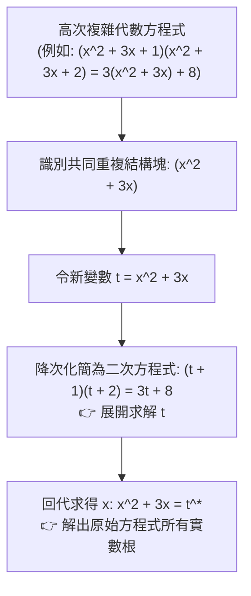

# 🎙️ 基礎數學與先修代數：多項式變數代換法、方根整數小數化簡與段考檢討 (授課講師 / 學員)

> **課程主題**：基礎數學段考核心難題檢討、多項式高次式變數代換技巧、無理數方根整數與純小數部分拆解  
> **授課教授**：授課講師（應用數學授課教授）  
> **核心模組**：Algebraic Substitution, Radical Simplification, Integer and Fractional Parts, Exam Review  
> **學習目標**：精熟令 $t = x^2 + 3x$ 之降次代換策略化簡複雜高次多項式，掌握無理數方根取整數與小數之代數操作  
> **關聯文件**：[📄 完整原話逐字稿 (2024-10-19-02-多項式變數代換與試題檢討-proofread.md)](./20241019-多項式變數代換與試題檢討.full.md)

---

## 🏛️ 高次多項式「變數代換法」解題思維模型

---

## 🎯 核心重點整理 (Key Takeaways)

### 1. 變數代換法 (Variable Substitution) 降次心法
- **難題破局點**：若直接將四次多項式暴力展開，極易產生高階繁瑣計算與符號錯誤。透過觀察對稱結構，令 $t = x^2 + 3x$，可將四次方程式立即降解為一元二次方程式。
- **回代檢驗**：求出 $t$ 之後，務必回代二次方程式 $x^2 + 3x - t = 0$，並透過判別式 $D = b^2 - 4ac$ 檢驗是否有實數解。

### 2. 無理數方根的「整數部分」與「小數部分」
- 設 $\sqrt{N}$ 介於兩相鄰正整數之間 $k < \sqrt{N} < k+1$：
  - **整數部分（Integer Part）**：$a = \lfloor \sqrt{N} \rfloor = k$。
  - **小數部分（Fractional Part）**：$b = \sqrt{N} - k \in (0, 1)$。
---

## 📐 核心多項式變數代換法則、方根整數小數拆解與試題解題步驟表

| 題型與代數結構 | 數學模型與變數代換技巧 | 運算關鍵步驟與約束條件 | 易錯陷阱與段考檢討要點 |
| :--- | :--- | :--- | :--- |
| **高次對稱多項式（四次方程式）** | 形如 $(x^2+3x)^2 - 2(x^2+3x) - 8 = 0$，令 $t = x^2+3x$ 降次為二次方程式 $t^2 - 2t - 8 = 0$ | 解出 $t = 4$ 或 $t = -2$ 後，必須回代求解 $x$：$x^2+3x-4=0 \implies x=1, -4$；$x^2+3x+2=0 \implies x=-1, -2$ | 學生常誤將 $t$ 之解直接當作最終答案，漏掉回代求 $x$ 之關鍵步驟 |
| **無理數方根之整數與小數部分** | 對於 $N = \sqrt{17}$，尋找最接近之完全平方數 $16 < 17 < 25$，得整數部分 $a = \lfloor \sqrt{17} \rfloor = 4$ | 小數部分表示為 $b = \sqrt{17} - 4$，滿足 $0 < b < 1$；若求 $b + \frac{1}{b}$，則有理化分母計算 $\frac{1}{\sqrt{17}-4} = \sqrt{17}+4$ | 忽略小數部分必須嚴格介於 0 與 1 之間，或在有理化分母時變號錯誤導致正負號顛倒 |
| **分式變數代換（$x + \frac{1}{x}$）** | 當方程式具備倒數對稱性 $x^2 + \frac{1}{x^2} + 3(x + \frac{1}{x}) = 0$，令 $u = x + \frac{1}{x}$ | 利用平方恆等式 $x^2 + \frac{1}{x^2} = u^2 - 2$，將高次分式方程轉化為 $u^2 + 3u - 2 = 0$ 求解 | 需檢驗實數解之存在域條件 $|u| \ge 2$（由算幾不等式保證），若 $u$ 落於 $(-2, 2)$ 則無對應實數 $x$ |
