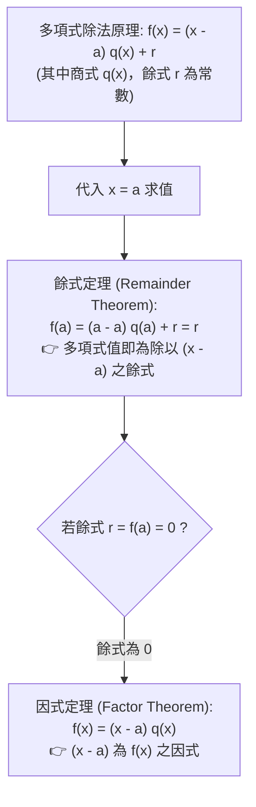

# 🎙️ 基礎數學與先修代數：多項式因式定理、餘式定理與高次代數分解實務 (授課講師 / 學員)

> **課程主題**：多項式餘式定理（Remainder Theorem）、因式定理（Factor Theorem）、高次多項式整係數因式分解與分配律逆推  
> **授課教授**：授課講師（應用數學授課教授）  
> **核心模組**：Remainder Theorem, Factor Theorem, Polynomial Factorization, Synthetic Division  
> **學習目標**：精熟 $f(a)=0 \iff (x-a) \mid f(x)$ 之因式定理雙向推論，掌握高次多項式一次因式檢驗法與分配律逆向因式提取  
> **關聯文件**：[📄 完整原話逐字稿 (2024-10-22-03-多項式因式定理與高次分解-proofread.md)](./20241022-多項式因式定理與高次分解.full.md)

---

## 🏛️ 多項式除法原理與餘式／因式定理推論脈絡

---

## 🎯 核心重點整理 (Key Takeaways)

### 1. 因式定理 (Factor Theorem) 核心判據
- 若多項式 $f(x)$ 滿足 $f(a) = 0$，則 $(x - a)$ 必為 $f(x)$ 之一階一次因式。
- **多根因式推廣**：若 $a, b$ 為兩相異實數，且 $f(a) = 0, f(b) = 0$，則 $f(x)$ 必同時含有 $(x - a)$ 與 $(x - b)$ 因式，即 $(x - a)(x - b) \mid f(x)$。

### 2. 分配律逆推與因式分解
- 高次多項式因式分解本質上為乘法分配律的逆向操作：
  $$a \cdot c + b \cdot c = (a + b) \cdot c$$
- 透過一次因式檢驗法猜根（可能的根必在最高次係數因數與常數項因數之商），結合綜合除法降次，逐階抽離線性因子。
---

## 📐 多項式因式定理、餘式定理與高次代數分解實務對照表

| 定理與分解方法 | 核心數學原理與公式表示 | 演算法實施步驟 | 應用題型與幾何意義 |
| :--- | :--- | :--- | :--- |
| **餘式定理（Remainder Theorem）** | 多項式 $f(x)$ 除以一次式 $(x - c)$，其所得餘式必恆等於函數值 $R = f(c)$ | 無需進行繁瑣長除法，直接將 $x = c$ 代入多項式求值即可快速獲得餘式數值 | 快速求解高次多項式在指定點之餘數，亦可用於多項式數值逼近與多點插值 |
| **因式定理（Factor Theorem）** | 若一次式 $(x - c)$ 為多項式 $f(x)$ 之因式，當且僅當 $f(c) = 0$（即 $c$ 為方程式之根） | 配合**有理根檢驗定理（Rational Root Theorem）**：候選根必為「常數項因數 / 最高次項係數因數」 | 快速篩選高次多項式之整數或有理數根，作為高次多項式降次因式分解之突破口 |
| **綜合除法（Synthetic Division）** | 簡化多項式除以一次式之計算流程，僅保留各項係數進行乘加迭代 | 1. 寫下被除式係數；2. 左側標註除式之根 $c$；3. 依序執行「落乘加」循環計算商式與餘式 | 顯著提升三次與四次多項式連續綜合除法（求泰勒展開式型態 $(x-c)^k$ 係數）之運算效率與正確率 |
