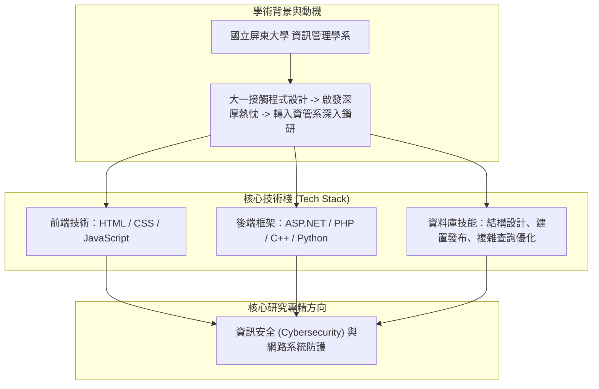

# 🎙️ 職涯發展專題：資管專業自我介紹演練、程式語言與全端資料庫技能自述 (蔣若成)

> **演練主題**：求職面試個人專業自述、跨領域轉系動機、全端程式開發與資料庫技能樹展現  
> **發表學員**：蔣若成（屏東大學資管系學員）  
> **核心模組**：Self Introduction, Full-Stack Tech Stack, Database Management, Cybersecurity Passion  
> **學習目標**：精熟一分鐘至三分鐘結構化技術自述技巧、有條理呈現個人技能廣度與核心優勢  
> **關聯文件**：[📄 完整原話逐字稿 (20241025-資訊專長自我介紹與技術履歷自述.full.md)](./20241025-資訊專長自我介紹與技術履歷自述.full.md)

---

## 🏛️ 個人技術棧架構與職涯發展地圖

---

## 🎯 核心重點整理 (Key Takeaways)

### 1. 學術歷程與轉系動機
- **自我定位清晰**：就讀於國立屏東大學資訊管理學系，大一接觸程式邏輯後確立熱忱，主動跨領域轉入資管專業深化軟體工程實力。

### 2. 多元技術棧全面布局
- **全端開發基礎**：前端熟練 HTML/CSS/JavaScript，後端掌握 ASP.NET、PHP、C/C++ 及 Python 多元語言。
- **資料庫管理能力**：具備實體關聯設計、資料庫建置設定、SQL 結構化查詢與效能優化之實作經驗。
- **資安核心導向**：將軟體工程實作與資訊安全防護緊密結合，作為未來深造與職涯核心發展主軸。
---

## 🎙️ 資管專業技術棧自述架構、作品集展現與高頻面試題應對表

| 自我介紹與自述模組 | 結構化表達框架（90 秒黃金黃金法則） | 具體技術話術範例 | 面試官追問焦點與防禦準備 |
| :--- | :--- | :--- | :--- |
| **破冰與個人定位（前 20 秒）** | 明確點出學校科系、核心專業標籤（如全端開發、資料工程或資安滲透）與求職意向 | 「面試官好，我是侑宸，中央資管畢業，專注於分散式後端架構與雲端資安防禦，具備 Python/FastAPI 與關聯資料庫高並發開發經驗。」 | 評估候選人是否口齒清晰、自信沉著，且個人求職意向與應徵職缺 JD（Job Description）高度契合 |
| **代表性專案與技術深度（中間 50 秒）** | 挑選最硬核之單一專案，依據 STAR 原則（情境、任務、行動、成果）精簡展開技術亮點 | 「在智慧醫療專案中，我負責重構非同步 API 服務，利用 Redis 快取與資料庫連線池調校，將 500 人並發下的 P95 延遲由 2.4s 壓降至 380ms。」 | 面試官將深入挖掘架構細節：「為何選 Redis 而非本地快取？」、「快取與資料庫一致性如何保證？」 |
| **個人熱忱與團隊價值（後 20 秒）** | 展現自我學習能力、開源社群參與度或領導協作軟實力，表達對加入該團隊的強烈動機 | 「我平時活躍於開源社群並持續撰寫技術筆記，期待能將全端與資安工程思維注入貴團隊，共同打造高可用系統。」 | 檢驗候選人之文化契合度（Culture Fit）與是否具備可塑性及長期成長潛力 |
