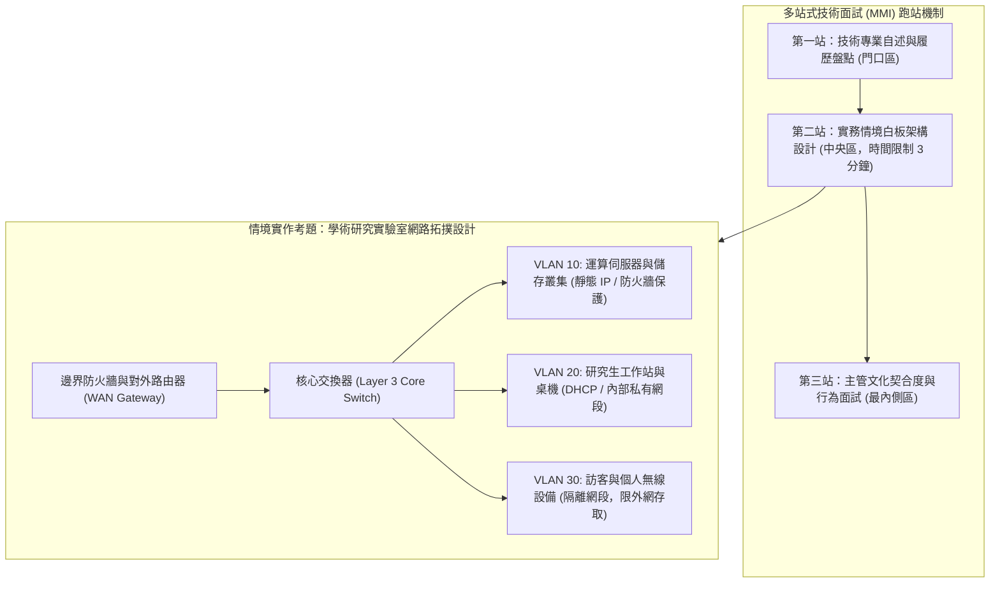

# 🎙️ 職涯發展專題：技術面試實體跑站演練——實驗室網路拓撲架構情境設計與口試 (技術面試官 / 應試學員)

> **演練主題**：多站式技術面試跑站（MMI）、情境白板題解題技巧、研究型實驗室實體網路拓撲規劃  
> **面試人員**：技術面試官、應試學員  
> **核心模組**：Technical Mock Interview, Whiteboard Design, Lab Network Topology, VLAN Segmentation  
> **學習目標**：掌握技術白板面試解題框架、短時間內精準繪製具安全性考量之企業級網路拓撲  
> **關聯文件**：[📄 完整原話逐字稿 (20241026-技術面試跑站演練實驗室網路拓撲規劃.full.md)](./20241026-技術面試跑站演練實驗室網路拓撲規劃.full.md)

---

## 🏛️ 多站式面試機制與實驗室網路拓撲架構圖

---

## 🎯 核心重點整理 (Key Takeaways)

### 1. 多站式技術面試（Mini-Multiple Interview, MMI）規範
- **嚴格時限掌控**：各站設定 2~3 分鐘計時鈴聲，考驗應試者在極限高壓環境下快速提煉關鍵架構之敏捷反應力。
- **動態白板答辯**：面對面試官即興丟出之情境考題，需在有限時間內完成拓撲草圖並清晰口述設計哲學。

### 2. 實驗室網路拓撲設計核心架構
- **安全性與網段隔離（Segmentation）**：
  - 核心運算主機（GPU 伺服器、NAS 儲存）配置獨立 VLAN，透過存取控制清單（ACL）管制外部連線。
  - 研究生開發桌機與訪客 Wi-Fi 徹底隔離，避免個人自備設備（BYOD）潛在惡意軟體橫向擴散。
- **備援與擴展性**：設計單臂路由器（Router-on-a-Stick）或 Layer 3 交換器互連，保留未來算力節點擴充之彈性。
---

## 🖥️ 實驗室網路拓撲設計跑站、即席技術口試與白板題解答策略表

| 跑站關卡與口試維度 | 考題情境與拓撲設計要求 | 考生回答策略與口試拆解維度 | 評審教授講評與常見扣分盲點 |
| :--- | :--- | :--- | :--- |
| **多網段架構與 VLAN 切割** | 為跨樓層 100 台主機規劃網路，區分行政人員、研究生與對外公開 Web 伺服器 | 依部門機能規劃 VLAN ID，配置 Class C 私有網段；核心交換器啟用 802.1Q Trunking 與 SVI 繞送 | 切忌將所有伺服器與訪客無線置於同一廣播網域，必須落實安全邊界與廣播風暴隔離 |
| **靜態路由 vs. 動態路由選擇** | 總部與分部間具備一條主線與一條低速備援線路，評估該配置何種路由模式 | 節點數少（<5 台）建議配置靜態路由搭配浮動靜態路由（Higher AD）實現秒級切換；大型網路則推薦 OSPF | 需說明次佳路徑防範、去程與回程路由雙向對稱性，避免封包回不來導致連線中斷 |
| **安全控制與 DMZ 隔離** | 企業 Web 伺服器必須接受外部存取，但禁止直接連入內部研發資料庫 | 規劃三向防火牆架構（外部 Internet、非軍事區 DMZ、內部 LAN），透過狀態檢視 ACL 嚴格限制 DMZ 單向連線內部 | 盲目在路由器全開 `permit any any` 或未於出入口介面部署封包過濾規則將直接失分 |
