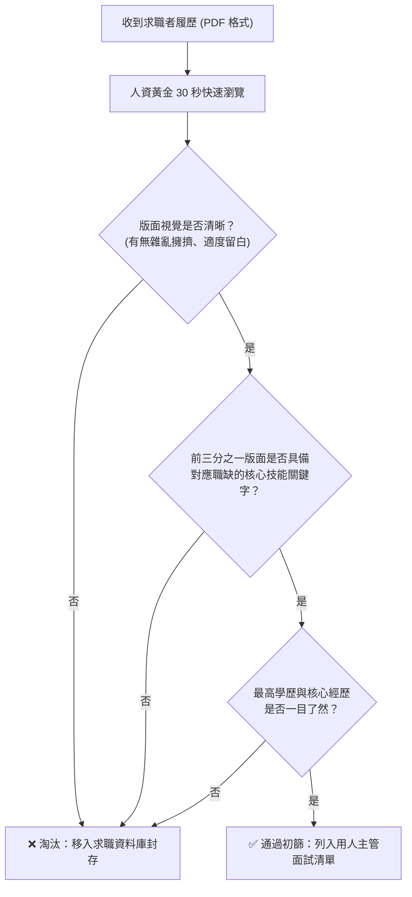

# 🎙️ 職涯發展與就業輔導：人資篩選心理學、履歷投遞時機與版面視覺優化 (授課講師 / 學員)

> **課程主題**：人資（HR）履歷篩選心理學、30 秒黃金掃描法則、個資去識別化原則與 1.5 倍行距排版美學  
> **授課教授**：授課講師（職涯就業輔導顧問）  
> **核心模組**：HR Resume Screening, 30-Second Rule, Privacy Protection, Typography, Line Spacing  
> **學習目標**：掌握人資篩選技術履歷的關鍵視角，平衡個人隱私防護與求職誠信，並運用專業排版強化閱讀舒適度  
> **關聯文件**：[📄 完整原話逐字稿 (2024-11-25-02-人資篩選心理與履歷視覺-proofread.md)](./20241125-02-人資篩選心理與履歷視覺.full.md)

---

## 🏛️ 人資（HR）履歷初篩 30 秒掃描決策模型

---

## 🎯 核心重點整理 (Key Takeaways)

### 1. 人資履歷篩選速度與心理機制
- **黃金 30 秒法則**：針對初階工程師或一般專員職缺，人資每次面對數百封投遞，平均僅停留 20 到 30 秒掃描關鍵字；主管職位才會逐行研讀。
- **投遞黃金時機**：避免在週五下午或週末深夜投遞，最佳時段為週二至週四上班日早晨，以確保履歷排列在人資收件箱最上方。

### 2. 個資保護與身分證字號揭露考量
- **防範資料外洩與偽冒**：在公開求職平台初期投遞時，身分證字號、完整戶籍地址無須完全暴露，可採去識別化處理（例如僅揭露首字母與前幾碼，後續錄取簽約時再補齊）。

### 3. 版面視覺排版細節
- **行距與留白**：文字間距切忌緊密堆疊，建議設定 **1.5 倍行高**，適度分段並建立視覺層次，大幅減輕審閱者之視覺疲勞。
---

## 📄 履歷視覺排版規範、行距留白原則與人資 30 秒關鍵字篩選對照表

| 視覺與排版元素 | 人資審查心理學（30 秒篩選法則） | 具體設計規範標準 | 常見嚴重排版地雷 |
| :--- | :--- | :--- | :--- |
| **頁面資訊階層與動線** | 人資瀏覽履歷呈「F 型」或「Z 型」視覺掃描動線；前 1/3 屏為兵家必爭之地 | 頂部姓名聯絡資訊下方立即列出「核心技能清單（Tech Stack）」與「最具份量學經歷」 | 將重要技能藏於文末，或使用過多花俏的進度條圖示（Progress Bar 毫無量化意義） |
| **字體、行距與留白空間** | 密密麻麻無留白會引發閱讀疲勞；行距過密或字體過小導致人資直接跳過 | 中文推薦微軟正黑體/思源黑體，英文 Arial/Calibri；內文字級 10-11pt，行距設定 **1.3 至 1.5 倍** | 濫用 3 種以上字體、字級低於 9pt 或邊界邊距小於 1.5 公分導致視覺壓迫感窒息 |
| **敏感個資揭露與隱私保護** | 傳統求職表格常要求填寫身分證字號、父母職業與詳細戶籍地址，存在個資外洩風險 | 現代技術履歷僅需揭露：姓名、專業 Email、電話、GitHub 連結與居住城市（如台北/桃園） | 附上身分證字號、完整身分證翻拍圖或自傳冗長贅述幼年成長史，顯得極不專業 |
