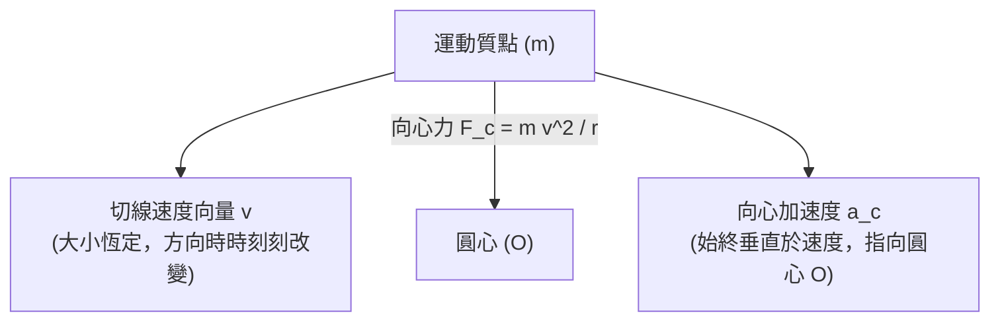

# 🎙️ 普通物理學：等速圓周運動切線速率、向心加速度與靜電庫侖定律 (授課講師 / 學員)

> **課程主題**：等速率圓周運動（Uniform Circular Motion）、切線速度向量、向心力、靜電荷庫侖定律與電場力線  
> **授課教授**：授課講師（普通物理授課教授）  
> **核心模組**：Uniform Circular Motion, Tangential Velocity, Centripetal Acceleration, Coulomb's Law, Electric Field Lines  
> **學習目標**：精確辨析等速度與等速率之向量本質，理解切線速度與向心加速度之幾何關係，掌握靜電作用力與電力線分佈  
> **關聯文件**：[📄 完整原話逐字稿 (2024-10-25-01-圓周運動切線速率與庫侖定律-proofread.md)](./20241025-01-圓周運動切線速率與庫侖定律.full.md)

---

## 🏛️ 等速圓周運動之速度與加速度向量結構

---

## 🎯 核心重點整理 (Key Takeaways)

### 1. 「等速圓周運動」的真正物理意義
- **等速率而非等速度**：速度是具備「大小」與「方向」的向量。圓周運動中速率（純量大小）雖保持不變，但運動方向隨時間持續旋轉，因此**絕非等速度運動**，而是一種**具備加速度的變速度運動**。
- **沿切線飛出**：當繩索斷裂或向心力瞬間消失時，物體將依慣性定律（牛頓第一運動定律），沿著該瞬間的**切線方向（Tangential Direction）**以等速度直線飛出。

### 2. 靜電庫侖定律 (Coulomb's Law)
- **相互作用力**：帶電體間之靜電力大小與兩者電量乘積成正比，與距離平方成反比：
  $$F = k \frac{|q_1 q_2|}{r^2}$$
- **電力線特徵**：由正電荷出發、終止於負電荷；線條疏密代表該處電場強度。
---

## ⚡ 等速圓周運動向心力公式、庫侖靜電定律與電場強度向量對照表

| 物理運動與場域範疇 | 核心物理定律與數學公式 | 物理量符號、單位與方向定義 | 實務現象解析與考題重點 |
| :--- | :--- | :--- | :--- |
| **等速圓周運動（Uniform Circular Motion）** | 切線速率 $v = \frac{2\pi r}{T} = \omega r$；向心加速度 $a_c = \frac{v^2}{r} = r\omega^2$；向心力 $F_c = m\frac{v^2}{r}$ | 速率恆定但**速度方向時刻改變**，故必具備加速度；加速度與合力方向恆指向圓心 | 球體繫繩斷裂瞬間，質點依慣性沿**切線方向**做等速度直線運動飛出，絕非沿半徑方向射出 |
| **庫侖定律（Coulomb's Law）** | 兩靜止點電荷間之靜電力公式：$$F = k_e \frac{|q_1 q_2|}{r^2}$$（庫侖常數 $k_e \approx 8.99 \times 10^9 \text{ N}\cdot\text{m}^2/\text{C}^2$） | 電荷量單位庫侖（C），距離單位公尺（m）；方向依據同性相斥、異性相吸沿連心線方向 | 與萬有引力定律形式同為平方反比定律，但庫侖力包含吸引力與排斥力，且強度遠大於引力 |
| **電場強度（Electric Field Intensity）** | 試驗正電荷 $q_0$ 於空間中所受靜電力與其電量之比：$$\mathbf{E} = \frac{\mathbf{F}}{q_0} = k_e \frac{q}{r^2} \hat{\mathbf{r}}$$ | 向量單位為 $\text{N/C}$ 或 $\text{V/m}$；正電荷之電力線向外發散，負電荷之電力線向內匯聚 | 電力線切線方向即為該點電場方向，電力線疏密程度代表電場強度；兩電力線空間中絕不相交 |
