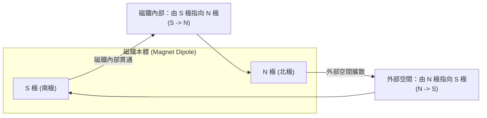

# 🎙️ 普通物理學：磁場分佈、磁力線封閉特性與磁通量物理機制 (授課講師 / 學員)

> **課程主題**：磁場（Magnetic Field）、磁力線封閉性、高斯磁定律（無磁單極）、磁通量與電磁學考點梳理  
> **授課教授**：授課講師（普通物理授課教授）  
> **核心模組**：Magnetic Field Lines, Closed Loops, Gauss's Law for Magnetism, Magnetic Flux, Dipole  
> **學習目標**：掌握磁力線內部與外部之連續封閉迴圈物理特性，理解磁力線疏密代表磁場強度大小之幾何意涵  
> **關聯文件**：[📄 完整原話逐字稿 (2024-10-25-02-磁場分佈與磁通量解析-proofread.md)](./20241025-02-磁場分佈與磁通量解析.full.md)

---

## 🏛️ 磁力線封閉迴圈 (Closed Loops) 拓撲流向

---

## 🎯 核心重點整理 (Key Takeaways)

### 1. 磁力線的「封閉曲線」本質
- **無起點亦無終點**：電力線有始有終（始於正電荷，終於負電荷）；但磁力線是一條**連續不斷的封閉平滑曲線（Closed Loop）**。
- **流向規則**：
  - **磁鐵外部**：由 **N 極指向 S 極**。
  - **磁鐵內部**：由 **S 極指向 N 極**。
- **高斯磁定律（Gauss's Law for Magnetism）**：自然界中不存在孤立的磁單極（Magnetic Monopole），通過任何封閉曲面的淨磁通量必恆等於零：$\oint \mathbf{B} \cdot d\mathbf{A} = 0$。

### 2. 磁場強度與空間疏密關係
- **空間密集度**：磁力線越密集的地方（如磁極兩端近處），磁場強度越大；磁力線稀疏的地方，磁場強度越弱。
- **切線方向**：磁力線上任意一點的切線方向，即代表小磁針 N 極在該點所受磁力方向。
---

## 🧲 磁力線封閉特性、高斯磁定律與磁通量度量單位對照表

| 電磁學概念範疇 | 物理定律與數學定義式 | 幾何拓撲特性與物理實體行為 | 測量單位與考點解析 |
| :--- | :--- | :--- | :--- |
| **磁力線空間分佈與連續性** | 磁場 $\mathbf{B}$ 切線方向；磁鐵**外部由 N 極指向 S 極，內部由 S 極指向 N 極** | 磁力線為**無起點、無終點之封閉平滑曲線**；絕不中斷、絕不相交，空間密度正比於磁場強度 | 空間中若將磁鐵切成兩半，每一截皆會重新產生完整的 N 極與 S 極，無法分離出單獨磁極 |
| **高斯磁定律（Gauss's Law for Magnetism）** | 馬克士威方程式之一：$$\oint \mathbf{B} \cdot d\mathbf{A} = 0$$ | 任意封閉曲面上之淨磁通量恆等於零；幾何本質意味著穿入閉合曲面之磁力線必恆等於穿出之磁力線 | 在物理學上確立了自然界迄今**不存在磁單極（Magnetic Monopoles）**之實驗事實 |
| **磁通量（Magnetic Flux, $\Phi_B$）** | 穿過指定平面區域之磁場積分：$$\Phi_B = \int \mathbf{B} \cdot d\mathbf{A} = B A \cos\theta$$ | $\theta$ 為磁場向量 $\mathbf{B}$ 與平面法向量（Normal Vector）之夾角；垂直穿過時 $\cos\theta=1$ 達到極大值 | 磁通量單位為韋伯（Weber, $\text{Wb} = \text{T}\cdot\text{m}^2$）；當夾角改變時磁通量隨時間變化，為電磁感應之源頭 |
