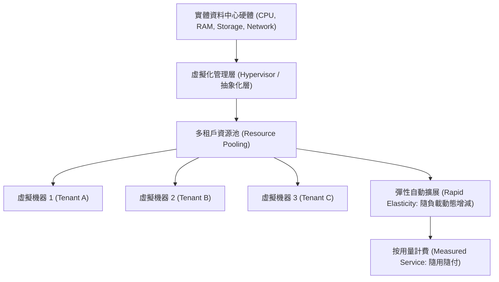

# 🎙️ 雲端運算導論：雲端本質剖析、伺服器虛擬化與現代資料中心集中運算 (授課講師 / 學員)

> **課程主題**：雲端運算導論、電腦硬體虛擬化本質、資源彈性調度與現代資料中心  
> **授課教授**：授課講師（資管系雲端架構授課教授）  
> **核心模組**：Cloud Computing Fundamentals, Hardware Decoupling, Virtualization & Hypervisor  
> **學習目標**：釐清「雲」背後的物理實體主機本質、理解虛擬化抽象層如何實現資源池化  
> **關聯文件**：[📄 完整原話逐字稿 (2024-10-17-01-虛擬化架構與資料中心運算-proofread.md)](./20241017-虛擬化架構與資料中心運算.full.md)

---

## 🏛️ 核心架構與概念流轉圖

---

## 🔑 重點提要 (Key Takeaways)

1. **雲端的真實本質**：雲端並非虛無飄渺，而是「別人的電腦」——透過高度自動化與虛擬化軟體，將集中在超大型資料中心的實體硬體切分為彈性運算單元。
2. **虛擬化（Virtualization）價值**：傳統單一主機運載率僅 10%~15%；透過虛擬化可將單一伺服器利用率提升至 70%~80%，大幅降低硬體與機房能耗成本。
---

## ☁️ 雲端運算本質、伺服器虛擬化 Hypervisor 架構與資料中心維運成本對照表

| 架構層級與模式 | 核心技術定義與實現機制 | 資源利用率與彈性擴展性 | 地端機房自建 vs. 公有雲出租經濟效益 |
| :--- | :--- | :--- | :--- |
| **伺服器虛擬化（Virtualization）** | 透過虛擬化管理層（Hypervisor / VMM）將實體 CPU、記憶體、儲存與網路硬體解耦並抽象化 | 允許多個相異作業系統（Guest OS）共享單一實體機器資源，打破過去「一伺服器一應用」之僵化架構 | 將傳統伺服器平均僅 10-15% 的 CPU 稼動率大幅拉升至 70-80%，大幅節省硬體購置成本與機櫃空間 |
| **Type-1 vs. Type-2 Hypervisor** | **Type-1（裸金屬 Bare-metal）**直接運行於硬體之上（如 VMware ESXi、KVM）；**Type-2（託管型 Hosted）**運行於既有 OS 之上（如 VirtualBox） | Type-1 具備最高 I/O 吞吐效能與最低虛擬化開銷（Overhead），為現代雲端資料中心底座標準 | Type-2 適合個人開發測試；企業級雲平台全面採用 Type-1 搭配軟體定義網路（SDN）管理萬級 VM |
| **集中式雲端運算經濟效益（Cloud Economics）** | 從傳統資本支出（CapEx，購置伺服器、不斷電系統 UPS、冰水主機空調）轉為營運支出（OpEx，隨需隨付 Pay-as-you-go） | 面對突發流量峰值時，可透過自動擴展（Auto-scaling）在數分鐘內橫向擴展數百節點，離峰自動釋放 | 自建機房需承擔龐大電力維護、折舊與專職網管維運人事成本；公有雲善用規模經濟（Economies of Scale）平攤算力單價 |
