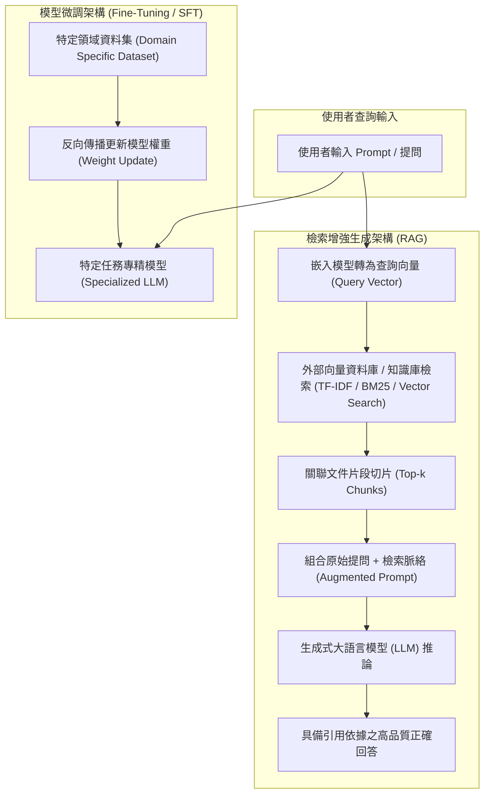

# 🎙️ 雲端運算期末成果：第七組 RAG 檢索增強生成與模型微調架構分析 (第七組簡報同學 / 授課教授講評)

> **課程主題**：雲端運算期末專題第七組成果發表、檢索增強生成（RAG）架構、微調（Fine-Tuning）技術對比與企業落地  
> **授課教授**：授課講師（資管系雲端運算授課教授）  
> **核心模組**：Retrieval-Augmented Generation (RAG), Fine-Tuning, TF-IDF/BM25, Vector Search, Knowledge Integration  
> **學習目標**：深度掌握 RAG 與 Fine-Tuning 底層差異、掌握企業外部知識庫整合流程與多模態版本管理規範  
> **關聯文件**：[📄 完整原話逐字稿 (20241219-期末專案第七組RAG與模型微調架構分析.full.md)](./20241219-期末專案第七組RAG與模型微調架構分析.full.md)

---

## 🏛️ RAG 檢索增強生成與模型微調架構對比

---

## 🎯 核心重點整理 (Key Takeaways)

### 1. RAG（檢索增強生成）三大核心工作流程
- **查詢向量化（Query Generation）**：將使用者自然語言提問透過 Embedding 模型轉為高維向量。
- **相關知識檢索（Knowledge Retrieval）**：在預定義的企業或領域知識庫中，結合向量語意搜尋（Dense Retrieval）與傳統關鍵字比對（TF-IDF、BM25 Sparse Retrieval）抓取高度關聯文本。
- **知識整合生成（Generation with Context）**：將檢索出的片段作為外部知識脈絡（Context）與原始問題拼接注入提示詞，使大語言模型在特定邊界內生成具可溯源性的精確解答。

### 2. RAG 與微調（Fine-Tuning / SFT）之技術定位與權衡
- **微調（Fine-Tuning）**：適用於改變模型行為風格、遵循特定結構化輸出格式（如 JSON Schema）或灌注高度內化的專業推理能力；但成本高昂、無法即時更新資料且容易產生幻覺。
- **RAG**：適用於需要**即時更新企業私有資料**、嚴格避免幻覺、降低算力訓練成本之場景（如金融法規審查、醫療病歷問答）。
- **混合架構（Hybrid Architecture）**：當代企業級應用的主流策略為「輕量微調領域模型 + 外掛即時 RAG 知識庫」。

### 3. 版本控制與工程落地建言
- **教授講評關鍵建議**：工程落地時不僅原始程式碼需透過 Git 進行嚴謹版本管理，知識庫切片、嵌入模型版本與向量庫索引亦須建立版本歷程記錄機制，確保生成結果具備可重現性（Reproducibility）與審計能力。
---

## 🤖 檢索增強生成（RAG）與模型強化微調（RFT）架構優劣勢對照表

| 技術架構路徑 | 核心實現原理與管線設計 | 資料時效性與幻覺抑制能力 | 算力成本與企業私有化落地評估 |
| :--- | :--- | :--- | :--- |
| **檢索增強生成（RAG, Retrieval-Augmented Generation）** | 將內部非結構化文件切塊（Chunking）轉為向量嵌入（Vector Embedding）儲存於向量資料庫，使用者查詢時透過語意相似度檢索前 $k$ 篇脈絡注入 Prompt | 能夠即時反映企業規章與最新動態資料，直接引用原始文件出處，可信度高且能大幅抑制模型幻覺（Hallucination） | 算力成本極低，無需重新訓練基礎模型權重，維護重點在於文字分塊品質、向量檢索精準度與重排序（Re-ranking）模組 |
| **監督式微調（SFT）與強化微調（RFT）** | 透過高品質專有問答對（QA Pairs）以反向傳播梯度更新神經網路底層權重，使模型內化領域特定語氣、專有名詞與推理模式 | 擅長適應垂直領域之嚴格輸出格式（如醫療病歷、合約摘要代碼），但無法動態更新時效性事實，且可能伴隨災難性遺忘（Catastrophic Forgetting） | 訓練與調優成本高昂，需消耗大量 GPU 算力與高品質標註資料集，通常作為 RAG 之互補搭配而非替代 |
| **微軟雲端知識庫實機展示評測** | 整合 Azure AI Search 與 OpenAI GPT 服務，建置企業內部問答機器人並實施角色權限控管 | 結合關鍵字 BM25 與向量稠密檢索之混合搜尋（Hybrid Search），在多輪對話中維持精確回答邊界 | 證明在中小企業與學術應用場景下，先建構高精確度 RAG 知識庫能以最快速度實現投資報酬率（ROI）最大化 |
