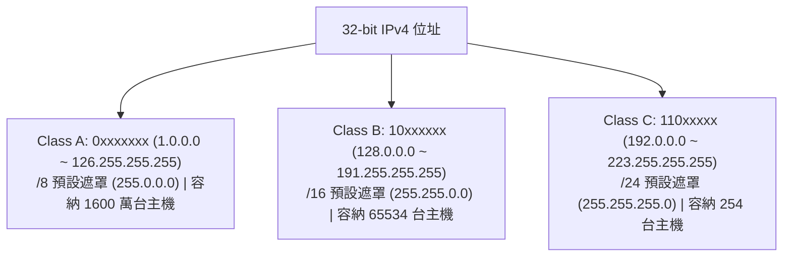

# 🎙️ 電腦網路期末總複習：IPv4 分類編址、子網路遮罩切割運算與網路安全加解密 (授課講師 / 學員)

> **課程主題**：電腦網路期末考點總盤點、IPv4 分類編址（Class A/B/C）、子網路遮罩切割（Subnetting）、密碼學加解密與 DDNS 實作  
> **授課教授**：授課講師（電腦網路授課教授）  
> **核心模組**：IPv4 Classful Addressing, Subnet Masking, FLSM, Symmetric/Asymmetric Encryption, DDNS  
> **學習目標**：精熟 IPv4 分類編址前導位元判定與子網路借位遮罩計算，掌握現代密碼學安全目標與動態網域名稱解析  
> **關聯文件**：[📄 完整原話逐字稿 (2024-12-23-期末總複習IPv4編址與網路安全-proofread.md)](./20241223-期末總複習IPv4編址與網路安全.full.md)

---

## 🏛️ IPv4 傳統分類編址 (Classful Addressing) 結構

---

## 🎯 核心重點整理 (Key Takeaways)

### 1. IPv4 Class A/B/C 前導位元特徵
- **Class A**：第一個位元固定為 `0`（範圍 1 ~ 126）。第 1 個 Byte 為 Net ID，後 3 個 Bytes 為 Host ID。
- **Class B**：前兩個位元固定為 `10`（範圍 128 ~ 191）。前 2 個 Bytes 為 Net ID，後 2 個 Bytes 為 Host ID。
- **Class C**：前三個位元固定為 `110`（範圍 192 ~ 223）。前 3 個 Bytes 為 Net ID，最後 1 個 Byte 為 Host ID。

### 2. 子網路遮罩 (Subnet Mask) 切割公式
- **可用子網路數**：$2^n$，其中 $n$ 為向主機位元借用的位元數。
- **每個子網路可用主機數**：$2^h - 2$，其中 $h$ 為剩餘的主機位元數（減去網路位址與廣播位址）。

### 3. 資訊安全與加密核心
- **對稱式金鑰（Symmetric）**：加密與解密使用相同金鑰（如 AES），速度快，適合傳輸巨量數據。
- **非對稱式金鑰（Asymmetric）**：公鑰加密、私鑰解密（如 RSA/ECC），解決了金鑰分發難題。
---

## 🛡️ IPv4 分類編址、子網路切割運算與對稱/非對稱網路安全機制對照表

| 網路架構與安全範疇 | 核心定址規則與演算法公式 | 實作運算步驟與結構拆解 | 安全威脅與防禦機制對應 |
| :--- | :--- | :--- | :--- |
| **IPv4 分類編址（Classful IP）** | Class A: `1.0.0.0`～`126.255.255.255` (`/8`)；Class B: `128.0.0.0`～`191.255.255.255` (`/16`)；Class C: `192.0.0.0`～`223.255.255.255` (`/24`) | 私有 IP 範圍：`10.0.0.0/8`、`172.16.0.0/12`、`192.168.0.0/16`；`127.0.0.1` 為本地回迴（Loopback）測試位址 | 廣播位址為該網段最後一個 IP（主機位元全為 1），不可指派給單一主機，避免廣播放大攻擊 |
| **無類別域間路由（CIDR）與子網路切割** | 將主機位元借位 $k$ 個給網路位元，可切割為 $2^k$ 個子網路，每個子網路可用主機數為 $2^{32-n} - 2$ | 減去的 2 個位址分別為**網路位址（Network ID，主機全 0）**與**直接廣播位址（Broadcast ID，主機全 1）** | 透過 VLSM（可變長度子網路遮罩）精準分配 IP，杜絕早期傳統分類編址造成之大量未用 IP 浪費 |
| **網路安全加解密機制（對稱 vs. 非對稱）** | **對稱金鑰（如 AES-256）**加解密同一金鑰，運算速度極快；**非對稱金鑰（如 RSA、ECC）**具公鑰與私鑰對 | 實務混合式加密（如 HTTPS/TLS）：非對稱金鑰用於伺服器身分驗證與協商工作階段金鑰（Session Key），後續通訊轉為對稱加密 | 結合數位簽章（私鑰簽名、公鑰驗證）確保資料完整性與不可否認性（Non-repudiation） |
