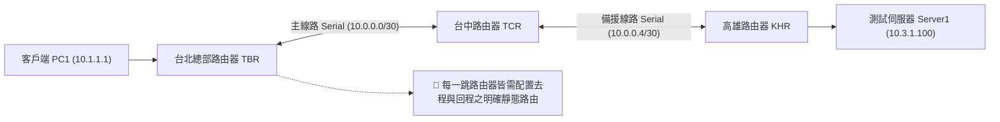

# 🎙️ Cisco CCNA 1 Lab Discovery 12：靜態路由實作演練與主線備援切換驗證 (授課講師 / 學員)

> **課程主題**：Cisco Discovery 12 實驗室：IPv4 靜態路由全網互聯與主備線路設定  
> **授課講師**：授課講師（資安與網路認證原廠認證講師）  
> **核心模組**：Cisco CCNA 1 Lab Discovery 12: Configuring IPv4 Static Routing  
> **學習目標**：實機設定三台路由器靜態路由、掌握逐跳躍點（Next-hop）配置與雙向連通性驗證  
> **關聯文件**：[📄 完整原話逐字稿 (2025-01-06-Lab-Discovery12-靜態路由實作與主線備援切換-proofread.md)](./20250106-01-靜態路由實作與主線備援切換.full.md)

---

## 🏛️ 核心架構與概念流轉圖



---

## 🔬 技術精華與核心考點解析

### 1. 實驗步驟關鍵指令
```cisco
! R1 (TBR) 靜態路由配置
ip route 10.2.1.0 255.255.255.0 10.0.0.2
ip route 10.3.1.0 255.255.255.0 10.0.0.6

! R2 (TCR) 回程與轉發配置
ip route 10.1.1.0 255.255.255.0 10.0.0.1
ip route 10.3.1.0 255.255.255.0 10.0.0.10

! R3 (KHR) 回程路由配置
ip route 10.1.1.0 255.255.255.0 10.0.0.5
ip route 10.2.1.0 255.255.255.0 10.0.0.9
```

### 2. 排錯檢查要領
- 使用 `show ip route` 確認各目標網段前綴均帶有代碼 `S`。
- 使用 `ping <target-ip>` 進行測試；若不通，使用 `traceroute <target-ip>` 檢查封包在哪一跳中斷，精確定位未配置回程路由之路由器。

---

## 💡 關鍵總結與考試應對重點

1. **實作要點：配置靜態路由時，下一跳 IP 必須是直連相鄰路由器的介面 IP，不可跳躍指定非直連 IP。**
2. **連通測試：`ping` 成功率須達到 100%（`!!!!!`），若出現 `U.U.U` 表示目的不可達（ICMP Unreachable），通常代表中間路由器查無路由。**
---

## 🛠️ Cisco IOS 靜態路由指令語法、AD 管理距離與排障驗證表

| 實作配置與網路情境 | Cisco IOS 標準配置指令語法 | 下一跳 IP vs. 出介面模式解析 | 常用排障檢查指令與輸出意義 |
| :--- | :--- | :--- | :--- |
| **下一跳 IP 靜態路由（Next-Hop）** | `Router(config)# ip route <目的網段> <遮罩> <下一跳IP>` (例: `ip route 10.2.1.0 255.255.255.0 10.0.0.2`) | 路由器需透過遞迴查表（Recursive Lookup）解析下一跳 IP 所在之介面，適用於多點廣播（以太網）環境 | `show ip route static`：檢視靜態路由表項；確認路由標記為 `S` 且狀態正常 |
| **出介面靜態路由（Exit-Interface）** | `Router(config)# ip route <目的網段> <遮罩> <出介面名稱>` (例: `ip route 10.2.1.0 255.255.255.0 Serial0/0/0`) | 路由器直接將封包送出該介面；僅適用於點對點（Point-to-Point）串列線路，若用於以太網會因 ARP 廣播泛濫造成記憶體耗盡 | `show ip interface brief`：檢查實體連接埠 Status 與 Protocol 是否皆呈現 `up/up` |
| **去程與回程雙向完整性驗證** | 每一跳節點（Hop）皆需配置對應之去程與回程路由，封包方能有來有回 | 網路通訊本質為雙向；單向配置路由會造成 Ping 請求成功抵達目的地但 Reply 回應無法返航 | `traceroute <目的IP>`：逐步追蹤封包每一跳路由路徑，精確定位斷點發生之路由器節點 |
