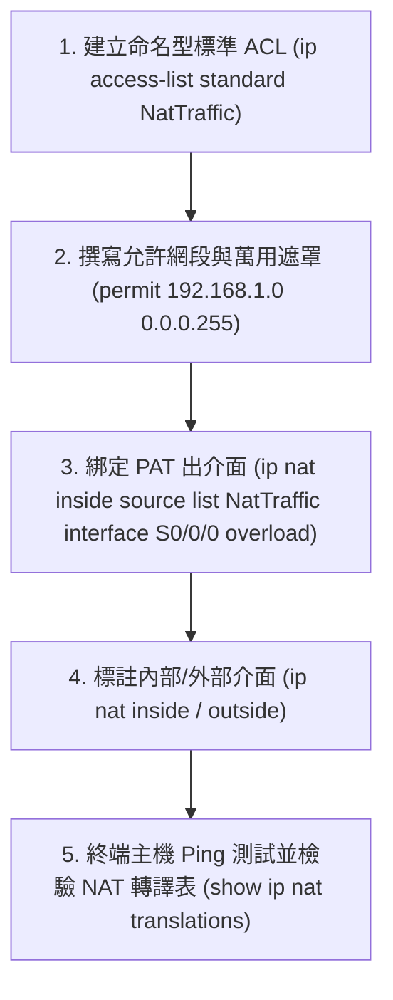

# 🎙️ Cisco CCNA 1 Lab Fastlab 09：PAT流量控制與ACL萬用遮罩整合演練 (授課講師 / 學員)

> **課程主題**：Cisco Fastlab 09：命名型 ACL 搭配 PAT 轉譯流量控制綜合實作演練  
> **授課講師**：授課講師（資安與網路認證原廠認證講師）  
> **核心模組**：Cisco CCNA 1 Lab Fastlab 09: PAT & Wildcard Mask Integration  
> **學習目標**：依據實驗規範精確建立 Named ACL、指派萬用遮罩並將其套用於 PAT 出介面  
> **關聯文件**：[📄 完整原話逐字稿 (2025-01-08-Lab-Fastlab09-PAT流量控制與ACL萬用遮罩整合演練-proofread.md)](./20250108-02-PAT流量控制與ACL萬用遮罩整合演練.full.md)

---

## 🏛️ 核心架構與概念流轉圖



---

## 🔬 技術精華與核心考點解析

### 1. 實驗關鍵設定指令
```cisco
! 建立命名型標準 ACL (名稱必須區分大小寫且完全符合題目規範)
ip access-list standard NatTraffic
 permit 192.168.1.0 0.0.0.255
 exit

! 啟用 PAT (Overload)
ip nat inside source list NatTraffic interface GigabitEthernet0/1 overload

! 介面設定
interface GigabitEthernet0/0
 ip nat inside
interface GigabitEthernet0/1
 ip nat outside
```

---

## 💡 關鍵總結與考試應對重點

1. **命名大小寫考點：在 Cisco IOS 中，命名型 ACL 的名稱（Name）具有大小寫敏感性（Case-Sensitive），題目要求 `NatTraffic` 若打成 `nattraffic` 會被判 0 分！**
2. **驗證方式：使用 `show ip access-lists` 可直接檢視該清單匹配之封包 Matches 計數。**
---

## 🔐 命名型 ACL 規則比對、Wildcard Mask 運算與 PAT 整合表

| 實作元件與技術規範 | Cisco IOS 配置指令語法 | Wildcard Mask 萬用字元遮罩運算規則 | PAT 連線表檢視與故障排除 |
| :--- | :--- | :--- | :--- |
| **命名型標準 ACL（Named ACL）** | `Router(config)# ip access-list standard ALLOW_LAN`<br/>`Router(config-std-nacl)# permit 192.168.1.0 0.0.0.255` | 命名型允許使用英文字串命名，並支援行號插入與刪除特定 ACE（Access Control Entry）規則 | 預設末端具備隱含拒絕（Implicit Deny All）；若未匹配到 permit 規則將被全數丟棄 |
| **萬用字元遮罩（Wildcard Mask）運算** | 0 代表「嚴格匹配對應位元」，1 代表「忽略任意位元」；運算方式為 `255.255.255.255` 減去子網路遮罩 | 子網路遮罩 `255.255.255.0` 對應 Wildcard 為 `0.0.0.255`；遮罩 `255.255.240.0` 對應 `0.0.15.255` | 切忌將子網路遮罩誤寫為萬用字元遮罩，否則 ACL 匹配範圍將完全顛倒導致全網斷線 |
| **NAT Overload (PAT) 綁定** | `Router(config)# ip nat inside source list ALLOW_LAN interface Gig0/0/1 overload` | 內部介面標註 `ip nat inside`，外部介面標註 `ip nat outside`；將 ACL 匹配之私有流量透過出口 IP 與動態 Port 轉譯 | `show ip nat translations`：即時檢視 NAT 轉換表；`clear ip nat translation *` 清除快取以重新排障 |
