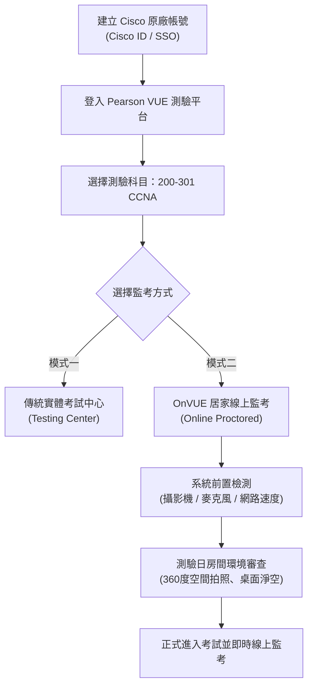

# 🎙️ Cisco CCNA 1 認證報考流程、Pearson VUE 帳號註冊與 OnVUE 居家線上考試指南 (授課講師)

> **課程主題**：Cisco CCNA 國際認證報考流程全攻略與 Pearson VUE 系統操作  
> **授課講師**：授課講師（資安與網路認證原廠認證講師）  
> **核心模組**：Cisco 認證管理系統與 Pearson VUE 線上考試服務  
> **學習目標**：熟悉原廠帳號綁定、考期排定、測驗費用支付及 OnVUE 線上居家監考設備合規標準  
> **關聯文件**：[📄 完整原話逐字稿 (2025-01-10-00-認證報考與OnVUE考試規則-proofread.md)](./20250110-01-認證報考與OnVUE考試規則.full.md)

---

## 🏛️ 核心架構與概念流轉圖

---

## 🔬 技術精華與核心考點解析

### Pearson VUE 平台與原廠授權機制

- 各大 IT 原廠（Cisco、CompTIA、Microsoft、AWS 等）測驗皆全面由 Pearson VUE 承辦提供測驗環境。
- 考題與題庫由各原廠端出題並加密推送，Pearson VUE 提供認證身分核驗與安全防弊防護。

### Cisco 原廠帳號與 SSO 整合

- 必須使用個人長久使用的 Email 建立 Cisco Account，以利後續長期證照延展與證書下載。
- 支援 Single Sign-On (SSO) 單一登入，考取證書後可於個人 Dashboard 獲取數位徽章（Digital Badge）與 PDF 證書。

### OnVUE 線上居家監考合規指南

- 硬體要求：電腦必須配備高品質視訊鏡頭（Webcam）與穩定麥克風，禁止使用外接雙螢幕。
- 環境規範：必須在四面有牆的獨立封閉小房間，測驗過程中嚴禁他人進入或出聲。
- 考前檢查：考官將要求透過鏡頭 360 度環視房間、桌面全面淨空（無紙筆、水杯無標籤、手機放遠處）。

---

## 💡 關鍵總結與考試應對重點

1. **OnVUE 考試前一天務必提前完成系統系統相容性測試（System Test），避免當天因防火牆擋截視訊串流。**
1. **考試過程中目光嚴禁長時間偏離螢幕，否則線上考官（Proctor）有權立即中斷測驗並判定無效。**
1. **考完後現場螢幕即時顯示通過與否（Preliminary Score Report），正式證書於 24-48 小時內同步至 Cisco Tracking System。**
---

## 🖥️ Pearson VUE 考試中心 vs. OnVUE 線上監考環境與報考規範對照表

| 考試交付模式 | 實體測驗中心（Test Center） | OnVUE 居家線上監考（Online Proctoring） | 報考排定與身分驗證注意事項 |
| :--- | :--- | :--- | :--- |
| **考試環境要求與設備** | 由原廠授權測驗中心提供標準 PC 終端、實體隔板與監考人員；無需自行準備視訊設備 | 考生需自備安靜獨立房間（桌面全清空，禁止他人進入）、具備麥克風與清晰 Webcam 之個人筆電 | 須提前透過 Cisco 原廠 Single Sign-On (SSO) 登入 Pearson VUE 平台預約測驗時間 |
| **考試當日簽到檢核SOP** | 攜帶雙證件（如護照、國民身分證或信用卡）親臨櫃台，現場進行拍照、數位簽名與安全檢查 | 考前 30 分鐘登入系統執行環境檢測，使用手機拍攝房間前後左右四面環境相片並上傳雙身分證件查驗 | 英文姓名拼音必須與護照完全一致；若拼寫有誤將被現場或線上監考官直接拒考且不予退費 |
| **測驗中違規行為與應對** | 考場嚴禁攜帶手錶、手機或紙筆；計算草稿由測驗中心提供專用可擦拭塑膠白板板夾 | 視訊鏡頭必須全程保持頭部與雙手在畫面內，嚴禁自言自語唸題目、目光移出螢幕或遮蔽嘴巴 | 提前練習英文題庫閱讀速度；正式考試一旦送出題目即無法返回修改，需妥善分配 120 分鐘答題節奏 |
