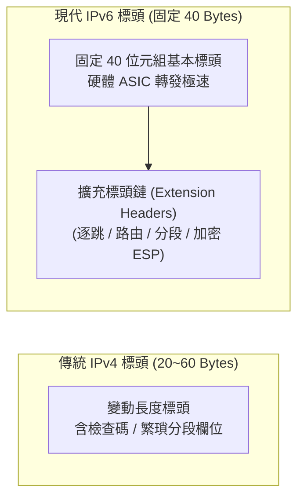

# 🎙️ Cisco CCNA 1 Lesson 頁445~452：IPv6 協定架構、128位元定址與擴充標頭設計 (授課講師)

> **課程主題**：下一代網際網路協定 IPv6 架構基礎與標頭演化革新  
> **授課講師**：授課講師（資安與網路認證原廠認證講師）  
> **核心模組**：Cisco CCNA 1 Chapter 11: Introduction to IPv6  
> **學習目標**：掌握 IPv6 定址位元長度、40 位元組固定標頭結構及廢除廣播之架構改良  
> **關聯文件**：[📄 完整原話逐字稿 (2025-01-10-Lesson-445-452-IPv6協定架構與設計-proofread.md)](./20250110-04-IPv6協定架構與設計.full.md)

---

## 🏛️ 核心架構與概念流轉圖

---

## 🔬 技術精華與核心考點解析

### IPv6 標頭簡化設計革新

- IPv6 基本標頭固定為 40 位元組，取消了 IPv4 繁瑣的 Header Checksum（交由 L2 與 L4 驗證），大幅減輕路由器 CPU 負擔。
- 取消中間路由器分段功能：Path MTU Discovery 確保由發送端來源主機完成分段。

### 三大傳輸類型革新

- Unicast（單播）：一對一傳送。
- Multicast（多播）：一對一組傳送，取代傳統 IPv4 廣播（Broadcast），消除全網廣播風暴。
- Anycast（任播）：一對最近端傳送，常用於全球 DNS 與 CDN 負載平衡。

---

## 💡 關鍵總結與考試應對重點

1. **考試常考：IPv6 徹底廢除了廣播（Broadcast）概念，原廣播需求皆改由特化 Multicast 取代！**
1. **IPv6 基本標頭固定大小為 40 位元組，IPv4 最小為 20 位元組。**
---

## 🌉 IPv6 標頭結構優化、過渡技術（Dual-Stack / Tunnel / NAT64）對照表

| IPv6 架構維度 | 核心技術特性與規格改進 | 與 IPv4 標頭之對比優勢 | 三大過渡遷移技術實務 |
| :--- | :--- | :--- | :--- |
| **128 位元龐大定址空間** | 位址長度達 128 位元（約 $3.4 \times 10^{38}$ 個），足以為地球上每顆沙子分配獨立全局 IP | 徹底解決 IPv4 32 位元位址枯竭危機，使端對端直接通訊重新成為可能，擺脫私有 NAT 之繁瑣中繼 | 採用十六進位冒號分隔表示（8 組，每組 4 個十六進位字元，如 `2001:0db8:85a3::8a2e:0370:7334`） |
| **簡化之固定標頭（Fixed Header）** | 固定為 **40 位元組**長度；廢除 IPv4 之標頭校驗和（Checksum）、標頭長度（IHL）與中途分段（Fragmentation）欄位 | 移除中間路由器逐跳重算 Checksum 之負擔，改由硬體 ASIC 進行線速轉發；擴充功能改以可選擴充標頭（Extension Headers）串接 | 僅允許來源端主機執行封包切片，大幅減輕網路骨幹路由器 CPU 運算開銷與緩衝延遲 |
| **平滑過渡遷移機制** | 1. **雙堆疊（Dual-Stack）**：節點同時啟用 IPv4 與 IPv6 協定棧（最推薦過渡方案）；2. **穿隧（Tunneling）**：IPv6 封包穿透 IPv4 網路；3. **NAT64/DNS64**：純 IPv6 客戶端存取純 IPv4 伺服器 | 現代作業系統預設優先發起 IPv6 DNS 查詢（AAAA 紀錄）；若不通則自動降級回 IPv4（Happy Eyeballs 機制） | 循序漸進遷移，避免全面硬切換導致全球網路中斷風險 |
