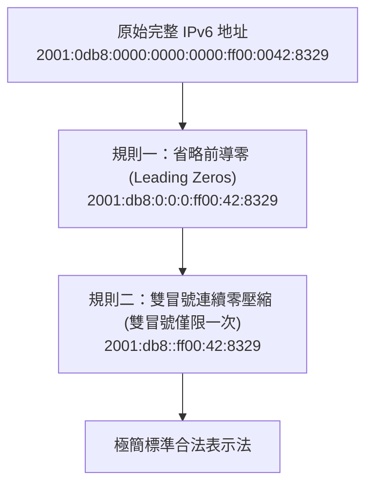

# 🎙️ Cisco CCNA 1 Lesson 頁451~457：IPv6 地址縮寫簡化兩大黃金規則與實務練習 (授課講師)

> **課程主題**：IPv6 128 位元地址書寫規範與兩大合法簡化原則  
> **授課講師**：授課講師（資安與網路認證原廠認證講師）  
> **核心模組**：Cisco CCNA 1 Chapter 11: IPv6 Representation and Shortening  
> **學習目標**：熟練前導零省略與雙冒號壓縮技巧，確保在 Cisco CLI 與認證考試中精準配置  
> **關聯文件**：[📄 完整原話逐字稿 (2025-01-10-Lesson-451-457-IPv6地址縮寫與簡化規則-proofread.md)](./20250110-05-IPv6地址縮寫與簡化規則.full.md)

---

## 🏛️ 核心架構與概念流轉圖

---

## 🔬 技術精華與核心考點解析

### 兩大縮寫法則核心規定

- 規則一：每個 16-bit 區塊內部的『前導零（Leading Zero）』皆可省略，例如 `01ab` -> `1ab`，`0000` -> `0`。但『後綴零（Trailing Zero）』嚴禁省略（例如 `ab00` 絕不能寫成 `ab`）。
- 規則二：連續一個或多個全為 0 的區塊，可用單一雙冒號 `::` 壓縮取代。

### 雙冒號只能使用一次之數學原因

- 若一個地址出現兩次雙冒號（如 `2001::abcd::1`），解碼時將無法確定左右兩處各自壓縮了多少個 16 位元區塊，導致數學歧義；因此全地址強制限制『雙冒號僅能出現一次』。

---

## 💡 關鍵總結與考試應對重點

1. **考試高頻必考題：給定一個完整 IPv6 地址，要求選出唯一合法壓縮格式，檢查雙冒號是否重複使用以及後導零是否被誤刪。**
1. **回環地址（Loopback）完整為 `0000:0000:0000:0000:0000:0000:0000:0001`，極致壓縮後為 `::1`。**
---

## 🔗 IPv6 簡化雙冒號規則、EUI-64 位址生成與 Multicast 取代廣播對照表

| 簡化規則與定址機制 | 數學表示法與轉換標準作業程序 | 具體位址轉換範例 | 網路傳輸行為與考題陷阱 |
| :--- | :--- | :--- | :--- |
| **規則一：前導零省略（Omit Leading Zeros）** | 每一組 16 位元區段（Hextet）中，左側開頭連續的 `0` 可省略；但若全為 0 則至少保留一個 `0` | `2001:0db8:0001:0000` 簡化為 `2001:db8:1:0`；不可省略末尾零（如 `0500` 不能簡化為 `5`） | 減少書寫與設定長度，提高網路工程師配置與除錯效率 |
| **規則二：連續全零雙冒號壓縮（Double Colon ::）** | 連續多組全為 `0000` 的區段可用單一雙冒號 `::` 壓縮；**在同一位址中雙冒號僅能出現一次** | `2001:0db8:0000:0000:0000:0000:0000:0001` 壓縮為 `2001:db8::1`；本機 Loopback `::1` | 若出現兩次雙冒號將造成還原時無法確定各區段補零數量之二義性錯誤，為考題高頻陷阱 |
| **EUI-64 位址生成與 Multicast 取代** | 將 48 位元 MAC 位址自中間切開插入 `FFFE` 擴展為 64 位元，並將第七個位元（U/L 位元）進行反轉（0 變 1） | MAC `00-11-22-33-44-55` 轉換為 Interface ID `0211:22FF:FE33:4455`；Link-Local 前綴為 `fe80::/10` | IPv6 **完全廢除廣播（Broadcast）**，全面改採群播（Multicast，如 `ff02::1` 全節點、`ff02::2` 全路由器），大幅消弭廣播風暴 |
