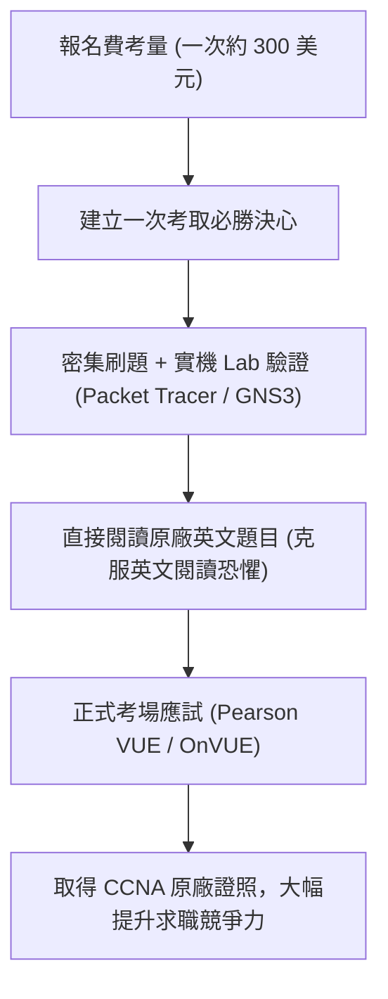

# 🎙️ CCNA1-Cisco CCNA 1 認證備考心得：考照投資報酬率、英語能力優勢與三次應試歷史經驗談 (授課講師 / 學員)

> **課程主題**：Cisco CCNA 認證報考歷程、報名成本權衡、英語題意掌握與備考心態  
> **授課講師**：授課講師（資安與網路認證原廠認證講師）  
> **核心模組**：Cisco CCNA Exam Preparation & Strategy  
> **學習目標**：克服英語應試心理障礙、掌握原廠認證考核邏輯與備考排程  
> **關聯文件**：[📄 完整原話逐字稿 (2025-01-10-Review-認證報考心態與歷屆應試經驗談-proofread.md)](./20250110-07-Review-認證報考心態與歷屆應試經驗談.full.md)

---

## 🏛️ 核心架構與概念流轉圖

---

## 🔑 重點提要 (Key Takeaways)

1. **英語原廠題目優勢**：CCNA 專業術語直接閱讀英文原題最為精確，中文翻譯常有專用術語曲解，英語底子好的學員具備天然優勢。
2. **沉沒成本轉化動力**：考試費用昂貴（約一萬台幣），應將成本轉化為排定死線（Deadline）全力衝刺的決心。
---

## 💡 CCNA 原廠英文題意解析策略、應試心態調適與證照投資效益表

| 備考與實戰維度 | 實務分析與經驗沉澱 | 具體應試策略與解題方法 | 職涯競爭力與投報率（ROI） |
| :--- | :--- | :--- | :--- |
| **原廠英文試題思維養成** | 習慣閱讀英文 Cisco 官方教材與考試題庫，避免依賴簡體中文二手翻譯造成的名詞扭曲與語意誤解 | 題目冗長情境題時，先閱讀最後一句問題與四個選項，再回頭檢索題幹拓撲圖中的關鍵參數，節省作答時間 | 培養與國際跨國工程團隊對齊之標準術語溝通能力，為後續報考 CCNP/CCIE 奠定厚實基礎 |
| **考試心態與考場突發應對** | 考前保持規律作息；應試過程中遭遇難題或 Lab 拖拉題時切忌慌亂停滯，控制每題作答不超過 1.5 分鐘 | CCNA 滿分 1000 分、通過門檻約 825 分，容許部分難題容錯率；確保基礎子網路切割與靜態路由題型 100% 拿下 | 建立自信沉穩的工程師心態，將考試視為系統化梳理網路知識架構之里程碑，而非單純死記答案 |
| **認證費用演變與長期價值** | 考試費用自早期 100 多美元逐步攀升至現代 300 美元，但原廠認證仍是國內外科技大廠履歷篩選黃金標準 | 取得 CCNA 證明具備獨立配置企業園區網路、路由排障與基礎網路安全防禦之即戰力 | 在求職與實習面試中展現具備被國際標準檢驗認證之專業實力，大幅提高錄取一線系統整合商之勝率 |
