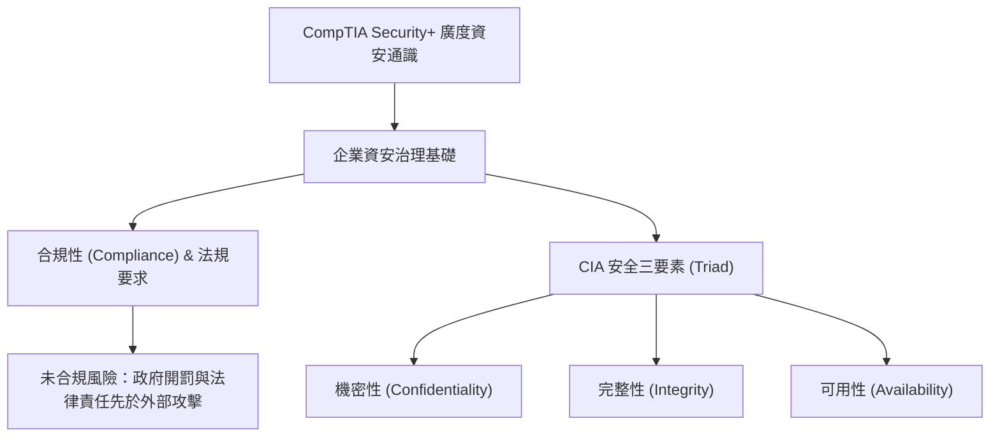

# 🎙️ CompTIA Security+ 頁01~10：資安核心範疇、合規性與CIA三要素 (授課講師 / 學員)

> **課程主題**：CompTIA Security+ 認證核心定位、資安合規性法規與 CIA 三要素  
> **授課講師**：授課講師（資安與網路認證原廠認證講師）  
> **核心模組**：CompTIA Security+ Topic 1: Security Fundamentals  
> **學習目標**：理解資安通識全貌、掌握合規性法規要求與 CIA 三大支柱  
> **關聯文件**：[📄 完整原話逐字稿 (2025-01-13-Lesson01-01-10-資安核心範疇與合規性導論-proofread.md)](./20250113-01-10-資安核心範疇與合規性導論.full.md)

---

## 🏛️ 核心架構與概念流轉圖

---

## 🔑 重點提要 (Key Takeaways)

1. **認證學習定位**：CompTIA Security+ 為廣泛涉獵各資安領域之通識認證，適合全盤了解後再深入特定領域（如法規合規、滲透測試、安全維運）。
2. **合規性重要性**：資安首重 Compliance。在受到駭客威脅前，若不符合政府法規要求，企業將面臨直接罰則。
3. **CIA 三要素平衡**：安全防護不能盲目加強，必須在保護資產機密與完整的同時，確保業務系統之可用性。
---

## 🛡️ 資安核心範疇、法規遵循與 CIA 三要素對照表

| 核心考點與維度 | 技術原理與協定運作機制 | 業界安全最佳實踐與防禦控制項 | 認證考試應試陷阱與排障關鍵 |
| :--- | :--- | :--- | :--- |
| **認證導引與專業學習心態** | CompTIA Security+ SY0-701 著重廠商中立性（Vendor-neutral），奠定威脅分析、風險評估與架構防禦基礎能力 | 定期追蹤 CVE/NVD 漏洞公告與 ATT&CK 框架，維持持續學習熱忱 | 避免將認證僅視為死背題目，需結合實務拓撲理解各項安全控制之關聯性 |
| **企業法規遵循與治理合規** | 符合 GDPR、HIPAA、PCI-DSS 與台灣資通安全法規範，落實責任歸屬與外部獨立第三方稽核審查 | 建立內部控制制度與合規矩陣，避免違規面臨龐大罰鍰與商譽受損 | 合規（Compliance）不等於安全（Security）；單純通過稽核不保證免於 APT 攻擊 |
| **CIA 三要素黃金三角架構** | 機密性（Confidentiality，加密/存取控管）、完整性（Integrity，雜湊/數位簽章）、可用性（Availability，備援/容錯） | 平衡資安三角：過度強化機密性（如多重複雜認證）可能犧牲可用性與使用者體驗 | 鑑別性（Authentication）、不可否認性（Non-repudiation）作為 CIA 之關鍵延伸支柱 |

- **本單元核心綜述與實務指引**：CompTIA Security+ SY0-701 考核重心在於將理論原則（如縱深防禦、最小權限與 CIA 三要素）無縫轉化為具體的系統配置與威脅處置作業流程。考生在面對複雜案例題時，應始終優先識別資產邊界與潛在威脅向量，並依據標準控制項架構採取最適切之技術或管理防禦措施。
