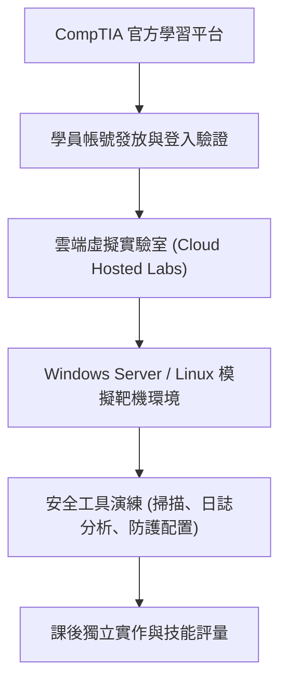

# 🎙️ CompTIA Security+ 頁03~05：原廠線上實驗室開通、環境測試與操作實務 (授課講師 / 學員)

> **課程主題**：原廠雲端實驗室開通、帳號配置與實作環境架構  
> **授課講師**：授課講師（資安與網路認證原廠認證講師）  
> **核心模組**：CompTIA Security+ Topic 1: Hands-on Lab Environment Setup  
> **學習目標**：掌握原廠 Lab 系統登入流程、遠端虛擬主機連線與自學演練方式  
> **關聯文件**：[📄 完整原話逐字稿 (2025-01-13-Lesson01-03-05-原廠線上實驗室開通與實作-proofread.md)](./20250113-02-05-原廠線上實驗室開通與實作.full.md)

---

## 🏛️ 核心架構與概念流轉圖

---

## 🔑 重點提要 (Key Takeaways)

1. **環境開通**：每位學員具備專屬虛擬實驗室存取金鑰，由瀏覽器直接存取後端雲端虛擬機器拓撲。
2. **實作考題關聯**：CompTIA 認證包含 Performance-Based Questions (PBQs)，必須熟悉實機操作介面。
---

## 🛡️ 原廠線上實驗室平台架構、虛擬主機拓撲與實作規範表

| 核心考點與維度 | 技術原理與協定運作機制 | 業界安全最佳實踐與防禦控制項 | 認證考試應試陷阱與排障關鍵 |
| :--- | :--- | :--- | :--- |
| **雲端實作平台環境檢測** | 透過 HTML5 瀏覽器連線至雲端 Lab 入口，執行網路延遲、WebSocket 與頻寬適應性檢驗 | 確保本地端防毒軟體或企業代理伺服器（Proxy）未阻擋 8443/443 穿隧通訊埠 | 避免在不穩定無線網路下執行長時間靶機爆破演練，防止連線中斷狀態遺失 |
| **虛擬主機拓撲與遠端桌面** | 包含 Kali Linux 攻擊機、Windows Server 2022 網域控制器、Ubuntu 靶機與 pfSense 虛擬防火牆 | 使用 RDP/VNC 協定進行圖形介面操作，遵循隔離虛擬私有雲（VPC）內部路由規範 | 嚴禁將實驗室內部弱點工具或私鑰外洩至外部公網，落實沙盒隔離原則 |
| **課堂演練排程與自學實機** | 配合 SY0-701 各章節排定 Nmap 掃描、Wireshark 側錄、John the Ripper 密碼破解等動手實驗 | 建立個人實作操作日誌（Runbook），記錄每道指令輸入與對應回傳結果 | 重置靶機快照（Snapshot）前確認無未存檔之重要組態檔案，維持環境乾淨可重現 |

- **本單元核心綜述與實務指引**：CompTIA Security+ SY0-701 考核重心在於將理論原則（如縱深防禦、最小權限與 CIA 三要素）無縫轉化為具體的系統配置與威脅處置作業流程。考生在面對複雜案例題時，應始終優先識別資產邊界與潛在威脅向量，並依據標準控制項架構採取最適切之技術或管理防禦措施。
