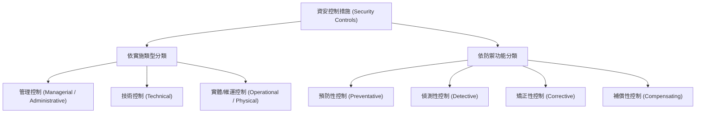

# 🎙️ CompTIA Security+ 頁12~16：資安控制措施分類、縱深防禦與安全評估 (授課講師 / 學員)

> **課程主題**：安全控制措施（Security Controls）分類法與縱深防禦架構  
> **授課講師**：授課講師（資安與網路認證原廠認證講師）  
> **核心模組**：CompTIA Security+ Topic 1: Security Controls & Defense-in-Depth  
> **學習目標**：區分技術、管理、實體控制，掌握預防、偵測、矯正等控制功能  
> **關聯文件**：[📄 完整原話逐字稿 (2025-01-13-Lesson01-12-16-控制措施分類與防禦深度評估-proofread.md)](./20250113-03-16-控制措施分類與防禦深度評估.full.md)

---

## 🏛️ 核心架構與概念流轉圖

---

## 🔑 重點提要 (Key Takeaways)

1. **控制類型三面向**：管理（規章政策）、技術（防火牆、加密、ACL）、實體（門禁、監視器、警衛）。
2. **縱深防禦原則**：單一層面被突破時，後續控制措施必須能立即承接，杜絕單點故障（SPOF）。
---

## 🛡️ 安全控制措施分類、縱深防禦架構與評估指標對照表

| 核心考點與維度 | 技術原理與協定運作機制 | 業界安全最佳實踐與防禦控制項 | 認證考試應試陷阱與排障關鍵 |
| :--- | :--- | :--- | :--- |
| **技術、管理與實體控制** | 技術控制（防火牆、IDS/IPS、加密）；管理控制（資安政策、風險評估）；實體控制（門禁刷卡、監視器、警衛） | 三大控制構面相輔相成，單一維度缺陷將直接形成整體安全木桶之短板 | 技術控制失效時，實體門禁與管理審查能發揮最後一道防線作用 |
| **功能型控制措施分類** | 預防性（Preventative，阻擋攻擊）；偵測性（Detective，告警日誌）；矯正性（Corrective，備份還原）；補償性（Compensating，替代方案） | 依據威脅生命週期部署：事前預防、事中偵測、事後矯正復原 | 補償性控制需經風險管理委員會正式核准，不可長期作為延宕修補漏洞之藉口 |
| **縱深防禦（Defense-in-Depth）** | 不依賴單一設備；在網路周界、內部子網、主機端點、應用程式與資料庫層層設防 | 即便外層周界防火牆遭穿透，內部端點 EDR 與資料庫加密仍能阻斷橫向移動 | 過度堆疊未整合的資安工具可能導致告警疲勞（Alert Fatigue），需搭配 SIEM 收斂 |

- **本單元核心綜述與實務指引**：CompTIA Security+ SY0-701 考核重心在於將理論原則（如縱深防禦、最小權限與 CIA 三要素）無縫轉化為具體的系統配置與威脅處置作業流程。考生在面對複雜案例題時，應始終優先識別資產邊界與潛在威脅向量，並依據標準控制項架構採取最適切之技術或管理防禦措施。
