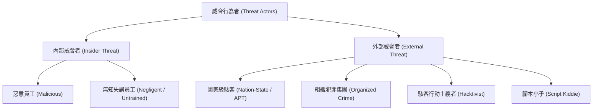

# 🎙️ CompTIA Security+ 頁01~06：威脅行為者分類、攻擊動機與內外部威脅 (授課講師 / 學員)

> **課程主題**：威脅行為者（Threat Actors）類型屬性與背後動機分析  
> **授課講師**：授課講師（資安與網路認證原廠認證講師）  
> **核心模組**：CompTIA Security+ Topic 2: Threat Actors & Motivations  
> **學習目標**：掌握 APT 組織、內部威脅、腳本小子特徵與攻擊動機矩陣  
> **關聯文件**：[📄 完整原話逐字稿 (2025-01-13-Lesson02-01-06-威脅行為者分類與攻擊動機剖析-proofread.md)](./20250113-04-06-威脅行為者分類與攻擊動機剖析.full.md)

---

## 🏛️ 核心架構與概念流轉圖

---

## 🔑 重點提要 (Key Takeaways)

1. **內部威脅危害最鉅**：威脅不限於頂尖駭客，內部未經訓練或疏忽大意的員工（豬隊友）常造成嚴重資安破口。
2. **資源與動機差異**：APT 組織具備國家級經費與長期潛伏能力；組織犯罪著重勒索金錢；腳本小子則缺乏底層理解僅依賴現成工具。
---

## 🛡️ 威脅行為者分類、攻擊動機剖析與威脅屬性對照表

| 核心考點與維度 | 技術原理與協定運作機制 | 業界安全最佳實踐與防禦控制項 | 認證考試應試陷阱與排障關鍵 |
| :--- | :--- | :--- | :--- |
| **內部人員威脅（Insider Threats）** | 現職員工、離職人員或特權外包商，因不滿待遇、經濟誘因或疏失造成機密外洩 | 具備內部網路合法存取權限，最難被傳統外部邊界防火牆偵測與防禦 | 實施最小權限原則（PoLP）、職務區隔（SoD）與使用者行為分析（UBA） |
| **國家級 APT 與組織犯罪集團** | APT（高級持續性威脅）具備國家算力與資金支持，專注長期潛伏竊密；黑產集團專注勒索與金融詐欺 | 攻擊手法極具隱蔽性，善用 0-Day 漏洞、供應鏈污染與客製化無檔案惡意軟體 | 防禦需建立跨國威脅情資共享機制與 24/7 SOC 戰情室即時聯防 |
| **腳本小子與駭客行動主義者** | 腳本小子（Script Kiddies）缺乏底層原理，僅使用現成開源工具；駭客主義者（Hacktivists）追求政治/社會宣傳 | 常見手法為 DDoS 癱瘓網站、首頁篡改（Defacement）或公布未加密資料庫 | 部署 WAF 阻擋常見已知攻擊 Payload，並建立 CDN 流量清洗機制緩解流量衝擊 |

- **本單元核心綜述與實務指引**：CompTIA Security+ SY0-701 考核重心在於將理論原則（如縱深防禦、最小權限與 CIA 三要素）無縫轉化為具體的系統配置與威脅處置作業流程。考生在面對複雜案例題時，應始終優先識別資產邊界與潛在威脅向量，並依據標準控制項架構採取最適切之技術或管理防禦措施。
