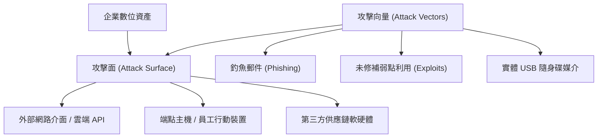

# 🎙️ CompTIA Security+ 頁07~13：攻擊面分析、攻擊向量與威脅情資來源 (授課講師 / 學員)

> **課程主題**：攻擊面（Attack Surface）盤點、攻擊向量辨識與威脅情資收集  
> **授課講師**：授課講師（資安與網路認證原廠認證講師）  
> **核心模組**：CompTIA Security+ Topic 2: Attack Surfaces & Vectors  
> **學習目標**：理解系統漏洞與暴露途徑、掌握縮小攻擊面實務與威脅情報獲取管道  
> **關聯文件**：[📄 完整原話逐字稿 (2025-01-13-Lesson02-07-13-攻擊面與各類攻擊向量辨識-proofread.md)](./20250113-05-13-攻擊面與各類攻擊向量辨識.full.md)

---

## 🏛️ 核心架構與概念流轉圖

---

## 🔑 重點提要 (Key Takeaways)

1. **攻擊面最小化**：關閉不需要的服務、連接埠與存取路徑，將潛在弱點暴露減至最低。
2. **向量防護重點**：電子郵件依然是最常見且最致命的攻擊向量，必須搭配嚴格的資安意識培訓與過濾機制。
---

## 🛡️ 企業攻擊面收斂、攻擊向量辨識與威脅情資對照表

| 核心考點與維度 | 技術原理與協定運作機制 | 業界安全最佳實踐與防禦控制項 | 認證考試應試陷阱與排障關鍵 |
| :--- | :--- | :--- | :--- |
| **攻擊面（Attack Surface）盤點** | 系統暴露於潛在攻擊者之所有可存取進入點總和（對外 Port、API、遠端桌面、員工終端） | 遵循最小暴露原則（Attack Surface Reduction, ASR），關閉非必要服務與未用連接埠 | 定期執行外部資產攻擊面管理（EASM），盤點被遺忘之測試主機與影子 IT（Shadow IT） |
| **關鍵攻擊向量（Attack Vectors）** | 電子郵件釣魚（Phishing）、軟體供應鏈依賴庫污染、雲端組態漂移（Misconfiguration）與 USB 可卸除式媒體 | 社交工程攻擊利用人性弱點；技術漏洞則利用缺乏邊界驗證之網路協定缺陷 | 端點停用 USB 自動執行（AutoRun）、部署郵件閘道（SEG）過濾惡意附件與微連結 |
| **開源威脅情報（OSINT）收集** | 利用 Shodan、Censys、VirusTotal、MISP 平台收集威脅指標（IoC：IP、Domain、Hash） | 主動將外部情資轉化為防火牆防禦規則與 SIEM 關聯分析過濾條件 | 避免單純被動等待受害，落實主動威脅獵捕（Threat Hunting） |

- **本單元核心綜述與實務指引**：CompTIA Security+ SY0-701 考核重心在於將理論原則（如縱深防禦、最小權限與 CIA 三要素）無縫轉化為具體的系統配置與威脅處置作業流程。考生在面對複雜案例題時，應始終優先識別資產邊界與潛在威脅向量，並依據標準控制項架構採取最適切之技術或管理防禦措施。
