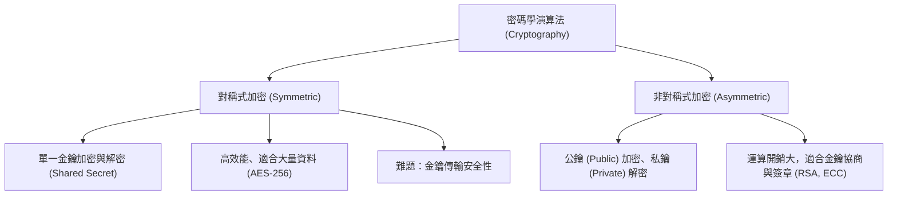

# 🎙️ CompTIA Security+ 頁05~14：密碼學原理、對稱式加密與非對稱式加密架構 (授課講師 / 學員)

> **課程主題**：密碼學核心架構、對稱式加密與非對稱式金鑰交換實務  
> **授課講師**：授課講師（資安與網路認證原廠認證講師）  
> **核心模組**：CompTIA Security+ Topic 3: Cryptographic Algorithms  
> **學習目標**：理解對稱式（AES）與非對稱式（RSA/ECC）運作特性及金鑰交換挑戰  
> **關聯文件**：[📄 完整原話逐字稿 (2025-01-14-Lesson03-05-14-密碼學對稱式與非對稱式加密-proofread.md)](./20250114-01-14-密碼學對稱式與非對稱式加密.full.md)

---

## 🏛️ 核心架構與概念流轉圖

---

## 🔑 重點提要 (Key Takeaways)

1. **混合加密架構**：實務上（如 TLS/HTTPS）結合非對稱式密碼學進行身分驗證與對稱金鑰交換，後續大量傳輸則使用高效之 AES 對稱式加密。
2. **金鑰管理核心**：演算法公開無妨，安全性全繫於私密金鑰之妥善保管。
---

## 🛡️ 密碼學對稱式與非對稱式加密演算法架構對照表

| 核心考點與維度 | 技術原理與協定運作機制 | 業界安全最佳實踐與防禦控制項 | 認證考試應試陷阱與排障關鍵 |
| :--- | :--- | :--- | :--- |
| **Kerckhoffs 原則與金鑰本質** | 密碼系統的安全性必須僅取決於「金鑰的保密性」，而非演算法本身的隱蔽性（Security through Obscurity 必然失敗） | 所有現代標準演算法（AES、RSA）皆為公開透明，經由全球密碼學家公開審查檢驗 | 金鑰長度直接決定抗暴力破解（Brute-force）強度；AES-128/256 具備計算不可行之強度 |
| **對稱式加密演算法（Symmetric）** | AES（Rijndael, 128/192/256 位元區塊加密）、DES（已棄用）、3DES（過渡過時）；加解密使用同一把共用金鑰 | 優勢為運算吞吐極快、硬體加速開銷極低；核心難題在於「安全金鑰分發（Key Distribution Problem）」 | 大量節點互通需要 $\frac{n(n-1)}{2}$ 把金鑰，在分散式網路中擴展性極差 |
| **非對稱式加密演算法（Asymmetric）** | RSA（基於大質數分解難題）、ECC（橢圓曲線密碼學，金鑰短且計算效率高）；具備公鑰（公開）與私鑰（私密） | 公鑰加密僅能由私鑰解密（保密性）；私鑰加密由公鑰解密（數位簽章與鑑別） | 運算開銷龐大，實務上作為混合式加密（Hybrid Encryption）之金鑰交換協商通道 |

- **本單元核心綜述與實務指引**：CompTIA Security+ SY0-701 考核重心在於將理論原則（如縱深防禦、最小權限與 CIA 三要素）無縫轉化為具體的系統配置與威脅處置作業流程。考生在面對複雜案例題時，應始終優先識別資產邊界與潛在威脅向量，並依據標準控制項架構採取最適切之技術或管理防禦措施。
