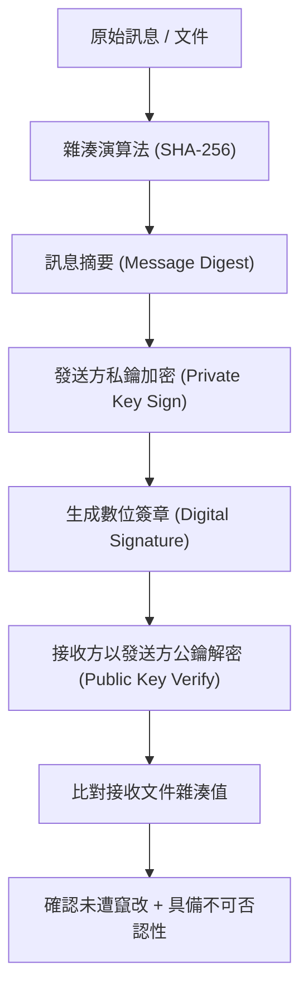

# 🎙️ CompTIA Security+ 頁15~17：雜湊演算法、不可否認性與數位簽章驗證 (授課講師 / 學員)

> **課程主題**：雜湊函數（Hashing）、數位簽章驗證與不可否認性架構  
> **授課講師**：授課講師（資安與網路認證原廠認證講師）  
> **核心模組**：CompTIA Security+ Topic 3: Hashes & Digital Signatures  
> **學習目標**：掌握 SHA-2/3 演算法、數位簽章私鑰簽章/公鑰驗證原理與防篡改機制  
> **關聯文件**：[📄 完整原話逐字稿 (2025-01-14-Lesson03-15-17-數位簽章與雜湊演算法完整性-proofread.md)](./20250114-02-17-數位簽章與雜湊演算法完整性.full.md)

---

## 🏛️ 核心架構與概念流轉圖

---

## 🔑 重點提要 (Key Takeaways)

1. **雜湊單向性**：雜湊不可逆，雪崩效應（Avalanche Effect）保證原始資料些微更動即造成摘要劇烈變化。
2. **數位簽章雙重保障**：同時提供資料完整性（Integrity）與發送方身分之不可否認性（Non-Repudiation）。
---

## 🛡️ 雜湊演算法抗碰撞特性、數位簽章與不可否認性對照表

| 核心考點與維度 | 技術原理與協定運作機制 | 業界安全最佳實踐與防禦控制項 | 認證考試應試陷阱與排障關鍵 |
| :--- | :--- | :--- | :--- |
| **單向雜湊函數（Hash Functions）** | SHA-256、SHA-3、MD5（已淘汰）、SHA-1（已棄用）；將任意長度輸入映射為固定長度輸出數值 | 具備單向性（Preimage Resistance）與雪崩效應（Avalanche Effect，改一字元全哈希劇變） | 抗碰撞性（Collision Resistance）：無法在合理時間內找到不同輸入產生相同雜湊值 |
| **數位簽章（Digital Signatures）** | 傳送者對訊息計算雜湊值，以自身**私鑰**對雜湊進行加密生成簽名；接收者以傳送者**公鑰**驗證雜湊是否吻合 | 保證訊息之**完整性（Integrity）**（未遭篡改）與發送方之**真實身分（Authentication）** | 簽署的是訊息的「雜湊值」而非原始龐大內文，大幅縮減非對稱運算時間開銷 |
| **不可否認性（Non-Repudiation）** | 發送方事後無法否認曾發送該訊息，因其私鑰為唯一且由其獨佔持有 | 訊息鑑別碼（HMAC）使用共用金鑰，可保證完整性但無法提供不可否認性（雙方皆持有該金鑰） | 在電子合約、金融轉帳、Git Commit GPG 簽署與軟體代碼發行中為法規效力之基石 |

- **本單元核心綜述與實務指引**：CompTIA Security+ SY0-701 考核重心在於將理論原則（如縱深防禦、最小權限與 CIA 三要素）無縫轉化為具體的系統配置與威脅處置作業流程。考生在面對複雜案例題時，應始終優先識別資產邊界與潛在威脅向量，並依據標準控制項架構採取最適切之技術或管理防禦措施。
