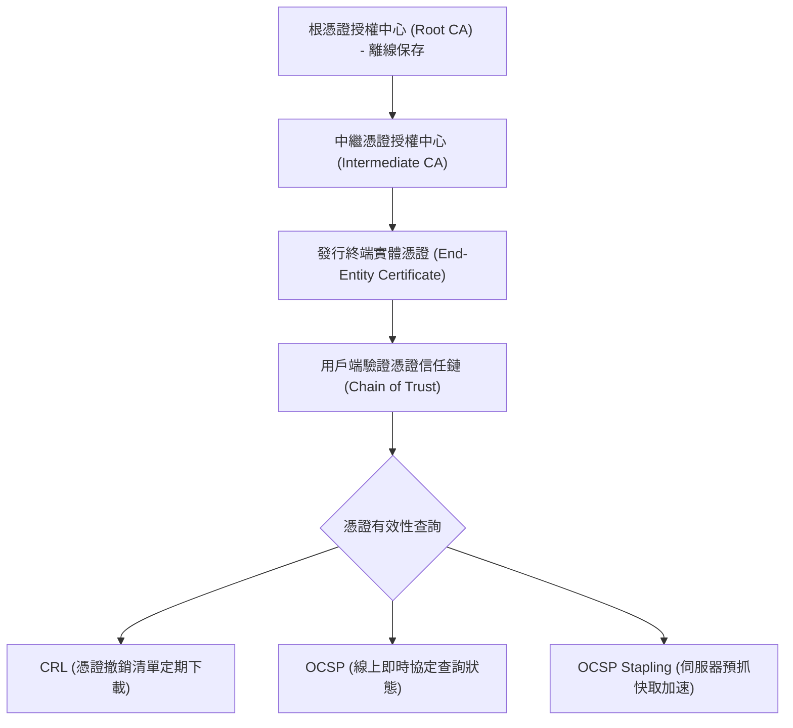

# 🎙️ CompTIA Security+ 頁18~32：PKI 公鑰基礎設施、憑證撤銷清單與金鑰生命週期 (授課講師 / 學員)

> **課程主題**：PKI 公鑰基礎設施、CA 階層信任鏈與金鑰管理生命週期  
> **授課講師**：授課講師（資安與網路認證原廠認證講師）  
> **核心模組**：CompTIA Security+ Topic 3: Public Key Infrastructure (PKI)  
> **學習目標**：理解 X.509 憑證標準、CRL/OCSP 撤銷查詢與 HSM 硬體防護  
> **關聯文件**：[📄 完整原話逐字稿 (2025-01-14-Lesson03-18-32-PKI憑證撤銷清單與金鑰管理-proofread.md)](./20250114-03-32-PKI憑證撤銷清單與金鑰管理.full.md)

---

## 🏛️ 核心架構與概念流轉圖

---

## 🔑 重點提要 (Key Takeaways)

1. **根 CA 離線原則**：Root CA 為整個信任體系之基石，簽發 Intermediate CA 後應立即離線實體封存，防止被駭。
2. **OCSP vs CRL**：CRL 存在更新延遲且檔案日益肥大；OCSP 提供即時查詢，而 OCSP Stapling 更解決了隱私與連線延遲問題。
---

## 🛡️ 公鑰基礎設施 PKI、憑證狀態驗證與金鑰生命週期表

| 核心考點與維度 | 技術原理與協定運作機制 | 業界安全最佳實踐與防禦控制項 | 認證考試應試陷阱與排障關鍵 |
| :--- | :--- | :--- | :--- |
| **憑證授權中心（CA 信任鏈）** | Root CA（離線自簽名根憑證）下發授權給 Intermediate CA（中間憑證），中間 CA 簽發終端主機憑證 | 瀏覽器內建受信任根憑證清單；透過信任鏈（Chain of Trust）由下而上依序向上校驗至根節點 | 根 CA 平時必須處於實體離線冷儲存狀態（Air-gapped），防止私鑰洩漏導致全網崩潰 |
| **憑證撤銷驗證機制（CRL vs. OCSP）** | CRL（憑證撤銷清單）：定期下載巨大黑名單，具延遲且檔案龐大；OCSP（線上憑證狀態協定）：即時單筆查詢狀態 | OCSP Stapling：由 Web 伺服器代為向 CA 查詢並快取包含時間戳的數位簽名狀態，解決隱私與連線延遲問題 | 憑證過期或私鑰洩漏時必須立即撤銷，客戶端校驗時不可忽視撤銷狀態檢查 |
| **金鑰管理與 HSM 硬體安全模組** | 產生、儲存、分發、輪替（Rotation）與銷毀；使用 FIPS 140-2 Level 3/4 認證之 HSM 實體防篡改硬體 | 金鑰託管（Key Escrow）：第三方備份金鑰以備法律合規調閱；密碼分割（M-of-N）：需多位主管同時授權 | 禁止將未加密私鑰硬編碼（Hard-code）於程式原始碼或置於 Git 版控庫中 |

- **本單元核心綜述與實務指引**：CompTIA Security+ SY0-701 考核重心在於將理論原則（如縱深防禦、最小權限與 CIA 三要素）無縫轉化為具體的系統配置與威脅處置作業流程。考生在面對複雜案例題時，應始終優先識別資產邊界與潛在威脅向量，並依據標準控制項架構採取最適切之技術或管理防禦措施。
