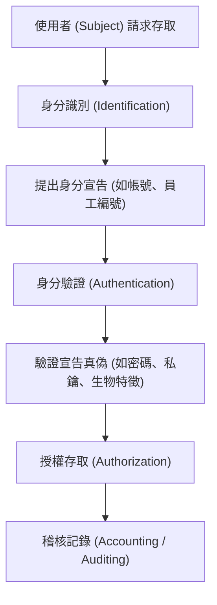

# 🎙️ CompTIA Security+ 頁01~09：身分識別、鑑別與密碼管理原則 (授課講師 / 學員)

> **課程主題**：身分識別與存取管理（IAM）、驗證概念與企業密碼原則  
> **授課講師**：授課講師（資安與網路認證原廠認證講師）  
> **核心模組**：CompTIA Security+ Topic 4: Identity & Access Management Fundamentals  
> **學習目標**：釐清 Identification 與 Authentication 差異，掌握企業密碼策略  
> **關聯文件**：[📄 完整原話逐字稿 (2025-01-15-Lesson04-01-09-身分鑑別與存取管理IAM架構-proofread.md)](./20250115-01-09-身分鑑別與存取管理IAM架構.full.md)

---

## 🏛️ 核心架構與概念流轉圖

---

## 🔑 重點提要 (Key Takeaways)

1. **IAM 核心四步驟（IAAA）**：識別（Who you are）、鑑別（Prove it）、授權（What you can do）、稽核（What you did）。
2. **密碼策略實務**：單純提高複雜度易導致便利性反噬（如貼便條紙），現代密碼策略更推崇足夠長度（Passphrase）與防暴力破解鎖定機制。
---

## 🛡️ 身分鑑別與存取管理 IAM 架構、AAA 模型與授權控制表

| 核心考點與維度 | 技術原理與協定運作機制 | 業界安全最佳實踐與防禦控制項 | 認證考試應試陷阱與排障關鍵 |
| :--- | :--- | :--- | :--- |
| **AAA 核心安全模型架構** | 驗證（Authentication，你是誰）；授權（Authorization，你能做什麼）；計費/審計（Accounting，你做了什麼） | AAA 為企業存取控制之靈魂骨架，廣泛落實於 RADIUS 與 TACACS+ 協定中 | 審計日誌必須集中轉發至安全伺服器（WORM 儲存），防止特權使用者毀屍滅跡 |
| **存取控制模型比較（RBAC / ABAC / DAC / MAC）** | DAC（自由選定，擁有者決定）；MAC（強制存取，基於安全標籤，軍用）；RBAC（基於角色職能）；ABAC（基於屬性/環境情境） | RBAC 適合大型企業一般業務，降低權限指派複雜度；ABAC 適合動態零信任環境（檢查時間、IP、裝置合規狀態） | 落實最小權限原則（Principle of Least Privilege），嚴禁濫用通用 Admin 權限 |
| **身分識別與存取生命週期** | 入職（Provisioning）$\to$ 調職（Deprovisioning 權限隨之回收）$\to$ 離職（即時凍結停用） | 未即時清理離職人員帳號將產生「幽靈帳號（Orphaned Accounts）」，成為潛在入侵後門 | 定期實施特權存取審查（User Access Review），回收因專案結束殘留之過度授權 |

- **本單元核心綜述與實務指引**：CompTIA Security+ SY0-701 考核重心在於將理論原則（如縱深防禦、最小權限與 CIA 三要素）無縫轉化為具體的系統配置與威脅處置作業流程。考生在面對複雜案例題時，應始終優先識別資產邊界與潛在威脅向量，並依據標準控制項架構採取最適切之技術或管理防禦措施。
