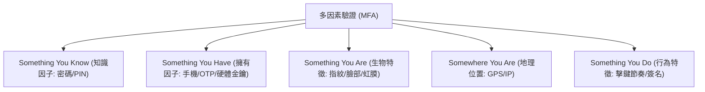

# 🎙️ CompTIA Security+ 頁18~26：多因素驗證（MFA）、生物特徵識別與實體權杖 (授課講師 / 學員)

> **課程主題**：多因素驗證（MFA）分類、生物辨識效能評估與硬體金鑰  
> **授課講師**：授課講師（資安與網路認證原廠認證講師）  
> **核心模組**：CompTIA Security+ Topic 4: MFA & Biometric Authentication  
> **學習目標**：理解 MFA 各項要素、掌握 FAR/FRR 權衡與無密碼 FIDO2 趨勢  
> **關聯文件**：[📄 完整原話逐字稿 (2025-01-15-Lesson04-18-26-多因素驗證MFA與生物辨識技術-proofread.md)](./20250115-02-26-多因素驗證MFA與生物辨識技術.full.md)

---

## 🏛️ 核心架構與概念流轉圖

---

## 🔑 重點提要 (Key Takeaways)

1. **真正 MFA 定義**：必須跨越「不同因子類別」。輸入兩組密碼不是 MFA，密碼搭配手機 Authenticator App 才是 MFA。
2. **生物辨識指標 CER**：錯誤接受率（FAR）與錯誤拒絕率（FRR）的交會點即為 Crossover Error Rate (CER)，CER 愈低代表系統整體精確度愈高。
---

## 🛡️ 多因素驗證 MFA、生物辨識誤判率與驗證因子矩陣表

| 核心考點與維度 | 技術原理與協定運作機制 | 業界安全最佳實踐與防禦控制項 | 認證考試應試陷阱與排障關鍵 |
| :--- | :--- | :--- | :--- |
| **驗證三大核心因子（Authentication Factors）** | 所知（Something you know：密碼/PIN）；所持（Something you have：手機/Token/硬體金鑰）；所具（Something you are：指紋/虹膜） | 真正的 MFA 必須跨越**至少兩種不同類型因子**；兩個不同密碼僅屬於單一因子 SFA | 額外維度包含「所在位置（Somewhere you are）」與「所作所為（Something you do，行為特徵）」 |
| **時間型動態密碼（TOTP）vs. FIDO2 / WebAuthn** | TOTP（RFC 6238）基於共用密鑰與時間計算 6 位數代碼，易受即時反向代理釣魚攔截（Evilginx2） | FIDO2 / Passkey 基於非對稱加密與網域綁定（Origin-bound），具備天然的**抗釣魚（Phishing-resistant）**能力 | 企業應加速淘汰 SMS 簡訊驗證碼（易遭 SIM-Swapping 攔截），全面升級為 FIDO2 實體安全金鑰 |
| **生物辨識指標（FAR, FRR, CER）** | FAR（誤接受率，Type II 錯誤，非本人卻通過）；FRR（誤拒絕率，Type I 錯誤，本人卻遭拒） | 兩曲線交會點稱為 **CER / EER（交叉錯誤率）**；CER 數值越低代表該生物辨識系統整體精準度越高 | 高機密金庫偏向降低 FAR，一般門禁偏向降低 FRR 以提升通關流暢度 |

- **本單元核心綜述與實務指引**：CompTIA Security+ SY0-701 考核重心在於將理論原則（如縱深防禦、最小權限與 CIA 三要素）無縫轉化為具體的系統配置與威脅處置作業流程。考生在面對複雜案例題時，應始終優先識別資產邊界與潛在威脅向量，並依據標準控制項架構採取最適切之技術或管理防禦措施。
