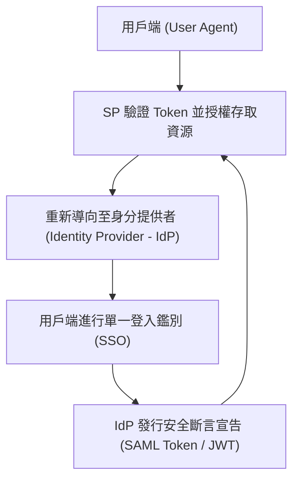

# 🎙️ CompTIA Security+ 頁27~34：帳號生命週期管理、目錄服務與身分同盟（SSO） (授課講師 / 學員)

> **課程主題**：集中式帳號管理、生命週期維運與同盟單一登入（SSO）  
> **授課講師**：授課講師（資安與網路認證原廠認證講師）  
> **核心模組**：CompTIA Security+ Topic 4: Identity Federation & Lifecycle  
> **學習目標**：掌握 LDAP/Kerberos 目錄運作、員工離退停權程序與 SAML/OIDC 同盟架構  
> **關聯文件**：[📄 完整原話逐字稿 (2025-01-15-Lesson04-27-34-帳號生命週期與目錄服務同盟-proofread.md)](./20250115-03-34-帳號生命週期與目錄服務同盟.full.md)

---

## 🏛️ 核心架構與概念流轉圖

---

## 🔑 重點提要 (Key Takeaways)

1. **離職即時停權**：員工離職或職務異動時，必須有標準化流程即時停用集中式帳號，防止孤兒帳號（Orphan Accounts）殘留。
2. **身分同盟優勢**：透過 SAML 2.0 或 OpenID Connect (OIDC)，企業員工可用同一身分安全存取外部雲端 SaaS 服務，免去多套密碼之資安風險。
---

## 🛡️ 目錄服務、單一登入 SSO 與跨域身分同盟協定對照表

| 核心考點與維度 | 技術原理與協定運作機制 | 業界安全最佳實踐與防禦控制項 | 認證考試應試陷阱與排障關鍵 |
| :--- | :--- | :--- | :--- |
| **輕量目錄存取協定（LDAP）與 AD 樹系** | 階層式 X.500 目錄服務；儲存使用者、群組、電腦與印表機物件；支援 LDAP（389）與 LDAPS（636 TLS 加密） | 提供企業內部集中的使用者資料庫與查詢索引，支援 Kerberos 票證（Ticket）單點驗證 | 必須強制全面啟用 LDAPS，防止使用者密碼以明文方式在局域網傳輸遭監聽 |
| **單一登入（SSO, Single Sign-On）機制** | 使用者僅需登入一次即可通行內部授權之多個獨立應用系統，降低頻繁輸入密碼與記密碼之負擔 | 大幅改善工作效率與降低密碼重置客服成本；缺點為單點故障（SPOF）風險，必須強制搭配高強度 MFA | 工作階段逾時（Session Timeout）機制必須與業務敏感度連動，防止無人值守遭盜用 |
| **跨網域身分同盟（SAML 2.0 / OAuth 2.0 / OIDC）** | SAML 2.0 基於 XML，主導企業級 Web 跨網域 SSO；OAuth 2.0 專注於 API「授權」；OIDC（OpenID Connect）基於 JSON/JWT 專注「身分驗證」 | 身分提供者（IdP，如 Entra ID/Google）簽發 Token，服務提供者（SP/RP）驗證 Token 換取存取權 | 實施同盟認證時需驗證簽章合法性，嚴防重放攻擊（Replay Attack）與 Token 竊取 |

- **本單元核心綜述與實務指引**：CompTIA Security+ SY0-701 考核重心在於將理論原則（如縱深防禦、最小權限與 CIA 三要素）無縫轉化為具體的系統配置與威脅處置作業流程。考生在面對複雜案例題時，應始終優先識別資產邊界與潛在威脅向量，並依據標準控制項架構採取最適切之技術或管理防禦措施。
