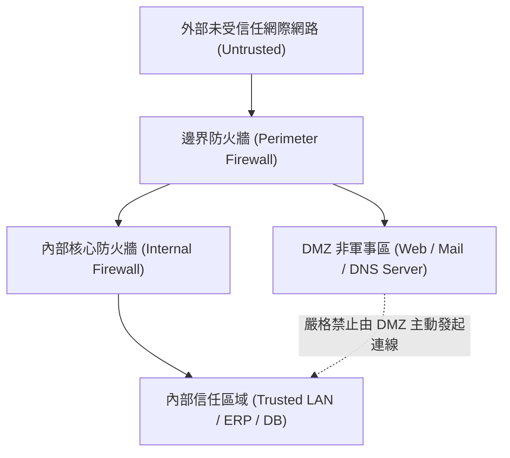

# 🎙️ CompTIA Security+ 頁01~08：企業園區網路架構、安全區域規劃與邊界隔離 (授課講師 / 學員)

> **課程主題**：在地網路安全拓撲、DMZ 邊界規劃與 VLAN 微區段隔離  
> **授課講師**：授課講師（資安與網路認證原廠認證講師）  
> **核心模組**：CompTIA Security+ Topic 5: Network Architecture & Segmentation  
> **學習目標**：掌握對外公開伺服器 DMZ 配置、內部機敏網段隔離與二層攻擊防禦  
> **關聯文件**：[📄 完整原話逐字稿 (2025-01-15-Lesson05-01-08-園區網路架構與安全區域規劃-proofread.md)](./20250115-05-08-園區網路架構與安全區域規劃.full.md)

---

## 🏛️ 核心架構與概念流轉圖

---

## 🔑 重點提要 (Key Takeaways)

1. **DMZ 設計原則**：所有對外提供公開服務之主機皆應置於 DMZ，即使被攻陷亦無法橫向滲透內部資料庫。
2. **網路分段（Segmentation）**：利用 VLAN 與子網劃分將財務、人資、研發與訪客網路隔離，阻斷勒索軟體橫向傳播。
---

## 🛡️ 企業園區網路架構、DMZ 非軍事區與微網段化規劃表

| 核心考點與維度 | 技術原理與協定運作機制 | 業界安全最佳實踐與防禦控制項 | 認證考試應試陷阱與排障關鍵 |
| :--- | :--- | :--- | :--- |
| **三層式階層化網路架構** | 核心層（Core，高速骨幹轉發）、發布/匯聚層（Distribution，路由策略/ACL）、存取層（Access，接取終端設備/VLAN） | 層級分工明確，故障隔離度高，避免存取層廣播風暴波及全網骨幹 | 核心層禁止配置繁複之過濾規則，保持線速無阻塞硬體轉發 |
| **DMZ 非軍事區架構設計** | 位於內部受信賴網路（LAN）與外部非信賴網際網路（Internet）之間的緩衝邊界子網 | 放置對外公開伺服器（Web, Mail, DNS）；外部僅能存取 DMZ，**嚴禁外部流量直接連入內部 LAN** | 即便 DMZ 伺服器遭 GetShell 淪陷，防火牆仍能阻止其向內部發起連線，阻斷滲透路徑 |
| **虛擬區域網路（VLAN）與微網段化（Micro-segmentation）** | 802.1Q 標籤劃分廣播網域；搭配軟體定義邊界（SDP）將安全邊界細化至單一虛擬機或容器層級 | 有效限制內部 ARP 詐欺與側向移動（Lateral Movement）路徑，落實零信任「永不信任、始終驗證」原則 | 未使用的 Switch Port 必須手動 `shutdown` 並劃入未指派之黑洞 VLAN |

- **本單元核心綜述與實務指引**：CompTIA Security+ SY0-701 考核重心在於將理論原則（如縱深防禦、最小權限與 CIA 三要素）無縫轉化為具體的系統配置與威脅處置作業流程。考生在面對複雜案例題時，應始終優先識別資產邊界與潛在威脅向量，並依據標準控制項架構採取最適切之技術或管理防禦措施。
