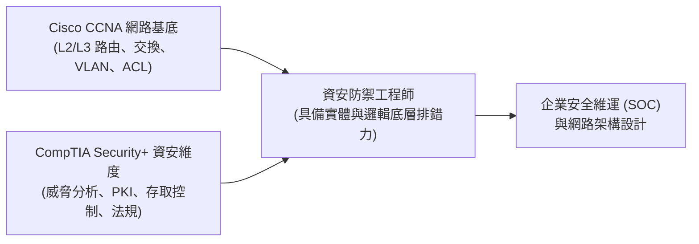

# 🎙️ CompTIA Security+ Part 1：認證備考策略、CCNA/Security+ 雙軌聯防與安全架構 (授課講師)

> **課程主題**：CCNA 網路基礎與 Security+ 資安專業雙認證之職涯發展與備考路徑  
> **授課講師**：授課講師（資安與網路認證原廠認證講師）  
> **核心模組**：CompTIA Security+ Domain 1 & 2: General Security Concepts & Network Architecture  
> **學習目標**：建立網工與資安雙視角，掌握考照時間規劃與網路安全一體化思維  
> **關聯文件**：[📄 完整原話逐字稿 (2025-01-16-Lesson05A-認證備考與雙軌防禦-proofread.md)](./20250116-03-A-認證備考與雙軌防禦.full.md)

---

## 🏛️ 核心架構與概念流轉圖

---

## 🔬 技術精華與核心考點解析

### CCNA 與 Security+ 的互補關係

- 資安不能脫離網路空談：不懂 IP 路由、TCP 三次交握、VLAN 切分與封包結構，就無法分析攻擊流量與防火牆日誌。
- CCNA 提供堅實的底層連線與設備配置能力，Security+ 則補足密碼學、威脅情資、存取控制及法規遵循的全局視野。

### 密集培訓之考試應對節奏

- 課後應趁記憶猶新在 2-4 週內完成預約與測驗，避免因工作繁忙遺忘細節。
- 原廠考試費用較高，應以一次考取為目標，多做原廠官方 Practice Test 檢視弱點領域。

---

## 💡 關鍵總結與考試應對重點

1. **在資安履歷上，同時具備 CCNA + Security+ 認證是跨入大型企業 SOC 或網安工程師的最佳敲門磚。**
1. **遇到題幹中涉及網路通訊協定的資安題目時，先以 CCNA 的封包流向思考，再套用 Security+ 的防護控制措施。**
---

## 🛡️ Security+ 認證備考核心心態、雙軌防禦與應試技巧表

| 核心考點與維度 | 技術原理與協定運作機制 | 業界安全最佳實踐與防禦控制項 | 認證考試應試陷阱與排障關鍵 |
| :--- | :--- | :--- | :--- |
| **雙軌防禦哲學（技術深度 vs. 管理廣度）** | SY0-701 試題不僅考技術指令與加密原理，更大量融入風險評估、商業衝擊與事故應變治理政策 | 工程師需跳脫純技術極客視角，站在 CISO 角度思考「資安投資如何對齊企業商業目標」 | 理解資安之終極目的在於「保護業務營運與資產價值」，而非阻礙業務推展 |
| **情境題型（PBQs）拆解破解SOP** | Performance-Based Questions（PBQs）通常出現在考試前 3-5 題，模擬配置防火牆 ACL、拖拉網路攻擊防禦步驟或排查日誌 | 先檢視拓撲架構與文字指令說明，找出核心矛盾點（如來源 IP 錯誤或遮罩打反）；若耗時過長先標記 Skip 留待最後作答 | 切忌在第一道 PBQ 耗費超過 15 分鐘，避免後續單選題面臨時間壓迫感崩潰 |
| **消去法與關鍵字定位策略** | 仔細閱讀題幹最後一句「BEST」、「FIRST」、「LEAST」關鍵詞；過濾明顯違反安全常理的選項 | 若題幹強調「完整性」，優先聯想雜湊與數位簽章；若強調「不可否認性」，排除單純 HMAC | 保持平和自信之應試心態，將考試視為整體專業思維之自我淬鍊 |

- **本單元核心綜述與實務指引**：CompTIA Security+ SY0-701 考核重心在於將理論原則（如縱深防禦、最小權限與 CIA 三要素）無縫轉化為具體的系統配置與威脅處置作業流程。考生在面對複雜案例題時，應始終優先識別資產邊界與潛在威脅向量，並依據標準控制項架構採取最適切之技術或管理防禦措施。
