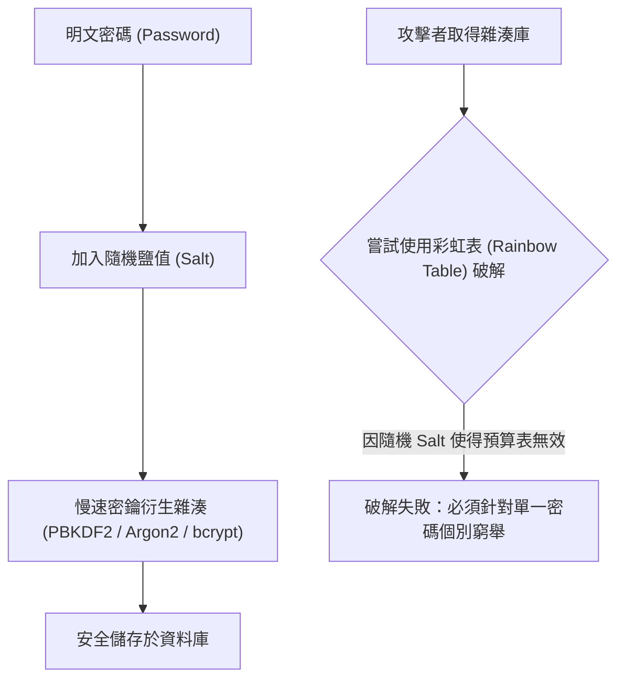

# 🎙️ CompTIA Security+ 頁01~18：密碼學攻擊手法、彩虹表碰撞與降級攻擊防禦 (授課講師 / 學員)

> **課程主題**：常見密碼破解攻擊、彩虹表運作原理與演算法弱點防護  
> **授課講師**：授課講師（資安與網路認證原廠認證講師）  
> **核心模組**：CompTIA Security+ Topic 6: Cryptographic Attacks & Weaknesses  
> **學習目標**：理解線上 vs. 離線密碼攻擊、掌握 Salt+Pepper 雜湊防護與抗碰撞要求  
> **關聯文件**：[📄 完整原話逐字稿 (2025-01-16-Lesson06-01-18-密碼學攻擊手法與演算法弱點-proofread.md)](./20250116-04-18-密碼學攻擊手法與演算法弱點.full.md)

---

## 🏛️ 核心架構與概念流轉圖

---

## 🔑 重點提要 (Key Takeaways)

1. **加鹽（Salting）關鍵價值**：Salt 破壞了預先計算雜湊表（Rainbow Table）的經濟效益，確保相同密碼之不同使用者擁有完全不同的雜湊值。
2. **密鑰延展函數（Key Stretching）**：使用 Argon2 或 PBKDF2 增加單次雜湊運算時間，有效遏制 GPU/ASIC 暴力破解速度。
---

## 🛡️ 密碼學攻擊手法、演算法弱點與前向保密性對照表

| 核心考點與維度 | 技術原理與協定運作機制 | 業界安全最佳實踐與防禦控制項 | 認證考試應試陷阱與排障關鍵 |
| :--- | :--- | :--- | :--- |
| **暴力破解、字典攻擊與彩虹表** | 暴力破解嘗試所有字元排列組合；字典攻擊遍歷常見密碼字庫；彩虹表（Rainbow Table）利用預先計算之雜湊鏈極速反查 | 防禦手段：**密碼加鹽（Salting，隨機亂數前綴）**徹底瓦解彩虹表反查優勢；採用高延展雜湊演算法（bcrypt, PBKDF2, Argon2） | 強制要求密碼複雜度並限制登入失敗次數，阻斷線上自動化爆破攻擊 |
| **生日攻擊與碰撞漏洞（MD5 / SHA-1）** | 源自生日悖論（Birthday Paradox）：僅需 $\sqrt{N}$ 次抽樣即具備 50% 碰撞機率；MD5 與 SHA-1 實務上已遭算力攻破碰撞防線 | 攻擊者可偽造具備相同雜湊值之惡意執行檔與合法憑證，實施中間人詐欺 | 全面汰除 MD5 與 SHA-1，系統全面升級為 SHA-256、SHA-512 或 SHA-3 系列演算法 |
| **降級攻擊與完全前向保密（PFS）** | POODLE 攻擊強制將 TLS 降級為具漏洞之 SSL 3.0；若未啟用 PFS，伺服器私鑰一旦在數年後外洩，過往側錄之全量加密流量將被全面解密 | 完全前向保密（PFS, Perfect Forward Secrecy）：使用 Ephemeral Diffie-Hellman（DHE/ECDHE）為每次工作階段生成臨時拋棄式金鑰 | 即便長期伺服器主私鑰遭盜取，亦無法解密過往已被攔截之歷史通訊封包 |

- **本單元核心綜述與實務指引**：CompTIA Security+ SY0-701 考核重心在於將理論原則（如縱深防禦、最小權限與 CIA 三要素）無縫轉化為具體的系統配置與威脅處置作業流程。考生在面對複雜案例題時，應始終優先識別資產邊界與潛在威脅向量，並依據標準控制項架構採取最適切之技術或管理防禦措施。
