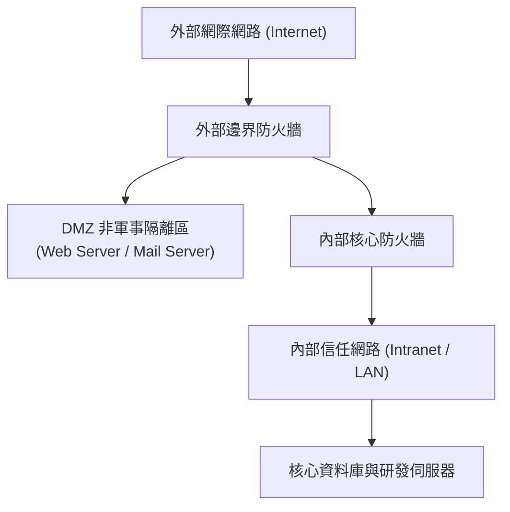

# 🎙️ CompTIA Security+ Part 2：安全架構設計、實體與邏輯網路邊界防護 (授課講師)

> **課程主題**：企業網路安全架構規劃與多層邊界防禦實務  
> **授課講師**：授課講師（資安與網路認證原廠認證講師）  
> **核心模組**：CompTIA Security+ Domain 2: Architecture and Design  
> **學習目標**：掌握 DMZ 隔離區規劃、內外網邊界安全與縱深防禦體系設計  
> **關聯文件**：[📄 完整原話逐字稿 (2025-01-17-Lesson05B-安全架構與邊界防護-proofread.md)](./20250117-01-B-安全架構與邊界防護.full.md)

---

## 🏛️ 核心架構與概念流轉圖

---

## 🔬 技術精華與核心考點解析

### DMZ 隔離區設計要點

- 對外公開服務（Web、Mail、DNS）必須置於 DMZ，嚴禁直接置於內部 LAN。
- 雙防火牆架構（Dual Firewall）：即使外部 Web 伺服器遭入侵提權，攻擊者仍受阻於第二道內部防火牆，無法直接刺探內部資料庫。

### 實體與邏輯安全控制

- 實體控制：機房門禁、監視器、訪客登記、機櫃上鎖與環境溫濕度監控。
- 邏輯控制：802.1Q VLAN 隔離、802.1X 網路存取控制（NAC）、ACL 與微隔離（Micro-segmentation）。

---

## 💡 關鍵總結與考試應對重點

1. **考試常考：何種伺服器適合放 DMZ？（答：需要直接接受網際網路未經身分驗證連線的服務）。**
1. **縱深防禦核心原則：任何單一控制措施（Control）失效時，不應導致整體系統全面淪陷。**
---

## 🛡️ 安全架構全域佈局、邊界防護與多層控制實務表

| 核心考點與維度 | 技術原理與協定運作機制 | 業界安全最佳實踐與防禦控制項 | 認證考試應試陷阱與排障關鍵 |
| :--- | :--- | :--- | :--- |
| **安全架構框架（NIST CSF / ISO 27001）** | NIST 網路安全框架五大核心功能：識別（Identify）、保護（Protect）、偵測（Detect）、回應（Respond）、復原（Recover） | 提供企業從技術、流程到人員之全方位資安能力成熟度評估標準 | 架構設計需由企業最高主管與董事會承諾支持，由上而下落實於日常作業規範 |
| **實體安全與環境控制措施** | 空調溫濕度控制（防止伺服器過熱與靜電損壞）、氣體滅火系統（FM-200，替代水損設備）、不斷電系統（UPS）與柴油發電機 | 雙迴路電力供應防範市電斷電；法拉第籠（Faraday Cage）阻絕電磁洩漏與外部 EMP 脈衝攻擊 | 實體出入口設置旋轉柵門（Turnstile）與捕人陷阱（Mantraps）防止未授權人員尾隨跟入 |
| **邊界防火牆與次世代檢驗** | 在網路周界佈建具備 DPI、應用程式識別、威脅防護與沙箱（Sandbox）分析能力之次世代防禦設備 | 結合反惡意軟體引擎與即時黑名單情資，對進出雙向流量實施嚴格審計 | 建立自動化連動防禦機制，於端點受害第一時間在邊界下發阻斷指令隔離威脅 |

- **本單元核心綜述與實務指引**：CompTIA Security+ SY0-701 考核重心在於將理論原則（如縱深防禦、最小權限與 CIA 三要素）無縫轉化為具體的系統配置與威脅處置作業流程。考生在面對複雜案例題時，應始終優先識別資產邊界與潛在威脅向量，並依據標準控制項架構採取最適切之技術或管理防禦措施。
