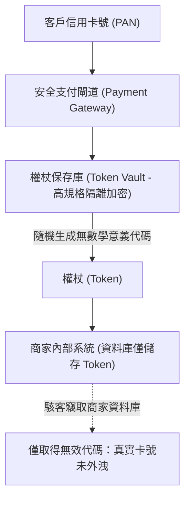

# 🎙️ CompTIA Security+ 頁21~27：資料遮蔽、權杖化技術與隱寫術（Steganography） (授課講師 / 學員)

> **課程主題**：資訊隱寫術（Steganography）、資料遮蔽與權杖化（Tokenization）  
> **授課講師**：授課講師（資安與網路認證原廠認證講師）  
> **核心模組**：CompTIA Security+ Topic 6: Data Obfuscation & Steganography  
> **學習目標**：識別機敏資料外洩之隱寫通道、掌握資料遮蔽手法與 PCI DSS 權杖化機制  
> **關聯文件**：[📄 完整原話逐字稿 (2025-01-17-Lesson06-21-27-資料隱碼混淆與隱寫術防護-proofread.md)](./20250117-02-27-資料隱碼混淆與隱寫術防護.full.md)

---

## 🏛️ 核心架構與概念流轉圖

---

## 🔑 重點提要 (Key Takeaways)

1. **權杖化（Tokenization） vs. 加密**：加密可透過演算法與金鑰解回明文；權杖化是由隨機代碼對應資料庫，代碼本身毫無數學可逆性，大幅縮小 PCI DSS 稽核範圍。
2. **隱寫術偵測**：隱寫術常被攻擊者用於機敏資料外洩（Exfiltration）或惡意酬載載入，需仰賴行為分析與異常雜湊檢測。
---

## 🛡️ 資料隱碼防護、混淆技術與隱寫術檢測對照表

| 核心考點與維度 | 技術原理與協定運作機制 | 業界安全最佳實踐與防禦控制項 | 認證考試應試陷阱與排障關鍵 |
| :--- | :--- | :--- | :--- |
| **SQL Injection（資料隱碼攻擊）與參數化查詢** | 未過濾輸入被拼接入 SQL 語法，攻擊者透過 `' OR 1=1 --` 繞過驗證、脫庫拖取機密資料或執行系統指令（xp_cmdshell） | 黃金防禦法則：全面採用**參數化查詢（Prepared Statements / Parameterized Queries）**與 ORM 框架 | 將資料與代碼嚴格分離，搭配最小資料庫帳號權限，阻絕任何二階注入可能 |
| **代碼混淆（Obfuscation）與逆向工程防護** | 利用變數重新命名（A/B/C 替換）、控制流平坦化（Control Flow Flattening）、字串動態加密增加靜態分析難度 | 常用於商業軟體防盜版與惡意軟體規避防毒引擎；藍隊使用反編譯器（Ghidra/IDA Pro）與動態調試器（x64dbg）逆向還原 | 混淆僅能「增加逆向時間成本」，無法提供絕對的保密性保證 |
| **隱寫術（Steganography）與隱蔽傳輸** | 將機密資料隱藏於多媒體載體（BMP/PNG 圖片之最低有效位 LSB、音訊頻譜或 TCP 標頭未使用欄位）之中，外觀毫無破綻 | 內部惡意員工常用於繞過資料外洩防護（DLP）系統私帶機密原始碼或客戶清單出境 | 透過統計分析（卡方檢定分析像素分佈）與檔案特徵結構比對進行隱寫偵測與淨化處理 |

- **本單元核心綜述與實務指引**：CompTIA Security+ SY0-701 考核重心在於將理論原則（如縱深防禦、最小權限與 CIA 三要素）無縫轉化為具體的系統配置與威脅處置作業流程。考生在面對複雜案例題時，應始終優先識別資產邊界與潛在威脅向量，並依據標準控制項架構採取最適切之技術或管理防禦措施。
