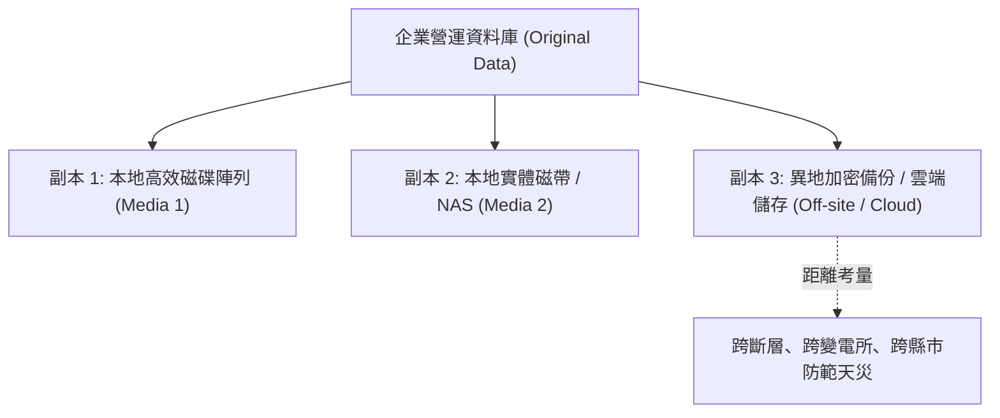

# 🎙️ CompTIA Security+ 頁06~17：3-2-1 備份黃金原則、異地備援距離與加密實務 (授課講師 / 學員)

> **課程主題**：3-2-1 備份原則、異地實體距離規劃與機敏備份加密保護  
> **授課講師**：授課講師（資安與網路認證原廠認證講師）  
> **核心模組**：CompTIA Security+ Topic 7: Backup Strategies & Redundancy  
> **學習目標**：落實 3-2-1 備份拓撲、理解區域性災害對異地距離之要求與加密存放  
> **關聯文件**：[📄 完整原話逐字稿 (2025-01-17-Lesson07-06-17-三二一備份原則與異地備援-proofread.md)](./20250117-03-17-三二一備份原則與異地備援.full.md)

---

## 🏛️ 核心架構與概念流轉圖

---

## 🔑 重點提要 (Key Takeaways)

1. **3-2-1 現代化延伸（3-2-1-1-0）**：加碼 1 份離線/不可變（Air-gapped / Immutable）副本，以及 0 個備份還原錯誤驗證。
2. **異地備援距離**：兩地距離不能僅設在同一園區隔壁棟，須考量地震、停電或淹水等區域天災，確保至少跨電網/跨地理區域。
---

## 🛡️ 三二一備份原則、儲存媒體與異地備援架構對照表

| 核心考點與維度 | 技術原理與協定運作機制 | 業界安全最佳實踐與防禦控制項 | 認證考試應試陷阱與排障關鍵 |
| :--- | :--- | :--- | :--- |
| **三二一備份黃金準則（3-2-1 Rule）** | 保存 **3 份**資料副本（1 份原始 + 2 份備份）；儲存於 **2 種**相異物理媒體（如磁碟陣列 + 磁帶/物件儲存）；至少 **1 份**存放於**異地（Offsite）** | 現代更進階演化為 **3-2-1-1-0 原則**：增加 1 份不可變（Immutable）或離線備份，且確保測試還原 0 錯誤 | 全面防禦本地機房火災、水患、地震及全域勒索軟體橫向感染全毀風險 |
| **完整備份 vs. 差異備份 vs. 增量備份** | 完整（Full）：備份全部資料；差異（Differential）：備份自上次 Full 後所有變更；增量（Incremental）：僅備份自上次備份後之變更 | 備份時間：Full 最慢，Incremental 最快；還原時間：Full 最快，Incremental 最慢（需 Full + 依序所有 Incremental） | 企業需權衡備份儲存成本與災難發生時之還原時間目標（RTO） |
| **冷備援、溫備援與熱備援中心（Cold / Warm / Hot Sites）** | 冷站（僅有場地水電網路，需手動購置安裝硬體，RTO 數週）；溫站（有硬體與部分設定，無最新即時資料，RTO 數天）；熱站（全鏡像即時同步，RTO 數秒至數分鐘） | 熱備援中心維運成本最高，但具備最高可用性，金融核心業務必備；冷備援成本極低但恢復時間漫長 | 依據業務衝擊分析（BIA）結果，為不同關鍵等級系統配置對應等級之備援站台 |

- **本單元核心綜述與實務指引**：CompTIA Security+ SY0-701 考核重心在於將理論原則（如縱深防禦、最小權限與 CIA 三要素）無縫轉化為具體的系統配置與威脅處置作業流程。考生在面對複雜案例題時，應始終優先識別資產邊界與潛在威脅向量，並依據標準控制項架構採取最適切之技術或管理防禦措施。
