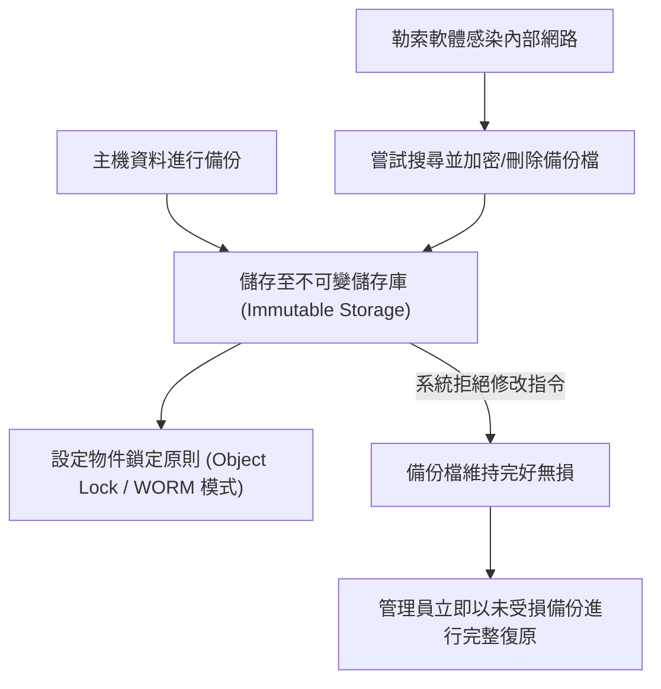

# 🎙️ CompTIA Security+ 頁31~40：快照技術、不可變備份（WORM）與勒索軟體防禦演練 (授課講師 / 學員)

> **課程主題**：不可變儲存（Immutable Backups）、快照機制與定期復原演練  
> **授課講師**：授課講師（資安與網路認證原廠認證講師）  
> **核心模組**：CompTIA Security+ Topic 7: Immutable Backups & Ransomware Defense  
> **學習目標**：防範勒索軟體破壞備份檔、建立 Write Once Read Many (WORM) 保護並落實驗證  
> **關聯文件**：[📄 完整原話逐字稿 (2025-01-17-Lesson07-31-40-不可變備份與系統快照驗證演練-proofread.md)](./20250117-05-40-不可變備份與系統快照驗證演練.full.md)

---

## 🏛️ 核心架構與概念流轉圖

---

## 🔑 重點提要 (Key Takeaways)

1. **不可變備份抗勒索**：現代勒索軟體會先潛伏並尋找備份系統刪除之。啟用 WORM 或 S3 Object Lock 確保即使擁有最高管理員權限也無法在設定期限內刪除或竄改。
2. **驗證勝於備份**：沒有經過成功還原測試的備份等於不存在，企業必須排程模擬災害演練確認資料可用。
---

## 🛡️ 不可變備份、磁碟快照驗證與勒索防禦復原表

| 核心考點與維度 | 技術原理與協定運作機制 | 業界安全最佳實踐與防禦控制項 | 認證考試應試陷阱與排障關鍵 |
| :--- | :--- | :--- | :--- |
| **不可變儲存（Immutable Storage / WORM）** | 一次寫入、多次讀取（Write Once, Read Many）；在預設保留期內，即便具備 Domain Admin 特權亦無法修改或刪除 | 直接摧毀勒索軟體「先加密備份、再撕票企業」的經典攻擊鏈，為勒索威脅下最後防線 | 雲端 S3 Object Lock 配合合規保留模式（Compliance Mode）為現代主流實現方案 |
| **快照機制（Snapshot）與磁帶冷備份** | 基於儲存層之寫入時複製（Copy-on-Write, CoW）或重新導向（Redirect-on-Write），秒級記錄磁碟區塊狀態 | 快照依賴底層實體儲存池，不可替代獨立實體備份；實體離線磁帶（Tape）具備物理氣隙（Air-gap）特性 | 定期將關鍵備份寫入磁帶並移送離線金庫保存，防範全網蠕蟲式無差別感染 |
| **備份資料完整性與自動還原驗證** | 多數企業只做備份卻從未測試還原，直到災難發生才發現備份檔案損毀或遺失金鑰無法解密 | 導入自動化沙盒驗證機制：定期排程將備份映像檔於隔離虛擬機開機、啟動服務並檢驗資料庫查詢 | 只有成功還原且資料無損的備份才算真正的備份，將備份可還原率納入 KPI 考核 |

- **本單元核心綜述與實務指引**：CompTIA Security+ SY0-701 考核重心在於將理論原則（如縱深防禦、最小權限與 CIA 三要素）無縫轉化為具體的系統配置與威脅處置作業流程。考生在面對複雜案例題時，應始終優先識別資產邊界與潛在威脅向量，並依據標準控制項架構採取最適切之技術或管理防禦措施。
