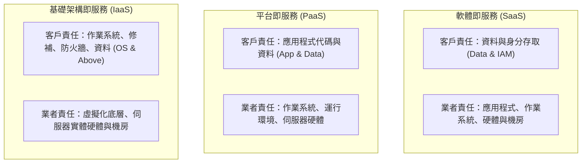

# 🎙️ CompTIA Security+ 頁11~13：雲端運算架構、共享責任模型（SRM）與安全配置 (授課講師 / 學員)

> **課程主題**：雲端運算服務架構、共享責任模型（SRM）與企業雲端安全控管  
> **授課講師**：授課講師（資安與網路認證原廠認證講師）  
> **核心模組**：CompTIA Security+ Topic 8: Cloud Models & Shared Responsibility  
> **學習目標**：釐清 IaaS/PaaS/SaaS 責任歸屬、掌握 CASB/CSPM 雲端合規監控  
> **關聯文件**：[📄 完整原話逐字稿 (2025-01-20-Lesson08-11-13-雲端共享責任模型與服務架構-proofread.md)](./20250120-02-13-雲端共享責任模型與服務架構.full.md)

---

## 🏛️ 核心架構與概念流轉圖

---

## 🔑 重點提要 (Key Takeaways)

1. **資料責任永遠在客戶**：無論使用 IaaS、PaaS 還是 SaaS，資料擁有權與法規合規性責任永遠歸屬於客戶企業本身。
2. **CASB 守門員角色**：雲端存取安全性代理（CASB）作為地端與雲端間的受控閘道，負責強制執行 DLP、身分認證與威脅防禦。
---

## 🛡️ 雲端共享責任模型、服務層級與安全控制劃分表

| 核心考點與維度 | 技術原理與協定運作機制 | 業界安全最佳實踐與防禦控制項 | 認證考試應試陷阱與排障關鍵 |
| :--- | :--- | :--- | :--- |
| **共享責任模型（Shared Responsibility Model）** | 雲端服務供應商（CSP）負責「雲端本身的安全性（Security OF the Cloud，實體機房、硬體、虛擬化底座）」 | 客戶企業負責「雲端內部的安全性（Security IN the Cloud，資料、身分驗證、作業系統修補、網路防火牆組態）」 | 不可誤以為將系統搬遷上雲即自動獲得百分之百安全，客戶端組態疏失佔雲端外洩之 90% 以上 |
| **IaaS vs. PaaS vs. SaaS 責任邊界劃分** | IaaS（基礎架構即服務，如 AWS EC2）：客戶需負責 Guest OS、修補、中介軟體與應用；PaaS（平台即服務，如 RDS）：CSP 負責 OS 修補，客戶負責代碼與資料 | SaaS（軟體即服務，如 M365）：CSP 負責底層全架構，客戶僅需負責「身分存取管理與資料權限分類」 | 層級越高 CSP 負擔越重，客戶控制彈性越小但維護成本大幅降低 |
| **雲端安全態勢管理（CSPM）與 CASB** | CSPM（Cloud Security Posture Management）：自動化掃描雲端資產組態漂移（如公開 S3 Bucket、全開 0.0.0.0/0 安全群組） | CASB（雲端存取安全代理）：監控企業員工對外部 SaaS 應用之存取，執行外發資料防洩露（DLP）與威脅防護 | 雲端原生安全工具（CNAPP）全面整合容器、無伺服器（Serverless）與基礎架構即代碼（IaC）掃描 |

- **本單元核心綜述與實務指引**：CompTIA Security+ SY0-701 考核重心在於將理論原則（如縱深防禦、最小權限與 CIA 三要素）無縫轉化為具體的系統配置與威脅處置作業流程。考生在面對複雜案例題時，應始終優先識別資產邊界與潛在威脅向量，並依據標準控制項架構採取最適切之技術或管理防禦措施。
