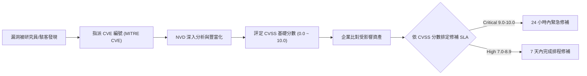

# 🎙️ CompTIA Security+ 頁29~36：弱點管理架構、CVE/NVD 資料庫與 CVSS 風險評分 (授課講師 / 學員)

> **課程主題**：弱點管理生命週期、CVE/NVD 資料庫與 CVSS 風險指標計算  
> **授課講師**：授課講師（資安與網路認證原廠認證講師）  
> **核心模組**：CompTIA Security+ Topic 8: Vulnerability Management & CVSS  
> **學習目標**：理解 CVE 識別碼體系、解讀 CVSS 向量字串並排定修補優先權  
> **關聯文件**：[📄 完整原話逐字稿 (2025-01-20-Lesson08-29-36-弱點評估架構與CVE資料庫-proofread.md)](./20250120-03-36-弱點評估架構與CVE資料庫.full.md)

---

## 🏛️ 核心架構與概念流轉圖

---

## 🔑 重點提要 (Key Takeaways)

1. **CVSS 指標三維度**：Base Metrics（固有弱點本質）、Temporal Metrics（是否有 Exploit 武器化流傳）、Environmental Metrics（在特定企業內之實際影響）。
2. **CWE vs. CVE**：CWE 為弱點型態分類（如 SQL Injection、Buffer Overflow）；CVE 則是特定軟體特定版本上的具體具名漏洞。
---

## 🛡️ 弱點評估架構、CVE/NVD 資料庫與 CVSS 評分對照表

| 核心考點與維度 | 技術原理與協定運作機制 | 業界安全最佳實踐與防禦控制項 | 認證考試應試陷阱與排障關鍵 |
| :--- | :--- | :--- | :--- |
| **通用弱點揭露（CVE）與國家漏洞庫（NVD）** | CVE 提供全球資安漏洞之標準化唯一識別代碼（格式: `CVE-YYYY-NNNNN`），消弭各廠商各自命名之混亂 | NVD 由美國 NIST 維護，針對 CVE 條目進行深度分析、關聯 CWE 弱點類別並計算標準化 CVSS 分數 | 安全維運團隊必備之漏洞情資索引庫，作為修補優先等級排程之核心依據 |
| **通用漏洞評分系統（CVSS v3.1 / v4.0）** | 基本分數（Base Metric, 0.0 - 10.0）：評估攻擊途徑（AV: 網路/本地）、複雜度（AC）、權限要求（PR）、使用者互動（UI）及 CIA 衝擊 | 分數級距：Low (0.1-3.9), Medium (4.0-6.9), High (7.0-8.9), Critical (9.0-10.0) | 實務需結合時間指標（Temporal）與環境指標（Environmental，內網隔離程度）計算真實業務風險 |
| **弱點評估週期（Vulnerability Lifecycle）** | 探索資產 $\to$ 漏洞掃描（Scanner） $\to$ 優先級排序（Prioritization） $\to$ 修補驗證（Remediation） $\to$ 復查緩解 | 單純看 CVSS 分數容易失真；需結合真實威脅情報（EPSS 預測利用率評分與 CISA KEV 已被在野利用清單）排定 Patch 優先順序 | 定期排程掃描與變更後即時觸發掃描並行，杜絕新上線系統帶有已知致命漏洞 |

- **本單元核心綜述與實務指引**：CompTIA Security+ SY0-701 考核重心在於將理論原則（如縱深防禦、最小權限與 CIA 三要素）無縫轉化為具體的系統配置與威脅處置作業流程。考生在面對複雜案例題時，應始終優先識別資產邊界與潛在威脅向量，並依據標準控制項架構採取最適切之技術或管理防禦措施。
