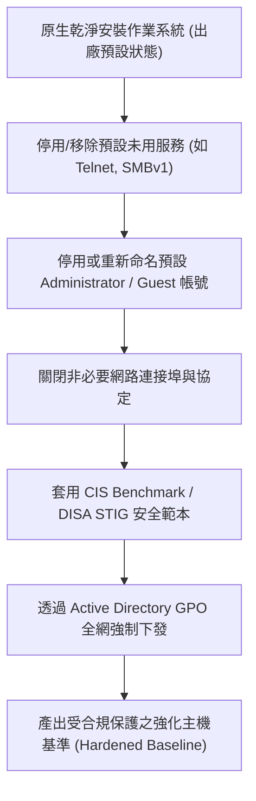

# 🎙️ CompTIA Security+ 頁04~20：作業系統安全強化（Hardening）、服務停用與基準配置 (授課講師 / 學員)

> **課程主題**：作業系統強化（OS Hardening）、服務最小化與 CIS 安全基準  
> **授課講師**：授課講師（資安與網路認證原廠認證講師）  
> **核心模組**：CompTIA Security+ Topic 9: Host Hardening & Baselines  
> **學習目標**：停用多餘服務、改寫不安全預設值，利用 GPO 落實企業安全 Baseline  
> **關聯文件**：[📄 完整原話逐字稿 (2025-01-20-Lesson09-04-20-主機安全強化與作業系統基準-proofread.md)](./20250120-04-20-主機安全強化與作業系統基準.full.md)

---

## 🏛️ 核心架構與概念流轉圖

---

## 🔑 重點提要 (Key Takeaways)

1. **預設安全（Secure by Default）**：絕不保留任何預設密碼、示範帳號或預設開放的管理埠號。
2. **CIS Benchmarks**：網路安全中心（CIS）發布的指引為國際公認之作業系統安全強化權威標準，可直接量化主機合規程度。
---

## 🛡️ 主機安全強化基準、CIS Benchmarks 與最小化攻擊面對照表

| 核心考點與維度 | 技術原理與協定運作機制 | 業界安全最佳實踐與防禦控制項 | 認證考試應試陷阱與排障關鍵 |
| :--- | :--- | :--- | :--- |
| **CIS 安全基準標準（CIS Benchmarks）** | 由網路安全中心（CIS）發布之全球權威系統加固標準指南，涵蓋 Windows、Linux、資料庫與網通設備 | 提供共識驅動之加固設定清單（包含密碼複雜度、未用服務停用、日誌稽核策略與特權存取限制） | 企業部署金鑰主機映像檔（Golden Image）時應強制通過 CIS Level 1 或 Level 2 稽核檢測 |
| **作業系統強化核心措施（OS Hardening）** | 1. 停用並解除安裝非必要軟體與常駐服務（如 Telnet, SMBv1, FTP）；2. 變更預設帳號名稱與關閉 Guest 帳戶；3. 限制遠端管理連線來源 IP | 啟用主機型本機防火牆（Windows Defender Firewall / iptables），嚴格限制進出通訊埠 | 即時套用原廠作業系統安全修補更新（Security Patches），排定零信任更新排程 |
| **最小功能化與安全性基準（Baseline）** | 伺服器應恪守單一職責原則（Single Role Principle），Web 主機嚴禁安裝編譯器或兼當檔案共享伺服器 | 建立並固化系統組態基準（Baseline）；透過組態管理工具（Ansible, Puppet）定期巡檢並自動糾偏漂移 | 任何對基準之變更必須走正式變更管理審查流程（Change Management），防止後門植入 |

- **本單元核心綜述與實務指引**：CompTIA Security+ SY0-701 考核重心在於將理論原則（如縱深防禦、最小權限與 CIA 三要素）無縫轉化為具體的系統配置與威脅處置作業流程。考生在面對複雜案例題時，應始終優先識別資產邊界與潛在威脅向量，並依據標準控制項架構採取最適切之技術或管理防禦措施。
