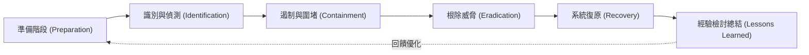

# 🎙️ CompTIA Security+ 頁37~43：事件應變生命週期（PICERL）、遏制根除與證據監管鏈 (授課講師 / 學員)

> **課程主題**：事件應變生命週期（PICERL）、遏制與根除處置、數位鑑識證據保全  
> **授課講師**：授課講師（資安與網路認證原廠認證講師）  
> **核心模組**：CompTIA Security+ Topic 12: Incident Response & Digital Forensics  
> **學習目標**：熟悉事件應變標準作業程序、掌握證據揮發性順序與法律監管鏈要求  
> **關聯文件**：[📄 完整原話逐字稿 (2025-01-22-Lesson12-37-43-資安事件應變流程與數位鑑識原則-proofread.md)](./20250122-02-43-資安事件應變流程與數位鑑識原則.full.md)

---

## 🏛️ 核心架構與概念流轉圖

---

## 🔑 重點提要 (Key Takeaways)

1. **證據揮發性順序（Order of Volatility）**：由最易消失至最持久：CPU 快取/暫存器 $\to$ 實體記憶體（RAM） $\to$ 網路狀態/核心快取 $\to$ 磁碟儲存 $\to$ 遠端日誌 $\to$ 實體備份。拔插頭前務必先做記憶體傾印！
2. **監管鏈（Chain of Custody）**：記載何人、何時、何因接觸過該數位證物，中途不得有斷裂，否則法院將判定證物失效不可採信。
---

## 🛡️ 資安事件應變流程 IRP、證據揮發性順序與數位鑑識表

| 核心考點與維度 | 技術原理與協定運作機制 | 業界安全最佳實踐與防禦控制項 | 認證考試應試陷阱與排障關鍵 |
| :--- | :--- | :--- | :--- |
| **事件應變六大生命週期（NIST / SANS Framework）** | 1. 準備（Preparation） $\to$ 2. 偵測與分析（Detection） $\to$ 3. 圍堵（Containment，短期/長期） $\to$ 4. 根除（Eradication） $\to$ 5. 復原（Recovery） $\to$ 6. 檢討事後學習（Lessons Learned） | 圍堵階段優先切斷受害主機網路連線，防止橫向擴散；根除階段全面清理後門帳號與重灌 Golden Image | 事後檢討會必須產出具體改進報告，修正資安防禦政策與偵測規則 |
| **證據揮發性順序（Order of Volatility）** | 由最易消失至最持久：**1. CPU 快取與暫存器 $\to$ 2. 實體記憶體（RAM） $\to$ 3. 網路狀態與核心快取 $\to$ 4. 硬碟與儲存媒體 $\to$ 5. 遠端日誌 $\to$ 6. 實體備份媒體** | 數位鑑識大忌：遭遇感染直接拔插頭斷電或重開機，這將導致揮發性記憶體中的無檔案惡意進程與解密金鑰永久滅失 | 第一時間必先以專用工具（FTK Imager, DumpIt, LiME）進行全實體記憶體傾印（Live Memory Dump） |
| **監管鏈（Chain of Custody）與法庭證據力** | 詳細記錄證據蒐集人、時間、地點、序列號、保管轉移記錄與雜湊值校驗碼（SHA-256） | 確保數位證據在法庭訴訟中未曾遭受人為變更或污染，維持證據之**完整性與真實性** | 鑑識分析永遠只能在唯讀複製的「證據映像檔（Forensic Image）」上操作，嚴禁直接碰觸原始硬碟 |

- **本單元核心綜述與實務指引**：CompTIA Security+ SY0-701 考核重心在於將理論原則（如縱深防禦、最小權限與 CIA 三要素）無縫轉化為具體的系統配置與威脅處置作業流程。考生在面對複雜案例題時，應始終優先識別資產邊界與潛在威脅向量，並依據標準控制項架構採取最適切之技術或管理防禦措施。
