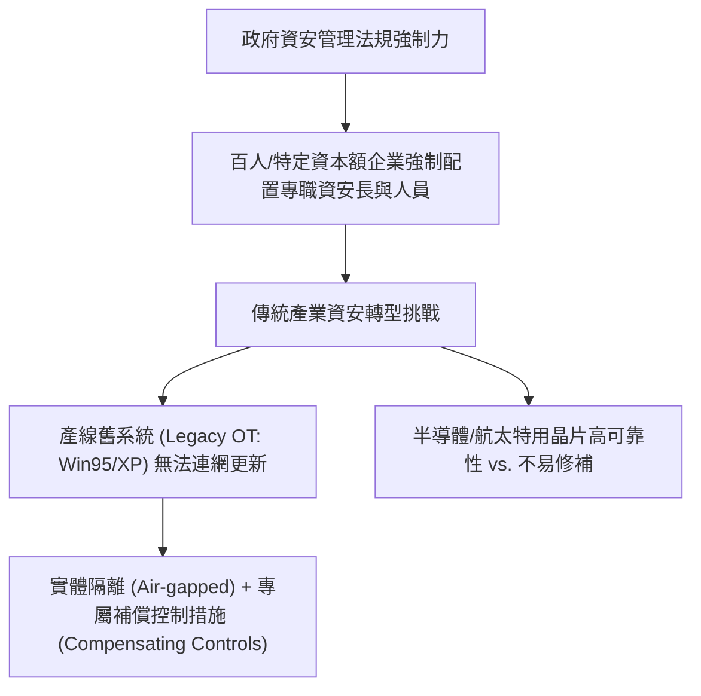

# 🎙️ CompTIA Security+ 頁01~06：企業資安人力配置、法規合規與舊版工控系統防護 (授課講師 / 學員)

> **課程主題**：傳產資安轉型現況、舊系統（Legacy/OT）防護挑戰與法規要求  
> **授課講師**：授課講師（資安與網路認證原廠認證講師）  
> **核心模組**：CompTIA Security+ Topic 13: Operational Technology & Legacy Security  
> **學習目標**：理解企業規模門檻資安人力法規、掌握半導體與航太舊架構補丁難題  
> **關聯文件**：[📄 完整原話逐字稿 (2025-01-22-Lesson13-01-06-傳統產業資安轉型與工控系統安全-proofread.md)](./20250122-03-06-傳統產業資安轉型與工控系統安全.full.md)

---

## 🏛️ 核心架構與概念流轉圖

---

## 🔑 重點提要 (Key Takeaways)

1. **舊系統維運現實**：許多高精密度半導體機台與航太系統運作於舊版 OS 上，無法直接升級或聯網修補，必須採用實體隔離與嚴格周邊設備管控。
2. **法規驅動資安就業**：政府法規強制要求中大型企業設置資安專責人員，帶動傳統產業強勁的資安合規人才需求。
---

## 🛡️ 傳統產業資安轉型、工控系統 OT/SCADA 安全架構表

| 核心考點與維度 | 技術原理與協定運作機制 | 業界安全最佳實踐與防禦控制項 | 認證考試應試陷阱與排障關鍵 |
| :--- | :--- | :--- | :--- |
| **資訊科技（IT）vs. 操作科技（OT）文化衝突** | IT 優先順序為 **C-I-A（機密性第一）**，系統可頻繁重開機修補更新；OT 優先順序為 **A-I-C（可用性第一）**，產線停機一分鐘損失數百萬 | 工控機台生命週期長達 10-20 年，內部常運行極老舊無修補之 Windows XP/7 嵌入式系統 | 傳統 IT 網管不可直接對 OT 產線下發自動化漏洞掃描，脆弱的 PLC 控制器極易直接當機停擺 |
| **普渡模型（Purdue Model）階層化工控防禦** | Level 0/1（實體製程/傳感器）；Level 2（控制層 PLC/DCS）；Level 3（操作監控 SCADA/MES）；Level 4/5（企業 IT 辦公網） | 在 IT（Level 4）與 OT（Level 3）之間必須建立嚴格的 **工業 DMZ（IDMZ）** 隔離通道 | 嚴禁辦公網路直通產線 PLC；所有跳板連線必須通過跳板機（Bastion Host）雙因子認證 |
| **傳統工控通訊協定缺陷（Modbus / DNP3）** | 傳統工控協定誕生於封閉時代，全數採用**明文傳輸、缺乏身分鑑別與防篡改校驗** | 攻擊者一旦切入內網即可輕易發送偽造控制指令（如震網 Stuxnet 攻擊操控離心機轉速） | 導入工控專用單向資料閘道（Data Diode，光閘）與 OT 深度封包檢驗 IDS，監控異常異常工控指令 |

- **本單元核心綜述與實務指引**：CompTIA Security+ SY0-701 考核重心在於將理論原則（如縱深防禦、最小權限與 CIA 三要素）無縫轉化為具體的系統配置與威脅處置作業流程。考生在面對複雜案例題時，應始終優先識別資產邊界與潛在威脅向量，並依據標準控制項架構採取最適切之技術或管理防禦措施。
