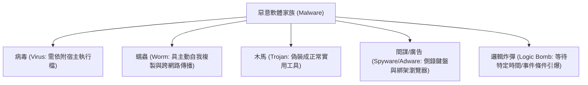

# 🎙️ CompTIA Security+ 頁07~14：惡意程式分類、廣告軟體（Adware）與特洛伊木馬潛伏 (授課講師 / 學員)

> **課程主題**：惡意軟體家族分類、廣告間諜軟體誘裝與後門潛伏機制  
> **授課講師**：授課講師（資安與網路認證原廠認證講師）  
> **核心模組**：CompTIA Security+ Topic 13: Malware Classifications & Indicators  
> **學習目標**：識別病毒/蠕蟲自我複製特性、掌握木馬偽裝手法與邏輯炸彈防範  
> **關聯文件**：[📄 完整原話逐字稿 (2025-01-22-Lesson13-07-14-惡意軟體特徵與間諜廣告軟體分析-proofread.md)](./20250122-04-14-惡意軟體特徵與間諜廣告軟體分析.full.md)

---

## 🏛️ 核心架構與概念流轉圖

---

## 🔑 重點提要 (Key Takeaways)

1. **病毒 vs. 蠕蟲本質差異**：病毒必須仰賴使用者點擊執行或宿主程式啟動；蠕蟲利用網路通訊協定弱點具備自主跨主機擴散能力。
2. **邏輯炸彈防禦**：多見於內部員工心懷不滿埋藏程式碼，須透過程式碼同儕審查（Peer Review）與離職停權機制防範。
---

## 🛡️ 惡意軟體特徵分類、間諜/廣告軟體分析與防禦表

| 核心考點與維度 | 技術原理與協定運作機制 | 業界安全最佳實踐與防禦控制項 | 認證考試應試陷阱與排障關鍵 |
| :--- | :--- | :--- | :--- |
| **病毒、蠕蟲與特洛伊木馬分野** | 病毒（Virus）：必須依附於宿主執行檔，需人類點擊執行方能傳播；蠕蟲（Worm）：獨立運行，具備網路自動掃描與自主自我複製傳播能力 | 特洛伊木馬（Trojan）：偽裝成正常合法工具（如破解器、遊戲外掛），誘騙使用者執行後暗中開啟後門 | 蠕蟲能於數分鐘內癱瘓全球網路（如 WannaCry 利用 MS17-010 漏洞橫向感染） |
| **間諜軟體、廣告軟體與鍵盤側錄器** | 間諜軟體（Spyware）：暗中監控鍵盤輸入、竊取瀏覽器儲存之密碼與 Session Cookie，回傳 C2 伺服器 | 廣告軟體（Adware）：強制彈出廣告、篡改瀏覽器首頁與搜尋引擎，消耗系統資源並引流至惡意網站 | 鍵盤側錄器（Keylogger）包含軟體 API 鉤子（Hooking）與實體 USB 硬體硬體硬體插頭 |
| **Rootkit 與邏輯炸彈（Logic Bomb）** | Rootkit：深植於作業系統核心（Kernel-mode）或 UEFI 韌體，主動攔截 API 調用，隱匿自身處理序、檔案與網路連線 | 邏輯炸彈：在特定條件觸發（如特定日期時間、特定帳號遭刪除時）引爆之惡意破壞程式碼 | Rootkit 需使用專用離線 PE 開機掃描檢測；邏輯炸彈防範仰賴嚴格代碼審查與職務代理雙人把關 |

- **本單元核心綜述與實務指引**：CompTIA Security+ SY0-701 考核重心在於將理論原則（如縱深防禦、最小權限與 CIA 三要素）無縫轉化為具體的系統配置與威脅處置作業流程。考生在面對複雜案例題時，應始終優先識別資產邊界與潛在威脅向量，並依據標準控制項架構採取最適切之技術或管理防禦措施。
