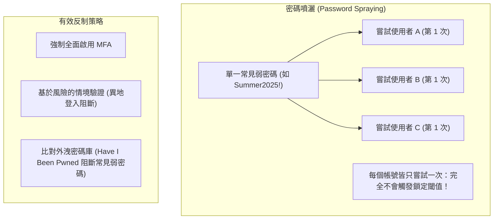

# 🎙️ CompTIA Security+ 頁22~25：線上密碼破解手法、密碼噴灑（Spraying）與憑證填充防護 (授課講師 / 學員)

> **課程主題**：線上密碼攻擊手法、密碼噴灑技術與防範外洩憑證填充  
> **授課講師**：授課講師（資安與網路認證原廠認證講師）  
> **核心模組**：CompTIA Security+ Topic 13: Password Attacks & Credential Stuffing  
> **學習目標**：理解密碼噴灑如何繞過「連續錯三次鎖定」、部署 MFA 與行為驗證遏止攻擊  
> **關聯文件**：[📄 完整原話逐字稿 (2025-01-23-Lesson13-22-25-線上密碼攻擊與憑證填充防護-proofread.md)](./20250123-01-25-線上密碼攻擊與憑證填充防護.full.md)

---

## 🏛️ 核心架構與概念流轉圖

---

## 🔑 重點提要 (Key Takeaways)

1. **密碼噴灑巧妙處**：傳統暴力破解是對「單一帳號嘗試千百種密碼」（立即鎖定）；密碼噴灑則是對「千百個帳號嘗試同一組常見密碼」，完美隱藏在正常登入雜訊中。
2. **憑證填充根源**：利用大眾「跨站使用同一組帳密」之壞習慣，拿暗網外洩的帳密庫自動化撞庫。
---

## 🛡️ 線上密碼攻擊模式、憑證填充與防禦控制對照表

| 核心考點與維度 | 技術原理與協定運作機制 | 業界安全最佳實踐與防禦控制項 | 認證考試應試陷阱與排障關鍵 |
| :--- | :--- | :--- | :--- |
| **線上爆破 vs. 憑證填充（Credential Stuffing）** | 線上暴力破解針對單一帳號狂試密碼，極易觸發帳號鎖定；憑證填充利用外部外洩之數十億帳密名單，對目標網站大量自動化撞庫 | 使用者跨平台重複使用相同密碼之惡習，為憑證填充攻擊能夠屢屢得手之核心主因 | 企業需結合 WAF 監控異常大量登入請求，比對已知外洩帳密庫進行強制重設密碼 |
| **密碼噴灑攻擊（Password Spraying）** | 「低速且橫向」：使用 1-2 個極常見弱密碼（如 `Spring2025!`），橫向嘗試組織內成千上萬個使用者帳號 | 巧妙規避「單一帳號密碼錯誤 3-5 次即鎖定」之傳統帳號鎖定門檻，長期潛伏極難被警覺 | 實施高強度長密碼政策（Passphrase 替代複雜短密碼），並強制關鍵帳號全面啟用抗釣魚 MFA |
| **防禦控制措施（CAPTCHA、速率限制與鎖定機制）** | 在登入介面部署驗證碼（Cloudflare Turnstile, reCAPTCHA）阻斷自動化殭屍腳本 | 實施 IP 與工作階段速率限制（Rate Limiting），對短時間異常高頻嘗試動態封鎖或延長延遲 | 帳號鎖定政策需平衡可用性，避免全公司帳號遭攻擊者惡意大量輸入錯誤密碼引發 DoS 癱瘓 |

- **本單元核心綜述與實務指引**：CompTIA Security+ SY0-701 考核重心在於將理論原則（如縱深防禦、最小權限與 CIA 三要素）無縫轉化為具體的系統配置與威脅處置作業流程。考生在面對複雜案例題時，應始終優先識別資產邊界與潛在威脅向量，並依據標準控制項架構採取最適切之技術或管理防禦措施。
