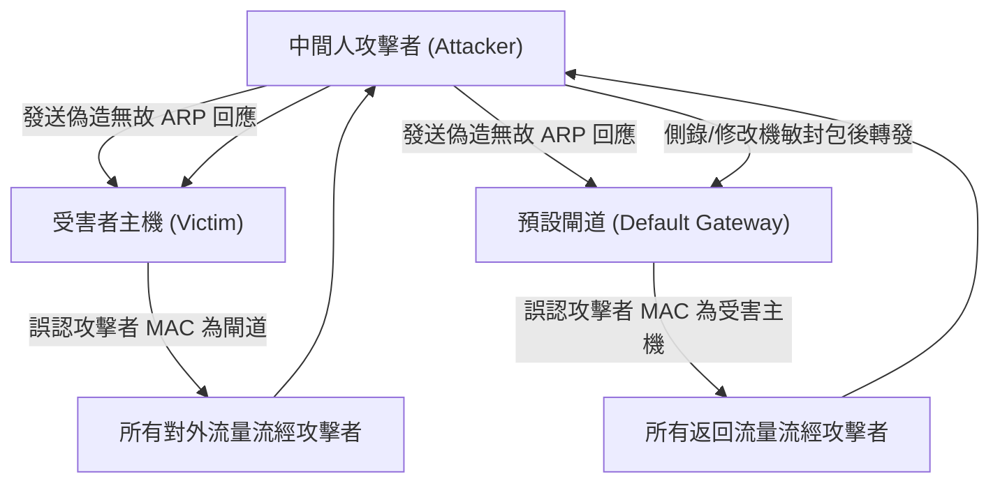

# 🎙️ CompTIA Security+ 頁26~32：網路層中間人攻擊（MitM）、ARP 欺騙毒化與 Rogue DHCP 防禦 (授課講師 / 學員)

> **課程主題**：局域網中間人攻擊（MitM）、ARP 快取毒化與交換器二層防護實務  
> **授課講師**：授課講師（資安與網路認證原廠認證講師）  
> **核心模組**：CompTIA Security+ Topic 13: Layer 2 Network Attacks & MitM  
> **學習目標**：剖析 ARP Spoofing 劫持流量機制、配置 DHCP Snooping 與 DAI 交換器防護  
> **關聯文件**：[📄 完整原話逐字稿 (2025-01-23-Lesson13-26-32-網路中間人攻擊與ARP毒化防禦-proofread.md)](./20250123-02-32-網路中間人攻擊與ARP毒化防禦.full.md)

---

## 🏛️ 核心架構與概念流轉圖

---

## 🔑 重點提要 (Key Takeaways)

1. **ARP 協定先天無驗證**：ARP 設計上信任所有接收到的 ARP Reply，導致局域網任何一台電腦都能聲稱自己是 Gateway。
2. **DHCP Snooping + DAI 鐵三角**：交換器啟用 DHCP Snooping 建立 IP-MAC-Port 綁定表，動態 ARP 檢驗（DAI）即以此表為基準丟棄非法 ARP 封包。
---

## 🛡️ 網路中間人攻擊、ARP 毒化與防護技術對照表

| 核心考點與維度 | 技術原理與協定運作機制 | 業界安全最佳實踐與防禦控制項 | 認證考試應試陷阱與排障關鍵 |
| :--- | :--- | :--- | :--- |
| **ARP 欺騙與毒化（ARP Spoofing / Poisoning）** | ARP 協定缺乏身分驗證；攻擊者在局域網發送偽造無故 ARP 回應（Gratuitous ARP），聲稱「我是預設閘道」 | 篡改交換器與目標主機的 ARP 快取表，將全網流量劫持導向攻擊者主機進行側錄或竄改 | 防禦技術：交換器啟用**動態 ARP 檢查（DAI, Dynamic ARP Inspection）**結合 DHCP Snooping 綁定表 |
| **DNS 欺騙與快取毒化（DNS Cache Poisoning）** | 攻擊者偽造 DNS 回應封包污染遞迴 DNS 伺服器之快取，將知名網域名稱解析至惡意釣魚伺服器 IP | 使用者瀏覽器網址列顯示正確合法網域名稱，但連線實體卻已遭到掉包劫持 | 防禦手段：全面部署 **DNSSEC（網域名稱系統安全延伸）**，透過加密數位簽章驗證 DNS 紀錄之真實性 |
| **SSL 剝離（SSL Stripping）與 HSTS 防禦** | 攻擊者攔截客戶端連線，與伺服器維持 HTTPS 連線，但向客戶端降級回送明文 HTTP 頁面，使流量全裸奔 | 使用者未察覺瀏覽器鎖頭遺失，輸入之帳密與信用卡全數在明文 HTTP 中遭側錄 | 防禦手段：啟用 **HSTS（HTTP 嚴格傳輸安全協定）**，強制瀏覽器僅能以 HTTPS 發起連線，杜絕降級 |

- **本單元核心綜述與實務指引**：CompTIA Security+ SY0-701 考核重心在於將理論原則（如縱深防禦、最小權限與 CIA 三要素）無縫轉化為具體的系統配置與威脅處置作業流程。考生在面對複雜案例題時，應始終優先識別資產邊界與潛在威脅向量，並依據標準控制項架構採取最適切之技術或管理防禦措施。
