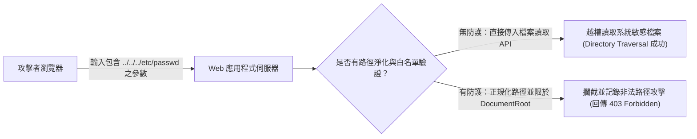

# 🎙️ CompTIA Security+ 頁01~09：Web 應用程式攻擊面、目錄遍歷（Directory Traversal）與注入防禦 (授課講師 / 學員)

> **課程主題**：Web 應用程式安全、目錄遍歷（Directory Traversal）與注入攻擊防護  
> **授課講師**：授課講師（資安與網路認證原廠認證講師）  
> **核心模組**：CompTIA Security+ Topic 14: Web Application Vulnerabilities  
> **學習目標**：理解目錄周遊路徑解析漏洞、掌握 WAF 過濾與嚴格白名單輸入驗證  
> **關聯文件**：[📄 完整原話逐字稿 (2025-01-23-Lesson14-01-09-Web應用程式漏洞與目錄周遊防禦-proofread.md)](./20250123-03-09-Web應用程式漏洞與目錄周遊防禦.full.md)

---

## 🏛️ 核心架構與概念流轉圖

---

## 🔑 重點提要 (Key Takeaways)

1. **目錄遍歷本質**：利用作業系統之相對路徑符號（`../`）逃逸出 Web Server 的根目錄限制，存取未經授權之主機系統設定檔。
2. **根本防禦思維**：絕不可將使用者傳入的字串直接拼接為作業系統指令或檔案路徑，必須進行 Canonicalization（路徑規範化）與白名單限制。
---

## 🛡️ Web 應用程式漏洞、目錄周遊與 OWASP 防禦表

| 核心考點與維度 | 技術原理與協定運作機制 | 業界安全最佳實踐與防禦控制項 | 認證考試應試陷阱與排障關鍵 |
| :--- | :--- | :--- | :--- |
| **目錄周遊（Directory Traversal / Path Traversal）** | 未過濾路徑參數，攻擊者傳送包含 `../../../../etc/passwd` 或 `..\..\boot.ini` 之相對路徑序列 | 穿透網頁根目錄限制，讀取伺服器內部機密系統設定檔、原始碼或資料庫連線字串 | 防禦措施：白名單硬性映射檔案 ID；在程式碼層調用標準庫路徑解析函數驗證絕對路徑是否超出合法根目錄 |
| **跨站腳本攻擊（XSS：Stored / Reflected / DOM-based）** | 攻擊者將惡意 JavaScript 腳本注入網頁；當受害者瀏覽時，腳本在受害瀏覽器執行，竊取 Session Cookie 或代發請求 | 儲存型（Stored XSS）存入資料庫，危害最廣；反射型（Reflected）藏於惡意連結參數中 | 防禦手段：對所有使用者輸入實施上下文相關之 **HTML 實體編碼（Encoding）**，並設定 Cookie `HttpOnly` 旗標 |
| **跨站請求偽造（CSRF）與 SameSite Cookie** | 利用受害者已登入目標網站之有效身分，誘騙其點擊惡意頁面，在背景偽造發送轉帳或修改密碼請求 | 伺服器無法區分該請求究竟是使用者本人自願發起或由惡意網頁第三方觸發 | 防禦手段：表單導入隨機一次性 **CSRF Token** 驗證；將重要 Session Cookie 設定 `SameSite=Strict` 或 `Lax` |

- **本單元核心綜述與實務指引**：CompTIA Security+ SY0-701 考核重心在於將理論原則（如縱深防禦、最小權限與 CIA 三要素）無縫轉化為具體的系統配置與威脅處置作業流程。考生在面對複雜案例題時，應始終優先識別資產邊界與潛在威脅向量，並依據標準控制項架構採取最適切之技術或管理防禦措施。
