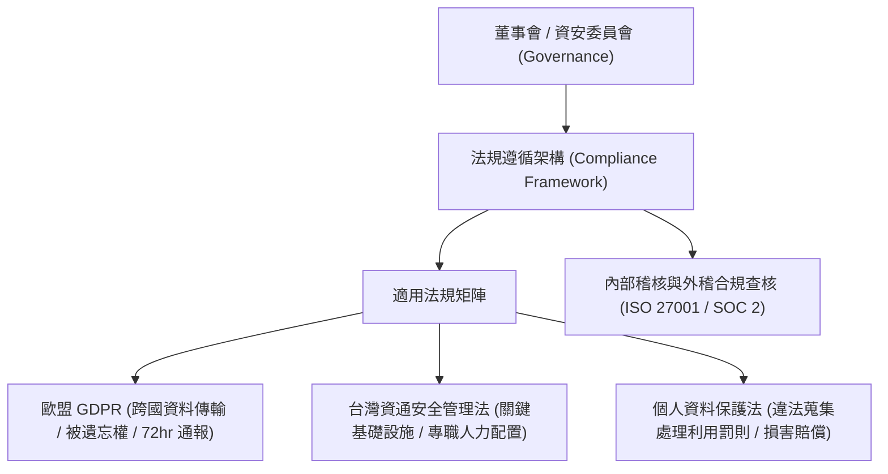

# 🎙️ CompTIA Security+ 頁10~25：法規遵循框架、GDPR、台灣資通安全管理法與個資法 (授課講師 / 學員)

> **課程主題**：資安合規框架、歐盟 GDPR 隱私規範與台灣資安法制實務  
> **授課講師**：授課講師（資安與網路認證原廠認證講師）  
> **核心模組**：CompTIA Security+ Topic 14: Compliance, Governance & Privacy Laws  
> **學習目標**：理解資通安全管理法 A~E 分級責任、個資法侵害民刑事風險與內部稽核  
> **關聯文件**：[📄 完整原話逐字稿 (2025-01-23-Lesson14-10-25-法規遵循框架與台灣資安法個資法實務-proofread.md)](./20250123-04-25-法規遵循框架與台灣資安法個資法實務.full.md)

---

## 🏛️ 核心架構與概念流轉圖

---

## 🔑 重點提要 (Key Takeaways)

1. **資安法責任分級**：公務機關與特定非公務機關（關鍵基礎設施）依 A、B、C、D、E 級承擔不同等級的資安人員配置、通報時限與演練責任。
2. **GDPR 巨額罰款**：最高可達全球營業額 4% 或 2000 萬歐元，倒逼全球企業全面重構資料隱私保護架構。
---

## 🛡️ 資安法規遵循框架、GDPR 與台灣資通安全法實務表

| 核心考點與維度 | 技術原理與協定運作機制 | 業界安全最佳實踐與防禦控制項 | 認證考試應試陷阱與排障關鍵 |
| :--- | :--- | :--- | :--- |
| **歐盟通用資料保護規則（GDPR）關鍵要求** | 被遺忘權（Right to be Forgotten）、資料可攜權、隱私設計（Privacy by Design）與預設隱私保護 | 發生重大個人資料外洩事故時，必須於 **72 小時內**正式通報主管監管機關與受影響當事人 | 違規最高可處以 2,000 萬歐元或全球年營業額 4% 之巨額罰鍰，為跨國企業合規重中之重 |
| **台灣《資通安全管理法》關鍵實務** | 納管公務機關與特定非公務機關（關鍵基礎設施提供者、公營事業、政府捐助之財團法人） | 依資通安全責任等級（A/B/C/D/E 級）劃分，A 級機關需建置專責資安單位、導入 ISMS 並每年完成紅隊演練 | 發生第一級至第四級資通安全事件時，必須依規定期限（1 小時內通報，特定時間內完成應變復原）通報主管機關 |
| **合規性稽核與持續遵循（Compliance Governance）** | 合規為基準低標而非終點；單純應付合規表單容易陷入虛假安全感，忽視前線在野威脅實務 | 建立定期內部稽核制度、供應鏈合規評鑑與隱私影響評估（PIA） | 資安人員需具備解讀跨國法規條文與將其轉化為工程控制項（Engineering Controls）之跨領域協調能力 |

- **本單元核心綜述與實務指引**：CompTIA Security+ SY0-701 考核重心在於將理論原則（如縱深防禦、最小權限與 CIA 三要素）無縫轉化為具體的系統配置與威脅處置作業流程。考生在面對複雜案例題時，應始終優先識別資產邊界與潛在威脅向量，並依據標準控制項架構採取最適切之技術或管理防禦措施。
