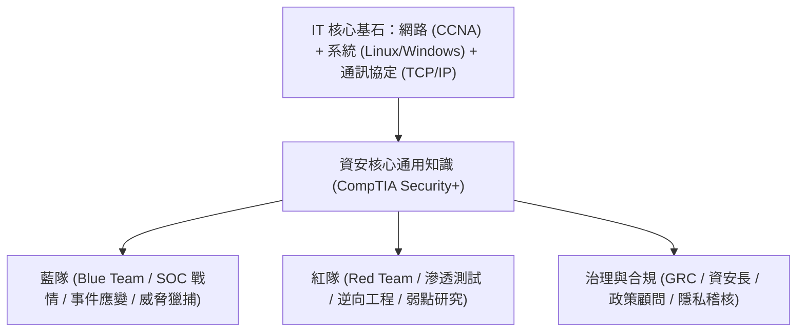

# 🎙️ CompTIA Security+ 頁01~13：資安專業職涯地圖、算力發展高原與不可替代核心技能 (授課講師 / 學員)

> **課程主題**：資安專業職涯規劃、AI 發展趨勢與底層網路系統不可替代價值  
> **授課講師**：授課講師（資安與網路認證原廠認證講師）  
> **核心模組**：CompTIA Security+ Topic 15: Career Pathways & Industry Trends  
> **學習目標**：建立長遠資安技能樹、掌握紅藍隊專業分工與核心通訊底層技術  
> **關聯文件**：[📄 完整原話逐字稿 (2025-01-23-Lesson15-01-13-資安工程師職涯發展與技能高原突破-proofread.md)](./20250123-05-13-資安工程師職涯發展與技能高原突破.full.md)

---

## 🏛️ 核心架構與概念流轉圖

---

## 🔑 重點提要 (Key Takeaways)

1. **底層技術永遠長青**：即使 AI 時代工具更迭劇烈，真正深刻理解作業系統核心、封包結構與交換路由的工程師永遠無法被輕易取代。
2. **T 型人才發展**：先以 Security+ 建立資安通識之廣度（橫杠），再挑選熱愛之專精領域（縱深）鑽研原廠進階證照。
---

## 🛡️ 資安工程師職涯發展、技能矩陣與高原期突破表

| 核心考點與維度 | 技術原理與協定運作機制 | 業界安全最佳實踐與防禦控制項 | 認證考試應試陷阱與排障關鍵 |
| :--- | :--- | :--- | :--- |
| **藍隊（防禦防守）職涯路徑與核心技能** | SOC 分析師 $\to$ 資安工程師 $\to$ 威脅獵捕專家 $\to$ 資安架構師；精通 SIEM 規則編寫、日誌分析、EDR 運作與取證鑑識 | 需具備極高的耐心與細膩度，在海量告警日誌中抽絲剝繭捕捉微弱的攻擊信號 | 考取 CompTIA Security+、CySA+、CASP+、BTL1 等藍隊實戰專業認證奠定職涯根基 |
| **紅隊（滲透攻防）職涯路徑與實戰歷練** | 弱點評估員 $\to$ 滲透測試工程師 $\to$ 紅隊算子；精通逆向工程、Web 漏洞挖掘、內網滲透、免殺繞過與社交工程 | 重視思維突破常規框架，專注尋找系統最脆弱的單點破口，繪製完整攻擊路徑 | 積極參與 CTF 競賽、HackTheBox、TryHackMe 演練，並考取 OSCP/PNPT 實機認證 |
| **技能高原期突破與管理視野升級** | 單純死記指令與工具使用極易遭遇職涯瓶頸；必須深入理解作業系統底層（OS Internals）、網路通訊協定與代碼邏輯 | 中高階轉型關鍵：從單一漏洞思維上升至「企業風險治理、成本效益評估與跨部門溝通談判」軟實力 | 以終為始規劃職涯，成為兼具技術攻防硬底子與商業治理高度之全方位資安專家 |

- **本單元核心綜述與實務指引**：CompTIA Security+ SY0-701 考核重心在於將理論原則（如縱深防禦、最小權限與 CIA 三要素）無縫轉化為具體的系統配置與威脅處置作業流程。考生在面對複雜案例題時，應始終優先識別資產邊界與潛在威脅向量，並依據標準控制項架構採取最適切之技術或管理防禦措施。
