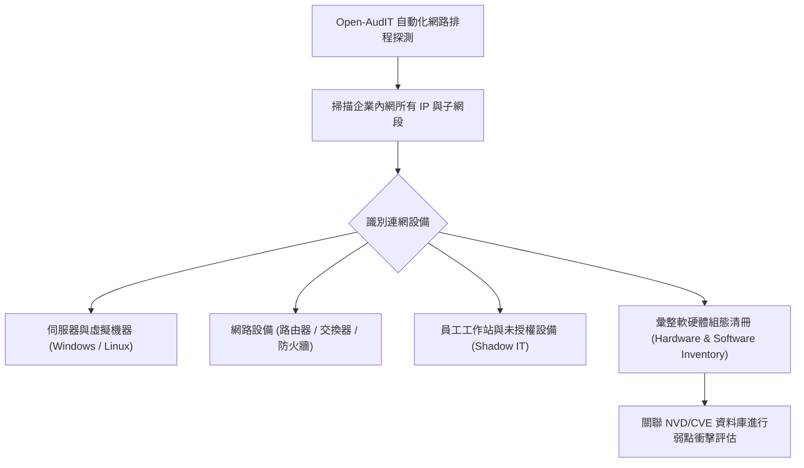

# 🎙️ CompTIA Security+ 專題延伸：開源資產管理工具、資訊資產生命週期與漏洞關聯分析 (授課講師 / 學員)

> **課程主題**：資訊資產盤點、開源 Open-AudIT 自動化探測與 Shadow IT 防範  
> **授課講師**：授課講師（資安與網路認證原廠認證講師）  
> **核心模組**：CompTIA Security+ Asset Management & Inventory Discovery  
> **學習目標**：部署自動化資產盤點系統、掌握 CIS Control #1/#2 資產清單建置要求  
> **關聯文件**：[📄 完整原話逐字稿 (20250124-03-開源資產管理工具與企業軟體盤點.full.md)](./20250124-03-開源資產管理工具與企業軟體盤點.full.md)

---

## 🏛️ 核心架構與概念流轉圖

---

## 🔑 重點提要 (Key Takeaways)

1. **CIS 關鍵控制項第一條**：CIS Controls 第一項即為「企業資產盤點與控制」，無法掌握全網設備就無法確保邊界安全。
2. **影子 IT（Shadow IT）威脅**：部門私自架設未報備的伺服器或使用未受控 SaaS，往往因缺乏安全補丁成為駭客入侵的第一個跳板。
---

## 🛡️ 開源資產管理、軟體清單盤點與影子 IT 防禦表

| 核心考點與維度 | 技術原理與協定運作機制 | 業界安全最佳實踐與防禦控制項 | 認證考試應試陷阱與排障關鍵 |
| :--- | :--- | :--- | :--- |
| **軟體物料清單（SBOM, Software Bill of Materials）** | 詳細列出應用程式內部包含之所有第三方開源依賴庫、元件名稱、版本號與授權協議清單 | 當爆發重大供應鏈漏洞（如 Log4j / XZ Utils）時，能於數分鐘內精確檢索企業全庫何處包含受害模組 | 現代 DevSecOps 與美國聯邦行政命令強制要求之軟體交付核心合規標準 |
| **開源資產管理工具（Snipe-IT, GLPI）** | 集中記錄硬體設備序號、MAC 位址、購買日期、指派保管員工與目前所在物理位置 | 與 Active Directory / LDAP 整合自動同步員工異動，即時反映設備離職員工回收狀態 | 徹底告別凌亂 Excel 人工作業，消弭幽靈資產與未受管主機之安全盲區 |
| **影子 IT（Shadow IT）盤點與風險收斂** | 員工未經 IT 部門核准授權私自採購或使用的雲端服務（如私人 Dropbox、未授權 AI 工具、外部免空） | 容易造成內部商業機密、原始碼與客戶個資在不受控狀態下外洩至外部公網 | 透過 CASB 與代理伺服器流量審計主動偵測未授權 SaaS 存取，將合規工具導入正規支援管道 |

- **本單元核心綜述與實務指引**：CompTIA Security+ SY0-701 考核重心在於將理論原則（如縱深防禦、最小權限與 CIA 三要素）無縫轉化為具體的系統配置與威脅處置作業流程。考生在面對複雜案例題時，應始終優先識別資產邊界與潛在威脅向量，並依據標準控制項架構採取最適切之技術或管理防禦措施。
