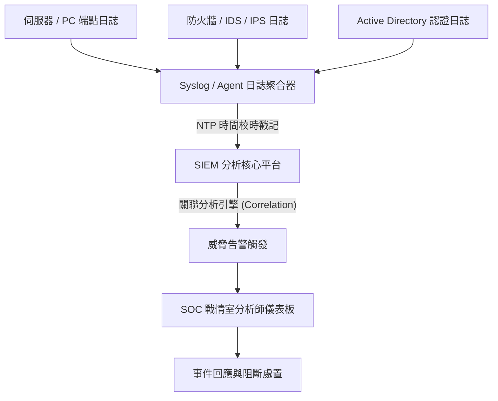

# 🎙️ CompTIA Security+：資安日誌記錄器、SIEM 架構與 SOC 戰情室事件監控 (授課講師)

> **課程主題**：企業級日誌聚合、SIEM 關聯分析與資安維運中心（SOC）威脅偵測實務  
> **授課講師**：授課講師（資安與網路認證原廠認證講師）  
> **核心模組**：CompTIA Security+ Domain 4: Operations and Incident Response  
> **學習目標**：掌握端點與網路日誌收集標準、SIEM 關聯規則設定與 NTP 時間同步之關鍵性  
> **關聯文件**：[📄 完整原話逐字稿 (2025-01-24-Lesson12-SIEM與SOC戰情室-proofread.md)](./20250124-04-SIEM與SOC戰情室.full.md)

---

## 🏛️ 核心架構與概念流轉圖

---

## 🔬 技術精華與核心考點解析

### 日誌收集與時間同步（NTP）之致命重要性

- 所有日誌來源主機必須強制設定 NTP（Network Time Protocol）同步至可信時間源。
- 若日誌時鐘偏差，不同設備產生的事件時間序將錯亂，導致 SIEM 無法建立因果關聯鏈，且在法律鑑識上失去證據效力。

### SIEM 關聯分析（Correlation）價值

- 單一防火牆連線被擋可能只是日常雜訊，單一帳號密碼輸錯可能只是忘記密碼；但若『短時間內 100 次登入失敗 ＋ 隨後成功登入 ＋ 隨即觸發非辦公時間海量外送連線』，SIEM 關聯規則將立刻判定為暴力破解成功並觸發 P1 緊急警報。

---

## 💡 關鍵總結與考試應對重點

1. **考試常考：日誌鑑識與跨設備關聯分析的第一前提是什麼？（答：嚴格精準的 NTP 時間同步）。**
1. **Write Once Read Many (WORM) 儲存裝置常用於封存日誌，確保日誌具備防竄改性（Tamper-proof）。**
---

## 🛡️ SIEM 與 SOC 戰情室架構、日誌關聯與告警調優表

| 核心考點與維度 | 技術原理與協定運作機制 | 業界安全最佳實踐與防禦控制項 | 認證考試應試陷阱與排障關鍵 |
| :--- | :--- | :--- | :--- |
| **安全資訊與事件管理（SIEM）核心運作** | 集中收集全網防火牆、交換器、Windows Event、Linux Syslog、EDR 與雲端稽核日誌 | 執行正規化（Normalization）、時間戳對齊與跨資料源多維度關聯分析規則（Correlation Rules） | 提供 SOC 分析師全網安全態勢之單一全景監控儀表板（Single Pane of Glass） |
| **SOC 一線與二線分析師分工協作** | Tier 1（分類與分流）：7x24 即時監控告警，初步判定真假陽性（True/False Positive），完成工單記錄 | Tier 2（深度調查）：接手高風險複雜事故，執行記憶體與網路取證，擬定圍堵根除方案 | Tier 3 / Threat Hunter：主動威脅獵捕，編寫全新偵測邏輯，反饋優化 SIEM 關聯規則 |
| **告警疲勞（Alert Fatigue）與 SOAR 自動化聯防** | 無效告警充斥會麻痺分析師注意力，導致真實致命攻擊遭忽視；需持續調優規則門檻與白名單過濾 | 導入安全協調自動化與回應（SOAR）：編寫 Playbook 自動執行 IP 封鎖、主機隔離與帳號停用 | 大幅縮減平均調查時間，讓人力專注於高階高難度未知威脅對抗 |

- **本單元核心綜述與實務指引**：CompTIA Security+ SY0-701 考核重心在於將理論原則（如縱深防禦、最小權限與 CIA 三要素）無縫轉化為具體的系統配置與威脅處置作業流程。考生在面對複雜案例題時，應始終優先識別資產邊界與潛在威脅向量，並依據標準控制項架構採取最適切之技術或管理防禦措施。
