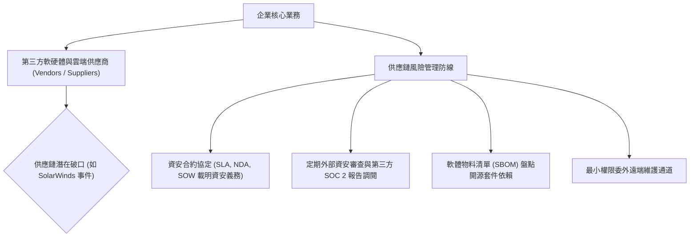

# 🎙️ CompTIA Security+ /16：安全控制成效評估、內外部資源比例與供應鏈風險管理 (授課講師 / 學員)

> **課程主題**：安全控制評估策略、內外部資源配置與供應鏈第三方風險管理  
> **授課講師**：授課講師（資安與網路認證原廠認證講師）  
> **核心模組**：CompTIA Security+ Topic 15/16: Vendor Risk & Security Assessments  
> **學習目標**：評估企業內建 vs. 委外資安效益、建立第三方合約防護網並管控供應鏈風險  
> **關聯文件**：[📄 完整原話逐字稿 (2025-01-24-Lesson15-19-16-08-安全控制評估與第三方供應商風險-proofread.md)](./20250124-05-16-08-安全控制評估與第三方供應商風險.full.md)

---

## 🏛️ 核心架構與概念流轉圖

---

## 🔑 重點提要 (Key Takeaways)

1. **軟體供應鏈風險防不勝防**：攻擊者不再直攻大企業，而是攻陷具備信任連線的下游廠商。必須落實嚴格的 Vendor Assessment。
2. **合約是最後一道防線**：在委外契約中必須明確載明資安事件之通報時效、賠償上限與稽核權利（Right to Audit）。
---

## 🛡️ 安全控制評估、第三方供應商風險與 SLA 治理表

| 核心考點與維度 | 技術原理與協定運作機制 | 業界安全最佳實踐與防禦控制項 | 認證考試應試陷阱與排障關鍵 |
| :--- | :--- | :--- | :--- |
| **第三方供應商風險管理（TPRM）** | 企業即便自身防線堅固，外包廠商、軟體協力商若遭攻破，攻擊者將透過信任通道長驅直入（如 Target 空調廠商外洩事件） | 簽約前實施嚴格供應商資安問卷審查（SIG）、要求出具 ISO 27001 或 SOC 2 稽核報告 | 建立持續性供應商資安評級監控，非單次審查後即放任不管 |
| **服務水準協議（SLA）與資安條款約束** | 在委外合約中白紙黑字載明可用性保證（如 99.9% 上線率）、漏洞修補時效與事故通報義務 | 規範供應商若發生個資外洩事件，必須於法定時限內通報並承擔連帶損害賠償責任 | 保留企業主動或委託第三方對其執行資安查核與滲透測試之審計權利（Right to Audit） |
| **安全控制評估（SCA, Security Control Assessment）** | 全面檢驗企業內部各項技術與管理控制項是否確實依據設計落實運作，識別未涵蓋之殘留風險（Residual Risk） | 將評估結果彙整為風險清單（Risk Register），定期向高階主管報告緩解進度 | 持續滾動修正控制措施，確保資安防禦能隨業務擴展與新型態威脅動態演進 |

- **本單元核心綜述與實務指引**：CompTIA Security+ SY0-701 考核重心在於將理論原則（如縱深防禦、最小權限與 CIA 三要素）無縫轉化為具體的系統配置與威脅處置作業流程。考生在面對複雜案例題時，應始終優先識別資產邊界與潛在威脅向量，並依據標準控制項架構採取最適切之技術或管理防禦措施。
