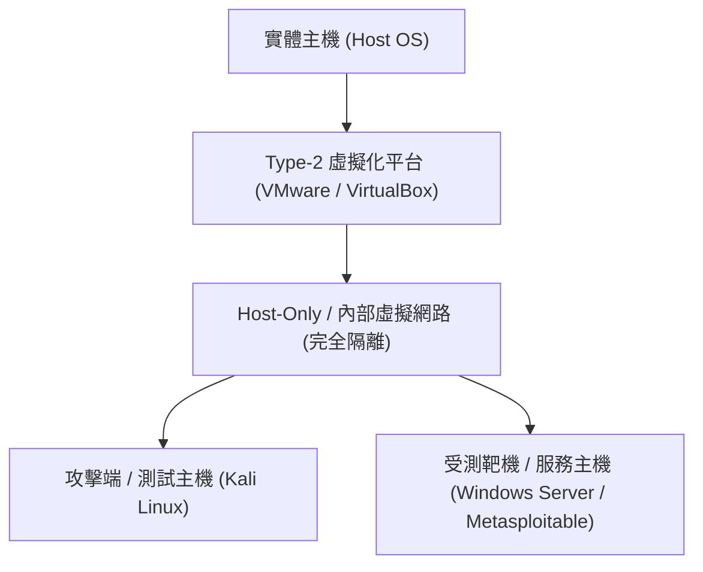

# 🎙️ CompTIA Security+：資安實驗環境安裝配置與實機實作排程 (授課講師)

> **課程主題**：安全隔離之資安實務攻防實驗室架構建置  
> **授課講師**：授課講師（資安與網路認證原廠認證講師）  
> **核心模組**：CompTIA Security+ Practical Lab Deployment  
> **學習目標**：掌握安全隔離沙箱環境規劃、虛擬機快照管理與實作安全防護  
> **關聯文件**：[📄 完整原話逐字稿 (2025-01-27-Lesson15-實作環境安裝與演練-proofread.md)](./20250127-實作環境安裝與演練.full.md)

---

## 🏛️ 核心架構與概念流轉圖

---

## 🔬 技術精華與核心考點解析

### 資安實驗室隔離規範

- 演練攻防與惡意程式分析時，虛擬機網卡必須設為 Host-Only 或獨立內部虛擬網路，嚴禁橋接（Bridged）至真實校園或公司區網。
- 實驗前務必建立乾淨快照（Snapshot），實驗完畢一鍵還原，杜絕環境被污染。

---

## 💡 關鍵總結與考試應對重點

1. **進行安全測試前，永遠確認授權範圍（Scope of Work / Rules of Engagement），未獲授權的掃描即屬違法。**
---

## 🛡️ Security+ 實作環境安裝、虛擬化除錯與靶機配置表

| 核心考點與維度 | 技術原理與協定運作機制 | 業界安全最佳實踐與防禦控制項 | 認證考試應試陷阱與排障關鍵 |
| :--- | :--- | :--- | :--- |
| **虛擬機安裝與 Hypervisor 選擇** | 使用 VirtualBox 或 VMware Workstation 建置本地專屬攻擊與防禦測試隔離網段（Host-Only / NAT Network） | 在 BIOS/UEFI 中開啟 CPU 虛擬化支援（Intel VT-x / AMD-V），分配適當 CPU 核心與 RAM 記憶體 | 保持宿主機（Host）與靶機（Guest）嚴格隔離，嚴禁開啟雙向共用剪貼簿與資料夾複製 |
| **Kali Linux 與靶機鏡像導入SOP** | 下載官方預建之 `.ova` 虛擬應用程式範本，匯入後第一時間執行系統更新與套件庫同步 | 靶機鏡像（如 Metasploitable2/3, OWASP Juice Shop）配置靜態 IP，建立安全演練封閉測試靶場 | 在執行破壞性滲透腳本前，強制為乾淨靶機建立基礎快照（Snapshot）以備一鍵還原 |
| **實作演練故障排查與網路連通** | 遭遇靶機無法 Ping 通時，依序檢查：1. 網卡連線模式；2. 本機防火牆設定；3. 網段 IP 是否在同一子網 | 檢查服務處理序是否正常監聽對應 Port，透過 `netstat -tuln` 或 `ss -tuln` 本地排查 | 動手實作除錯過程為理解網路協定與作業系統底層行為最具價值之學習途徑 |

- **本單元核心綜述與實務指引**：CompTIA Security+ SY0-701 考核重心在於將理論原則（如縱深防禦、最小權限與 CIA 三要素）無縫轉化為具體的系統配置與威脅處置作業流程。考生在面對複雜案例題時，應始終優先識別資產邊界與潛在威脅向量，並依據標準控制項架構採取最適切之技術或管理防禦措施。
