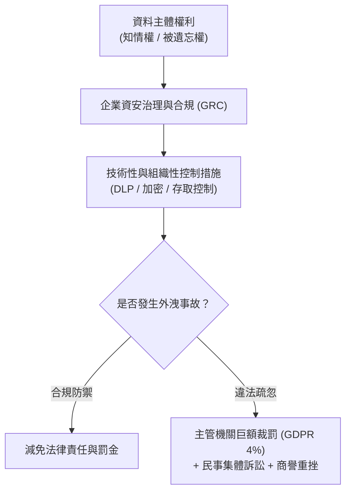

# 🎙️ CompTIA Security+：隱私權法規、資料保護規範與認證考試須知 (授課講師)

> **課程主題**：個人資料保護法規、企業資安合規義務與 Security+ 認證測驗全攻略  
> **授課講師**：授課講師（資安與網路認證原廠認證講師）  
> **核心模組**：CompTIA Security+ Domain 5: Governance, Risk, and Compliance (GRC) & Exam Rules  
> **學習目標**：掌握 GDPR 規範原則、資料外洩法律後果及 Security+ 實戰考試流程技巧  
> **關聯文件**：[📄 完整原話逐字稿 (2025-01-28-Lesson16-隱私法規與考試須知-proofread.md)](./20250128-隱私法規與考試須知.full.md)

---

## 🏛️ 核心架構與概念流轉圖

---

## 🔬 技術精華與核心考點解析

### 隱私權侵犯的法律定義與界線

- 未經授權讀取、修改、刪除或洩漏他人個人資料，即構成隱私侵權與犯罪行為。
- 未經客戶同意擅自更動客戶資料庫內容，即便出於善意亦屬違法行為。

### 歐盟 GDPR 與國際法規遵循

- GDPR 為全球資料保護法規標竿，罰金上限高達企業全球年營業額 4% 或 2000 萬歐元（以較高者為準）。
- 核心權利包含『被遺忘權（Right to be Forgotten）』，客戶有權要求企業徹底刪除其所有個人資料。

### 資安專業人員的顧問與參謀角色

- 資安人員應扮演企業管理層的智囊與參謀，需向董事會清楚說明資料外洩帶來的法律訴訟、商譽損害與巨額財務衝擊。

### CompTIA Security+ 認證考試須知

- 測驗時間：90 分鐘，最多 90 題，滿分 900 分，通過門檻為 750 分（約 83%）。
- 題型包含單選題、多選題，以及開頭的 3-5 題實作情境拖拉模擬題（Performance-Based Questions, PBQ）。
- 建議應試策略：開頭 PBQ 若題目較長可先標記（Flag）跳過，先做完所有單選題確保基本分，最後回頭專注攻克 PBQ。

---

## 💡 關鍵總結與考試應對重點

1. **GDPR 是 Security+ 法律法規章節中最常考的標的，務必熟記 Data Controller（資料控制者）與 Data Processor（資料處理者）的差別。**
1. **考試時 PBQ 佔分比重極高，務必詳讀題目拓撲圖，每一步驟都要在虛擬介面中點擊『Apply』或『Save』確保生效。**
---

## 🛡️ 隱私權法規、考試須知SOP與最終衝刺認證表

| 核心考點與維度 | 技術原理與協定運作機制 | 業界安全最佳實踐與防禦控制項 | 認證考試應試陷阱與排障關鍵 |
| :--- | :--- | :--- | :--- |
| **隱私權核心原則與個資保護** | 蒐集限制、目的明確性、使用限制、安全保障、公開透明與個人參與（OECD 隱私指引六大原則） | 去識別化技術：假名化（Pseudonymization，保留可逆映射金鑰）vs. 匿名化（Anonymization，完全不可逆） | 只有真正落實不可逆匿名化之資料集方能免除嚴苛隱私法規之全面拘束 |
| **Pearson VUE 應試終極檢核清單** | 確認雙證件有效日期，核對護照英文姓名與 VUE 預約系統完全一致；提早 30 分鐘完成線上報到環境上傳 | 清理書桌桌面所有雜物，確保無雙螢幕、無紙筆、無耳機、無智慧手錶，避免監考官直接取消資格 | 考前再次熟悉各題型操作介面，穩定心理素質，從容發揮實力 |
| **SY0-701 最終衝刺考點統整** | 熟記高頻連接埠號（DNS 53, Kerberos 88, NTP 123, SNMP 161, LDAP 389, LDAPS 636, FTPS 990） | 明確區分各類密碼演算法用途（AES 加密、SHA 雜湊、RSA/ECC 簽章金鑰交換）與攻擊防禦配對 | 順利通過 Security+ 認證，昂首邁入國際專業資安人才之林 |

- **本單元核心綜述與實務指引**：CompTIA Security+ SY0-701 考核重心在於將理論原則（如縱深防禦、最小權限與 CIA 三要素）無縫轉化為具體的系統配置與威脅處置作業流程。考生在面對複雜案例題時，應始終優先識別資產邊界與潛在威脅向量，並依據標準控制項架構採取最適切之技術或管理防禦措施。
